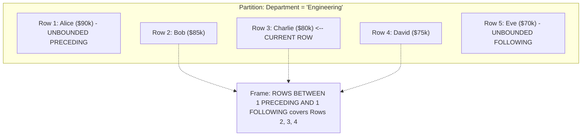
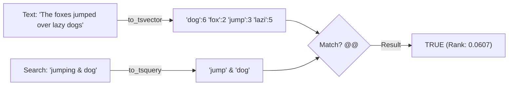

← [Back to Index](../README.md)

# Advanced SQL for Senior Backend Developers (PostgreSQL)

A hands-on, interview-ready guide covering advanced SQL patterns, PostgreSQL-specific query superpowers, query optimization, and complex data modeling for senior backend and data engineers (8+ years experience).

---

## 1. Window Functions Deep Dive

Window functions perform calculations across a set of table rows that are related to the current row without collapsing the rows into a single summary output (unlike `GROUP BY`).

### 1.1 Window Function Syntax & Framing

```sql
function_name([expression]) OVER (
    [PARTITION BY partition_col1, partition_col2, ...]
    [ORDER BY sort_col1 [ASC|DESC], ...]
    [ROWS|RANGE|GROUPS frame_specification]
)
```

#### Frame Specifications
A frame defines the subset of rows within the current partition evaluated by the window function:
- `ROWS BETWEEN UNBOUNDED PRECEDING AND CURRENT ROW`: From the start of the partition up to the current row (default when `ORDER BY` is present).
- `ROWS BETWEEN CURRENT ROW AND UNBOUNDED FOLLOWING`: From the current row to the end of the partition.
- `ROWS BETWEEN 1 PRECEDING AND 1 FOLLOWING`: Centered 3-row moving window.
- `ROWS BETWEEN 6 PRECEDING AND CURRENT ROW`: 7-day moving window.



---

### 1.2 Ranking Functions: ROW_NUMBER vs RANK vs DENSE_RANK

Consider the following sample table `employee_salaries`:

```sql
CREATE TABLE employee_salaries (
    id SERIAL PRIMARY KEY,
    name VARCHAR(50),
    department VARCHAR(50),
    salary NUMERIC(10,2)
);

INSERT INTO employee_salaries (name, department, salary) VALUES
('Alice',   'Engineering', 100000),
('Bob',     'Engineering', 95000),
('Charlie', 'Engineering', 95000),
('David',   'Engineering', 80000),
('Emma',    'Sales',       90000),
('Frank',   'Sales',       90000),
('Grace',   'Sales',       75000);
```

#### The Query:
```sql
SELECT 
    name,
    department,
    salary,
    ROW_NUMBER() OVER (PARTITION BY department ORDER BY salary DESC) AS row_num,
    RANK()       OVER (PARTITION BY department ORDER BY salary DESC) AS rnk,
    DENSE_RANK() OVER (PARTITION BY department ORDER BY salary DESC) AS dense_rnk
FROM employee_salaries;
```

#### Output & Key Differences:
| name | department | salary | row_num | rnk | dense_rnk | Explanation |
| :--- | :--- | :--- | :--- | :--- | :--- | :--- |
| Alice | Engineering | 100000 | 1 | 1 | 1 | Distinct highest salary |
| Bob | Engineering | 95000 | 2 | 2 | 2 | Tie for 2nd |
| Charlie | Engineering | 95000 | 3 | 2 | 2 | Tie for 2nd |
| David | Engineering | 80000 | 4 | **4** | **3** | `RANK` skips to 4; `DENSE_RANK` assigns 3 |
| Emma | Sales | 90000 | 1 | 1 | 1 | Tie for 1st |
| Frank | Sales | 90000 | 2 | 1 | 1 | Tie for 1st |
| Grace | Sales | 75000 | 3 | **3** | **2** | `RANK` skips to 3; `DENSE_RANK` assigns 2 |

> **Interview Golden Rule**:
> - Use `ROW_NUMBER()` when you need unique, non-repeating sequence IDs (e.g. pagination or deduplication).
> - Use `DENSE_RANK()` when finding "Top N distinct values" (e.g., "Find employees earning the 3rd highest distinct salary").

---

### 1.3 Value Navigation Functions: LEAD, LAG, FIRST_VALUE, LAST_VALUE

Let's calculate month-over-month (MoM) revenue growth:

```sql
CREATE TABLE monthly_revenue (
    month DATE PRIMARY KEY,
    revenue NUMERIC(12,2)
);

INSERT INTO monthly_revenue VALUES
('2026-01-01', 100000),
('2026-02-01', 125000),
('2026-03-01', 115000),
('2026-04-01', 150000);

SELECT 
    month,
    revenue,
    LAG(revenue, 1) OVER (ORDER BY month) AS prev_month_rev,
    ROUND(
        ((revenue - LAG(revenue, 1) OVER (ORDER BY month)) / 
        LAG(revenue, 1) OVER (ORDER BY month)) * 100, 2
    ) AS mom_growth_pct,
    LEAD(revenue, 1) OVER (ORDER BY month) AS next_month_rev
FROM monthly_revenue;
```

#### Output:
| month | revenue | prev_month_rev | mom_growth_pct | next_month_rev |
| :--- | :--- | :--- | :--- | :--- |
| 2026-01-01 | 100000 | *NULL* | *NULL* | 125000 |
| 2026-02-01 | 125000 | 100000 | +25.00% | 115000 |
| 2026-03-01 | 115000 | 125000 | -8.00% | 150000 |
| 2026-04-01 | 150000 | 115000 | +30.43% | *NULL* |

#### The `LAST_VALUE()` Gotcha
By default, when `ORDER BY` is specified, the frame defaults to:
`RANGE BETWEEN UNBOUNDED PRECEDING AND CURRENT ROW`.
Thus, `LAST_VALUE()` will simply return the **current row's value**, not the partition's last row!

```sql
-- WRONG: returns current row's salary
LAST_VALUE(salary) OVER (PARTITION BY department ORDER BY salary)

-- CORRECT: explicitly expand the frame to UNBOUNDED FOLLOWING
LAST_VALUE(salary) OVER (
    PARTITION BY department 
    ORDER BY salary 
    ROWS BETWEEN UNBOUNDED PRECEDING AND UNBOUNDED FOLLOWING
)
```

---

### 1.4 Distribution & Segmentation: NTILE

Divides an ordered partition into $N$ roughly equal buckets (e.g., customer quartiles or percentiles):

```sql
-- Segment customers into 4 spending quartiles (1 = VIP Top 25%, 4 = Bottom 25%)
SELECT 
    customer_id,
    total_spent,
    NTILE(4) OVER (ORDER BY total_spent DESC) AS spending_quartile
FROM customer_lifetime_value;
```

---

### 1.5 Running Aggregates & Moving Averages

```sql
SELECT 
    sale_date,
    daily_sales,
    -- Running Cumulative Total from Day 1
    SUM(daily_sales) OVER (ORDER BY sale_date ROWS BETWEEN UNBOUNDED PRECEDING AND CURRENT ROW) AS cumulative_sales,
    -- 7-Day Moving Average
    ROUND(AVG(daily_sales) OVER (ORDER BY sale_date ROWS BETWEEN 6 PRECEDING AND CURRENT ROW), 2) AS moving_avg_7d
FROM store_daily_sales;
```

---

## 2. Common Table Expressions (CTEs) & Recursion

A CTE provides a temporary named result set within a single SQL statement.

### 2.1 Recursive CTEs for Hierarchical & Tree Data

Recursive CTEs consist of:
1. **Anchor Member**: Initial base query executing first.
2. `UNION` or `UNION ALL`.
3. **Recursive Member**: Query referencing the CTE name, evaluated iteratively until it returns empty.
4. **Termination Condition**: Handled implicitly when the recursive step returns no new rows.

#### Example 1: Organization Chart (Employee Hierarchy)

```sql
CREATE TABLE employees (
    emp_id INT PRIMARY KEY,
    name VARCHAR(50),
    manager_id INT REFERENCES employees(emp_id)
);

INSERT INTO employees VALUES
(1, 'Satya (CEO)',        NULL),
(2, 'Scott (VP Cloud)',    1),
(3, 'Amy (CFO)',           1),
(4, 'Kevin (VP AI)',       1),
(5, 'Rajesh (Director)',   2),
(6, 'John (Senior Dev)',   5),
(7, 'Sarah (Staff Dev)',   5);

-- Recursive Query to generate Reporting Depth & Path
WITH RECURSIVE org_chart AS (
    -- 1. Anchor Member: Top of the hierarchy (CEO)
    SELECT 
        emp_id, 
        name, 
        manager_id, 
        1 AS level, 
        CAST(name AS TEXT) AS reporting_chain
    FROM employees
    WHERE manager_id IS NULL

    UNION ALL

    -- 2. Recursive Member: Join employees to their managers
    SELECT 
        e.emp_id, 
        e.name, 
        e.manager_id, 
        o.level + 1,
        o.reporting_chain || ' -> ' || e.name
    FROM employees e
    JOIN org_chart o ON e.manager_id = o.emp_id
)
SELECT level, LPAD('', (level - 1) * 3, ' ') || name AS indented_tree, reporting_chain 
FROM org_chart 
ORDER BY level, emp_id;
```

#### Output:
| level | indented_tree | reporting_chain |
| :---: | :--- | :--- |
| 1 | Satya (CEO) | Satya (CEO) |
| 2 | &nbsp;&nbsp;&nbsp;Scott (VP Cloud) | Satya (CEO) -> Scott (VP Cloud) |
| 2 | &nbsp;&nbsp;&nbsp;Amy (CFO) | Satya (CEO) -> Amy (CFO) |
| 2 | &nbsp;&nbsp;&nbsp;Kevin (VP AI) | Satya (CEO) -> Kevin (VP AI) |
| 3 | &nbsp;&nbsp;&nbsp;&nbsp;&nbsp;&nbsp;Rajesh (Director) | Satya (CEO) -> Scott (VP Cloud) -> Rajesh (Director) |
| 4 | &nbsp;&nbsp;&nbsp;&nbsp;&nbsp;&nbsp;&nbsp;&nbsp;&nbsp;John (Senior Dev) | Satya (CEO) -> Scott (VP Cloud) -> Rajesh (Director) -> John (Senior Dev) |
| 4 | &nbsp;&nbsp;&nbsp;&nbsp;&nbsp;&nbsp;&nbsp;&nbsp;&nbsp;Sarah (Staff Dev) | Satya (CEO) -> Scott (VP Cloud) -> Rajesh (Director) -> Sarah (Staff Dev) |

#### Preventing Infinite Cycles in Graphs
If data can contain circular references ($A \rightarrow B \rightarrow A$), track visited nodes using an array:

```sql
WITH RECURSIVE graph_traverse AS (
    SELECT node_id, ARRAY[node_id] AS path, false AS is_cycle
    FROM edges WHERE node_id = 1
    
    UNION ALL
    
    SELECT 
        e.next_node, 
        gt.path || e.next_node,
        e.next_node = ANY(gt.path) -- Cycle detected!
    FROM edges e
    JOIN graph_traverse gt ON e.node_id = gt.node_id
    WHERE NOT gt.is_cycle
)
SELECT * FROM graph_traverse;
```

---

### 2.2 Materialized vs Non-Materialized CTEs (PostgreSQL 12+)

In older PostgreSQL versions ($< 12$), all CTEs were **optimization barriers** (they were always materialized to memory/disk first, preventing the optimizer from pushing outer `WHERE` predicates into the CTE).

Since PostgreSQL 12:
- **Default**: The optimizer will inline a CTE if it has no side effects and is referenced only once.
- `AS MATERIALIZED`: Forces the query planner to calculate the CTE separately once and cache its result. Useful when an expensive CTE is referenced multiple times.
- `AS NOT MATERIALIZED`: Explicitly instructs the planner to inline the CTE into the parent query, allowing index scans and predicate pushdown.

```sql
-- Force materialization of expensive calculation used twice
WITH expensive_stats AS MATERIALIZED (
    SELECT department_id, AVG(salary) as avg_sal
    FROM payroll_records
    GROUP BY department_id
)
SELECT e.name, e.salary, s.avg_sal
FROM employees e
JOIN expensive_stats s ON e.department_id = s.department_id
WHERE e.salary > s.avg_sal;
```

---

## 3. Subqueries & Lateral Joins

### 3.1 EXISTS vs IN vs JOIN Performance & NULL Hazards

```sql
-- Subquery using IN
SELECT * FROM customers WHERE id IN (SELECT customer_id FROM orders);

-- Subquery using EXISTS
SELECT * FROM customers c WHERE EXISTS (SELECT 1 FROM orders o WHERE o.customer_id = c.id);
```

#### The Deadly `NOT IN` with NULL Trap:
```sql
-- If ANY order has customer_id = NULL:
SELECT * FROM customers WHERE id NOT IN (SELECT customer_id FROM orders);
```
> [!CAUTION]
> **Trap**: If the subquery in `NOT IN` returns even a single row with `NULL`, the entire expression evaluates to `UNKNOWN` for all rows, returning **ZERO records**!
> **Senior Fix**: Always use `NOT EXISTS` or `LEFT JOIN ... WHERE right.id IS NULL`. `NOT EXISTS` safely ignores nulls and enables the query planner to use an efficient **Anti-Join**.

---

### 3.2 Lateral Joins (`CROSS JOIN LATERAL` / `LEFT JOIN LATERAL`)

A `LATERAL` join acts like a **`for-each` loop in SQL**. It allows the subquery on the right-hand side to reference columns from the outer table on the left-hand side.

#### Use Case: Find the Top 2 Latest Orders for EVERY Customer

```sql
CREATE TABLE customers (
    id SERIAL PRIMARY KEY,
    name VARCHAR(50)
);

CREATE TABLE orders (
    id SERIAL PRIMARY KEY,
    customer_id INT REFERENCES customers(id),
    order_date DATE,
    amount NUMERIC(10,2)
);

-- Using LATERAL to fetch Top 2 latest orders per customer efficiently:
SELECT 
    c.id AS customer_id,
    c.name,
    latest_orders.order_date,
    latest_orders.amount
FROM customers c
CROSS JOIN LATERAL (
    SELECT o.order_date, o.amount
    FROM orders o
    WHERE o.customer_id = c.id   -- Correlated reference to outer table 'c'
    ORDER BY o.order_date DESC
    LIMIT 2
) latest_orders;
```

#### Why LATERAL beats Window Functions here:
With a window function (`ROW_NUMBER() <= 2`), PostgreSQL must scan and rank **all** orders for all customers.
With a `LATERAL` join combined with an index on `orders(customer_id, order_date DESC)`, Postgres does an $O(\log N)$ index lookup per customer, fetching exactly 2 index entries and stopping!

---

## 4. PostgreSQL JSON & JSONB Operations

PostgreSQL supports two JSON data types:
- `JSON`: Stores literal text as input. Re-parses JSON on every read. Preserves whitespace and key order.
- `JSONB`: Stores decomposed binary format. Slower to insert, but **lightning-fast to query and supports GIN indexing**. Always use `JSONB`.

```mermaid
flowchart LR
    Doc["JSON Document: {'user': {'id': 10, 'roles': ['admin', 'dev']}}"]
    Doc -->|'->' Returns JSONB| SubJson["'roles': ['admin', 'dev']"]
    Doc -->|'->>' Returns TEXT| TextVal["'admin'"]
    Doc -->|'#>' Path JSONB| DeepJson["'dev'"]
    Doc -->|'#>>' Path TEXT| DeepText["'dev'"]
    Doc -->|'@>' Containment Test| Bool["true / false"]
```

### 4.1 Key JSONB Extraction Operators

| Operator | Left Operand | Right Operand | Returns | Description |
| :--- | :--- | :--- | :--- | :--- |
| `->` | `JSONB` | `text` or `int` | `JSONB` | Get element by key or array index |
| `->>` | `JSONB` | `text` or `int` | `text` | Get element as plain text |
| `#>` | `JSONB` | `text[]` | `JSONB` | Extract nested object at path |
| `#>>` | `JSONB` | `text[]` | `text` | Extract nested object as plain text at path |
| `@>` | `JSONB` | `JSONB` | `boolean` | Left contains right JSON document? |
| `<@` | `JSONB` | `JSONB` | `boolean` | Left is contained within right JSON document? |
| `?` | `JSONB` | `text` | `boolean` | Does top-level key exist? |
| `?\|` | `JSONB` | `text[]` | `boolean` | Do ANY of these keys exist? |
| `?&` | `JSONB` | `text[]` | `boolean` | Do ALL of these keys exist? |

```sql
CREATE TABLE audit_events (
    id SERIAL PRIMARY KEY,
    payload JSONB NOT NULL
);

INSERT INTO audit_events (payload) VALUES
('{
    "user": {"id": 101, "email": "alice@corp.com"},
    "roles": ["admin", "billing"],
    "action": "UPDATE_BILLING",
    "ip": "192.168.1.1",
    "metadata": {"source": "web", "version": 2}
}');

-- 1. Extract email as TEXT:
SELECT payload->'user'->>'email' AS email FROM audit_events;
-- alice@corp.com

-- 2. Extract nested version using path `#>>`:
SELECT payload#>>'{metadata, version}' AS version FROM audit_events;
-- 2

-- 3. Query using containment operator `@>`:
SELECT id FROM audit_events 
WHERE payload @> '{"action": "UPDATE_BILLING", "user": {"id": 101}}';

-- 4. Check if array contains an element:
SELECT id FROM audit_events WHERE payload->'roles' ? 'admin';
```

### 4.2 Updating and Modifying JSONB Data

```sql
-- jsonb_set: Update a nested key (payload, path, new_value, create_if_missing)
UPDATE audit_events
SET payload = jsonb_set(payload, '{metadata, source}', '"mobile_app"', false)
WHERE id = 1;

-- Append a new key using concatenation operator ||
UPDATE audit_events
SET payload = payload || '{"processed": true, "timestamp": 1727190000}'::JSONB
WHERE id = 1;

-- Delete a key using '-' operator:
UPDATE audit_events
SET payload = payload - 'ip'
WHERE id = 1;
```

### 4.3 Unnesting JSON Arrays: `jsonb_array_elements`

```sql
-- Unnest the 'roles' array into individual relational rows
SELECT 
    id,
    jsonb_array_elements_text(payload->'roles') AS role_name
FROM audit_events;
```
| id | role_name |
| :---: | :--- |
| 1 | admin |
| 1 | billing |

### 4.4 Indexing JSONB with GIN
GIN indexes support high-performance lookups on JSONB columns:

```sql
-- 1. Default GIN index (supports all operators: @>, ?, ?|, ?&):
CREATE INDEX idx_audit_payload_gin ON audit_events USING GIN (payload);

-- 2. Fast Path GIN index (smaller, faster, but only supports containment @>):
CREATE INDEX idx_audit_payload_path_gin ON audit_events USING GIN (payload jsonb_path_ops);

-- 3. B-Tree index on a specific extracted field (ideal for equality and range):
CREATE INDEX idx_audit_user_id ON audit_events (((payload->'user'->>'id')::INT));
```

---

## 5. PostgreSQL Full-Text Search (FTS)

Unlike `LIKE '%query%'` which triggers sequential scans and ignores word stems, PostgreSQL Full-Text Search parses documents into language-aware **lexemes**.



### 5.1 tsvector vs tsquery

- **`tsvector`**: A sorted list of distinct normalized lexemes (stems) with word positions. Stop words (`the`, `over`) are automatically discarded.
- **`tsquery`**: Search terms combined with boolean operators (`&` AND, `|` OR, `!` NOT, `<->` FOLLOWED BY / PHRASE).

```sql
SELECT to_tsvector('english', 'The quick brown foxes jumped over the lazy dog');
-- Output: 'brown':3 'dog':9 'fox':4 'jump':5 'lazi':8 'quick':2

SELECT to_tsquery('english', 'foxes & jumping');
-- Output: 'fox' & 'jump'

-- The match operator is @@
SELECT to_tsvector('english', 'The quick brown foxes') @@ to_tsquery('english', 'fox');
-- Output: true
```

### 5.2 Building a Production Search Engine

```sql
CREATE TABLE knowledge_base (
    id SERIAL PRIMARY KEY,
    title VARCHAR(200) NOT NULL,
    body TEXT NOT NULL,
    -- Generated column automatically maintaining the tsvector:
    search_vector TSVECTOR GENERATED ALWAYS AS (
        setweight(to_tsvector('english', coalesce(title, '')), 'A') ||
        setweight(to_tsvector('english', coalesce(body, '')), 'B')
    ) STORED
);

-- Fast GIN index on tsvector:
CREATE INDEX idx_kb_search_vector ON knowledge_base USING GIN (search_vector);

INSERT INTO knowledge_base (title, body) VALUES
('PostgreSQL Indexing Guide', 'Learn how B-Tree, GIN, and BRIN indexes work internally.'),
('Spring Boot Microservices', 'Building fault-tolerant REST APIs with Spring Cloud and Resilience4j.'),
('Distributed Transactions with Saga', 'How to handle transactional consistency across databases without 2PC.');

-- Search Query with Ranking and Highlighting
SELECT 
    title,
    ts_rank(search_vector, query) AS relevance_score,
    ts_headline('english', body, query, 'StartSel=<b>, StopSel=</b>, MaxWords=20') AS snippet
FROM knowledge_base, 
     websearch_to_tsquery('english', 'postgresql indexes') query
WHERE search_vector @@ query
ORDER BY relevance_score DESC;
```

---

## 6. Aggregations & Grouping Sets

### 6.1 The FILTER Clause on Aggregates
Replaces ugly and slow `SUM(CASE WHEN ... THEN 1 ELSE 0 END)` syntax with ANSI-standard `FILTER`:

```sql
SELECT 
    department,
    COUNT(*) AS total_employees,
    COUNT(*) FILTER (WHERE salary >= 100000) AS high_earners_count,
    ROUND(AVG(salary) FILTER (WHERE tenure_years >= 5), 2) AS senior_avg_salary,
    SUM(salary) FILTER (WHERE is_active = true) AS active_payroll
FROM employees
GROUP BY department;
```

### 6.2 GROUPING SETS, ROLLUP, and CUBE

Allows multi-dimensional aggregations in a single query pass without expensive `UNION ALL` statements.

```sql
CREATE TABLE regional_sales (
    year INT,
    region VARCHAR(20),
    product VARCHAR(20),
    sales NUMERIC(10,2)
);

INSERT INTO regional_sales VALUES
(2025, 'North', 'Laptops', 50000),
(2025, 'North', 'Phones',  30000),
(2025, 'South', 'Laptops', 40000),
(2026, 'North', 'Laptops', 60000),
(2026, 'South', 'Phones',  35000);
```

#### A. ROLLUP (Hierarchical Totals)
Calculates sub-totals and grand total along a hierarchy: `(year) -> (year, region) -> (grand total)`.

```sql
SELECT 
    year, 
    region, 
    SUM(sales) as total_sales,
    GROUPING(year, region) as grouping_indicator
FROM regional_sales
GROUP BY ROLLUP (year, region)
ORDER BY year NULLS LAST, region NULLS LAST;
```
| year | region | total_sales | grouping_indicator | Meaning |
| :---: | :--- | :--- | :---: | :--- |
| 2025 | North | 80000.00 | 0 | Subtotal 2025 North |
| 2025 | South | 40000.00 | 0 | Subtotal 2025 South |
| 2025 | *NULL* | 120000.00 | 1 | **Subtotal Year 2025** |
| 2026 | North | 60000.00 | 0 | Subtotal 2026 North |
| 2026 | South | 35000.00 | 0 | Subtotal 2026 South |
| 2026 | *NULL* | 95000.00 | 1 | **Subtotal Year 2026** |
| *NULL* | *NULL* | 215000.00 | 3 | **Grand Total** |

#### B. CUBE (All Combinations)
Calculates subtotals across every possible permutation of the listed columns:

```sql
SELECT year, product, SUM(sales)
FROM regional_sales
GROUP BY CUBE (year, product);
```

---

## 7. UPSERT: `INSERT ... ON CONFLICT`

Handling concurrent inserts safely without race conditions.

```sql
CREATE TABLE product_inventory (
    sku VARCHAR(50) PRIMARY KEY,
    warehouse_id INT NOT NULL,
    stock_count INT NOT NULL,
    last_updated TIMESTAMPTZ NOT NULL DEFAULT NOW()
);
```

### 7.1 DO NOTHING (Idempotent Ingestion)
```sql
-- Useful for dead-letter retry queues and event streams:
INSERT INTO product_inventory (sku, warehouse_id, stock_count)
VALUES ('SKU-100', 1, 50)
ON CONFLICT (sku) DO NOTHING;
```

### 7.2 DO UPDATE with `EXCLUDED` Pseudo-Table
The `EXCLUDED` table represents the row values originally proposed by the `INSERT`:

```sql
INSERT INTO product_inventory (sku, warehouse_id, stock_count, last_updated)
VALUES ('SKU-100', 1, 25, NOW())
ON CONFLICT (sku) 
DO UPDATE SET 
    stock_count = product_inventory.stock_count + EXCLUDED.stock_count,
    last_updated = EXCLUDED.last_updated
WHERE EXCLUDED.stock_count > 0; -- Conditional Update
```

> **Why check-then-insert fails in Java**:
> In concurrent environments, executing:
> `if (!repo.existsById(sku)) repo.save(new Product(...))`
> creates a classic **Time-of-Check to Time-of-Use (TOCTOU)** race condition. Two threads pass the check simultaneously and both attempt an INSERT, throwing `UniqueConstraintViolationException`. `ON CONFLICT` acquires an atomic row lock on the unique index.

---

## 8. Essential PostgreSQL Power Features

### 8.1 The RETURNING Clause
Returns columns modified by `INSERT`, `UPDATE`, or `DELETE`.

```sql
-- 1. Return generated ID on insert
INSERT INTO users (name, email) VALUES ('Dave', 'dave@test.com') 
RETURNING id, created_at;

-- 2. Move soft-deleted rows to an archive table in a single atomic statement!
WITH deleted_rows AS (
    DELETE FROM active_sessions 
    WHERE last_active < NOW() - INTERVAL '30 days'
    RETURNING *
)
INSERT INTO archived_sessions SELECT * FROM deleted_rows;
```

### 8.2 `generate_series()` for Data Generation & Missing Date Fills

```sql
-- Zero-filling date gaps for charts:
SELECT 
    d.calendar_date,
    COALESCE(SUM(o.amount), 0) AS total_sales
FROM generate_series(
    '2026-09-01'::DATE, 
    '2026-09-07'::DATE, 
    '1 day'::INTERVAL
) AS d(calendar_date)
LEFT JOIN orders o ON o.order_date = d.calendar_date
GROUP BY d.calendar_date
ORDER BY d.calendar_date;
```

### 8.3 Array Operations

PostgreSQL supports first-class array types:

```sql
CREATE TABLE survey_responses (
    id SERIAL PRIMARY KEY,
    scores INT[]
);

INSERT INTO survey_responses (scores) VALUES (ARRAY[5, 4, 5, 3, 5]);

-- Array Aggregation & Unnesting
SELECT UNNEST(scores) AS single_score FROM survey_responses WHERE id = 1;

-- Check if array contains ANY element matching condition
SELECT id FROM survey_responses WHERE 5 = ANY(scores);

-- Array overlaps (checks if they share common elements)
SELECT ARRAY[1, 2, 3] && ARRAY[3, 4, 5]; -- Returns true
```

### 8.4 The `COPY` Command: Bulk Loading Millions of Rows
`INSERT` statements incur per-statement parse, planning, and WAL overhead. `COPY` streams raw data directly into the database engine:

```sql
-- In SQL:
COPY large_table FROM '/var/data/imports.csv' WITH (FORMAT csv, HEADER true, DELIMITER ',');
```

In Java / Spring Boot using PostgreSQL JDBC `CopyManager`:
```java
PGConnection pgConn = connection.unwrap(PGConnection.class);
CopyManager copyManager = pgConn.getCopyAPI();
FileReader fileReader = new FileReader("large_transactions.csv");
copyManager.copyIn("COPY transactions FROM STDIN WITH (FORMAT csv)", fileReader);
// Loads 1,000,000 rows in ~2 seconds!
```

---

## 9. Classic Senior Interview Problems & Solutions

### Problem 1: Top N Rows Per Group
**Prompt**: "Find the top 2 highest-paid employees in each department."

```sql
WITH ranked_employees AS (
    SELECT 
        name,
        department,
        salary,
        DENSE_RANK() OVER (PARTITION BY department ORDER BY salary DESC) AS rnk
    FROM employees
)
SELECT name, department, salary
FROM ranked_employees
WHERE rnk <= 2;
```

---

### Problem 2: Gaps and Islands (Streaks & Contiguous Ranges)
**Prompt**: "Given user login dates, find all consecutive login streaks of 3 or more days."

```sql
CREATE TABLE user_logins (
    user_id INT,
    login_date DATE
);

-- Strategy: (login_date - ROW_NUMBER() days) produces an identical date anchor for consecutive days!
WITH numbered_logins AS (
    SELECT 
        user_id,
        login_date,
        login_date - (ROW_NUMBER() OVER (PARTITION BY user_id ORDER BY login_date))::INT AS island_group
    FROM user_logins
)
SELECT 
    user_id,
    MIN(login_date) AS streak_start,
    MAX(login_date) AS streak_end,
    COUNT(*) AS consecutive_days
FROM numbered_logins
GROUP BY user_id, island_group
HAVING COUNT(*) >= 3
ORDER BY streak_start;
```

---

### Problem 3: Running Total & % of Category Total
**Prompt**: "Calculate each product's sales, running category total, and percentage of its department's total sales."

```sql
SELECT 
    department,
    product_name,
    sales,
    SUM(sales) OVER (
        PARTITION BY department 
        ORDER BY sales DESC 
        ROWS BETWEEN UNBOUNDED PRECEDING AND CURRENT ROW
    ) AS running_dept_sales,
    ROUND(
        (sales / SUM(sales) OVER (PARTITION BY department)) * 100, 2
    ) AS pct_of_department_sales
FROM product_sales;
```

---

### Problem 4: Deduplicate Rows Keeping Only the Latest Version

```sql
WITH duplicates_to_delete AS (
    SELECT 
        id,
        ROW_NUMBER() OVER (
            PARTITION BY email 
            ORDER BY updated_at DESC, id DESC
        ) AS row_num
    FROM users
)
DELETE FROM users
WHERE id IN (
    SELECT id FROM duplicates_to_delete WHERE row_num > 1
);
```

---

## 10. Senior Interview Questions & Gotchas

### Q1: What is Three-Valued Logic in SQL, and how does it impact `NULL` comparison?
**Answer**:
SQL uses Three-Valued Logic: a boolean expression evaluates to `TRUE`, `FALSE`, or `UNKNOWN` (`NULL`).
`NULL` represents missing or unknown data. Therefore:
- `NULL = NULL` is NOT `TRUE`; it evaluates to `UNKNOWN` (`NULL`).
- `NULL <> NULL` is also `UNKNOWN`.
- `WHERE val <> 'ACTIVE'` will **filter out rows where `val` is NULL**! To include them, you must write `WHERE val <> 'ACTIVE' OR val IS NULL` (or use `WHERE val IS DISTINCT FROM 'ACTIVE'`).
- In `ORDER BY`, PostgreSQL places `NULL`s at the end for `ASC` and at the start for `DESC`. Use `ORDER BY col ASC NULLS FIRST / LAST` to control this explicitly.

### Q2: What is the difference between `CROSS JOIN LATERAL` and a standard Correlated Subquery?
**Answer**:
A standard correlated subquery in the `SELECT` clause can only return a **single scalar value** (one column, one row). If it returns multiple rows, it throws `subquery must return only one column / more than one row returned by a subquery used as an expression`.
`CROSS JOIN LATERAL` allows the subquery to return **multiple columns and multiple rows**, joining the resulting relational set directly to the outer row like an inline table function.

### Q3: When should you avoid using CTEs in high-frequency queries?
**Answer**:
1. When recursive or materialized CTEs create memory pressure or spill to disk.
2. In PostgreSQL versions prior to 12, CTEs acted as optimization barriers that blocked index scans and predicate pushdown.
3. In statements where simple subqueries or joins allow the query optimizer to dynamically choose better join reordering and index paths that a materialized CTE restricts.

### Q4: What makes a WHERE clause condition Non-Sargable, and how do you fix it?
**Answer**:
**SARGable** stands for **S**earch **ARG**ument **ABLE**. A non-sargable query wraps indexed columns in functions, preventing the database engine from navigating the B-Tree index:
- Non-sargable: `WHERE EXTRACT(YEAR FROM order_date) = 2026`
- Sargable: `WHERE order_date >= '2026-01-01' AND order_date < '2027-01-01'`
- Non-sargable: `WHERE UPPER(email) = 'ALICE@EXAMPLE.COM'`
- Sargable fix: `CREATE INDEX idx_users_upper_email ON users(UPPER(email))` (Expression index).
