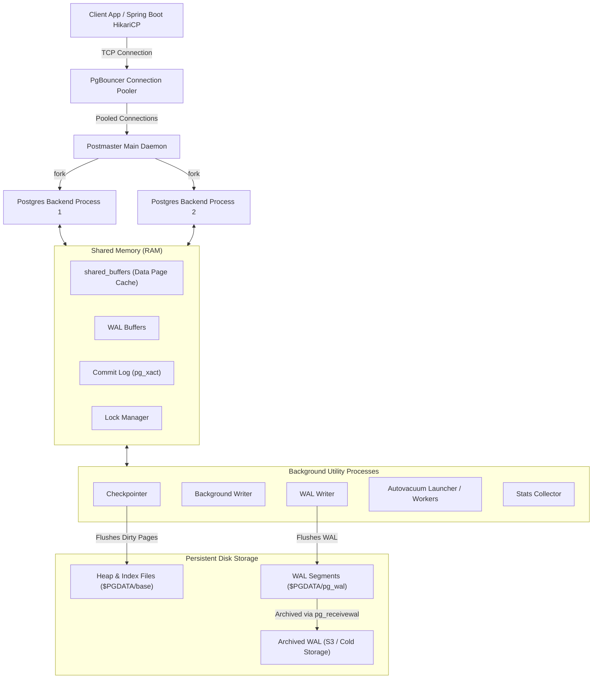
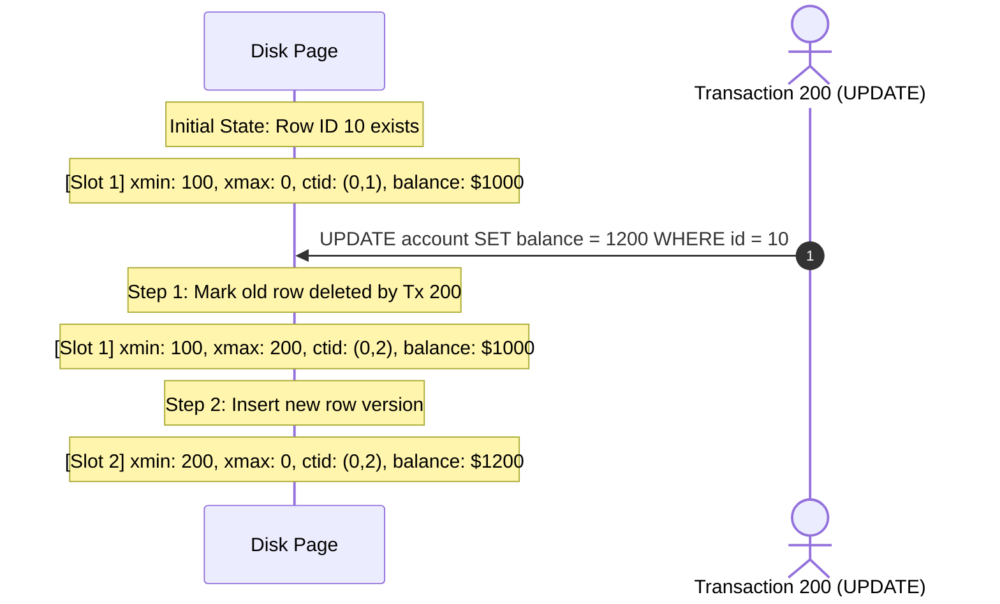
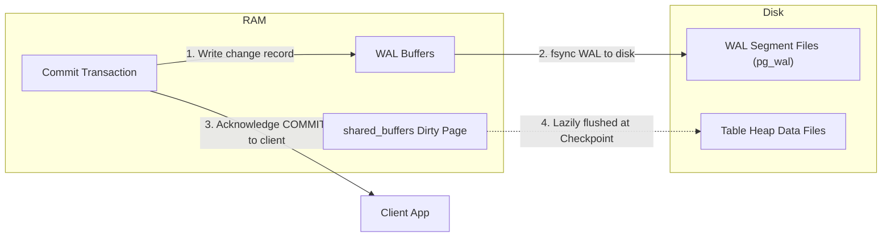
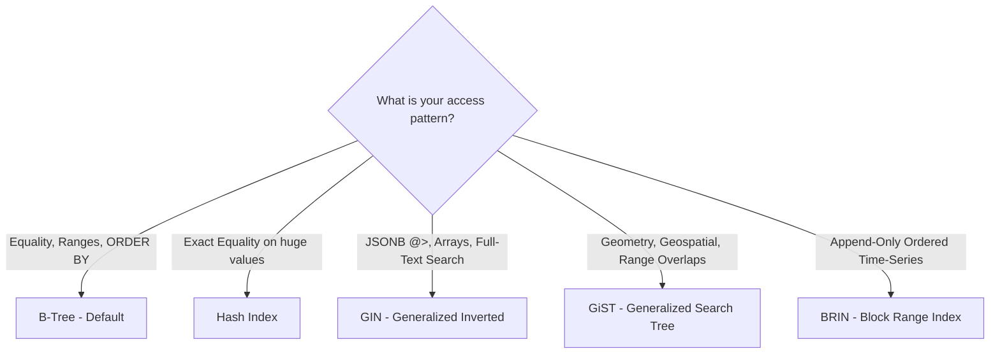
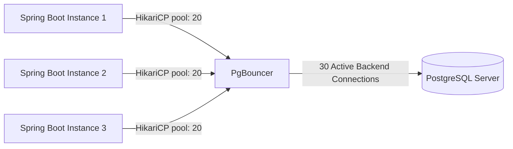
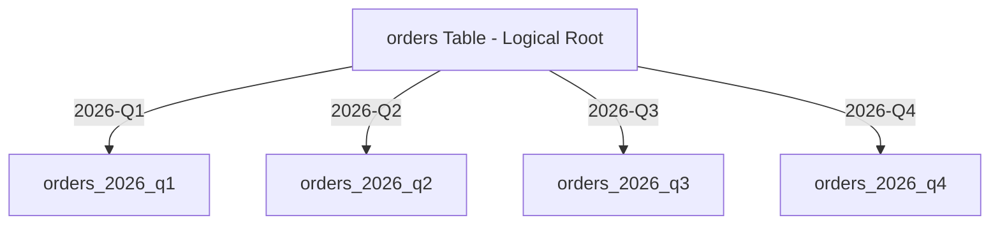

← [Back to Index](../README.md)

# PostgreSQL Internals & Performance Tuning

A deep dive into PostgreSQL architecture, storage engine mechanics, index selection, query optimization, and production tuning designed for senior backend engineers (8+ years experience). This guide covers what happens under the hood when queries execute and how to architect high-throughput, low-latency database backends.

---

## 1. PostgreSQL Process & Storage Architecture

PostgreSQL uses a **process-based model** (not thread-per-connection like MySQL or SQL Server). Each client connection is handled by a dedicated `postgres` backend process.



### Key Memory Areas
1. **`shared_buffers`**: Primary cache for tables and indexes. Reads load 8KB pages from OS/disk into shared buffers. Default is typically 128MB (way too low for production); recommended setting is **25% of total system RAM**.
2. **`work_mem`**: Private memory allocated to each backend process for complex operations (sorting, hash tables for hash joins, bitmap operations). **Allocated per sort/hash operation**, meaning a single complex query with 4 joins and 2 sorts can allocate `work_mem * 6`.
3. **`maintenance_work_mem`**: Memory used for maintenance commands (`VACUUM`, `CREATE INDEX`, `ALTER TABLE ADD FOREIGN KEY`).
4. **`effective_cache_size`**: Planner hint indicating the total memory available for disk caching (Postgres `shared_buffers` + Linux kernel page cache). Typically set to **50% to 75% of total system RAM**.

---

## 2. Multi-Version Concurrency Control (MVCC) Internals

PostgreSQL implements MVCC to achieve transaction isolation: **readers never block writers, and writers never block readers**.

### 2.1 Heap Tuple Header Fields
Every row (tuple) on disk includes a header with metadata tracking its lifecycle:

| Field | Size | Description |
| :--- | :--- | :--- |
| `t_xmin` | 4 bytes | The Transaction ID (XID) that **inserted/created** this tuple. |
| `t_xmax` | 4 bytes | The Transaction ID (XID) that **deleted or updated** this tuple (0 if active/alive). |
| `t_cid` | 4 bytes | Command Identifier (order of SQL statements within the creating transaction). |
| `t_ctid` | 6 bytes | Tuple ID `(page_number, offset)`. Points to itself if current, or to the newer version if updated. |
| `t_infomask` | 2 bytes | Bit flags caching transaction commit/abort status (`HEAP_XMIN_COMMITTED`, `HEAP_XMAX_INVALID`, etc.) to prevent CLOG lookups. |

### 2.2 UPDATE and DELETE Mechanics
PostgreSQL **never modifies a tuple in place** (unless HOT applies):
- **INSERT**: Writes a new tuple with `xmin = current_xid`, `xmax = 0`.
- **DELETE**: Sets `xmax = current_xid` on the existing tuple. The tuple remains physically in the table as a **dead tuple**.
- **UPDATE**: Performs a DELETE + INSERT. The old tuple gets `xmax = current_xid`, and a brand new tuple is inserted with `xmin = current_xid`. The old tuple's `t_ctid` points to the new tuple's physical disk address.



### 2.3 Inspecting MVCC Tuples in SQL
You can directly query hidden system columns in PostgreSQL:

```sql
-- Create sample table
CREATE TABLE accounts (
    id SERIAL PRIMARY KEY,
    name VARCHAR(50),
    balance NUMERIC(10,2)
);

-- Insert record (Tx 1)
INSERT INTO accounts (name, balance) VALUES ('Alice', 1000.00);

-- Query hidden system columns
SELECT ctid, xmin, xmax, id, name, balance FROM accounts;
-- Output:
--  ctid  | xmin  | xmax | id | name  | balance 
-- -------+-------+------+----+-------+---------
--  (0,1) | 50123 |    0 |  1 | Alice | 1000.00

-- Update record (Tx 2)
UPDATE accounts SET balance = 1200.00 WHERE id = 1;

-- Notice ctid changed from (0,1) to (0,2)
SELECT ctid, xmin, xmax, id, name, balance FROM accounts;
-- Output:
--  ctid  | xmin  | xmax  | id | name  | balance 
-- -------+-------+-------+----+-------+---------
--  (0,2) | 50124 |     0 |  1 | Alice | 1200.00

-- Using pageinspect extension to see dead tuples
CREATE EXTENSION IF NOT EXISTS pageinspect;

SELECT lp as tuple_slot, t_xmin, t_xmax, t_ctid, t_data 
FROM heap_page_items(get_raw_page('accounts', 0));
-- Displays both slot 1 (dead tuple: xmax=50124) and slot 2 (live tuple: xmin=50124, xmax=0)
```

### 2.4 Snapshot Isolation & Visibility Rules
When a transaction executes a query, PostgreSQL takes a **Snapshot**. A snapshot is represented as:
$$\text{Snapshot} = \text{xmin} : \text{xmax} : \text{xip\_list}$$
- `xmin`: Lowest transaction ID that was still active (uncommitted) when the snapshot was taken. All transactions $< xmin$ are committed and **visible**.
- `xmax`: Highest transaction ID assigned so far $+ 1$. Any transaction $\ge xmax$ started after snapshot creation and is **invisible**.
- `xip_list`: List of transaction IDs between `xmin` and `xmax` that were active/uncommitted when the snapshot was taken. These are **invisible**.

#### Isolation Level Visibility Differences
- **READ COMMITTED** (Postgres Default): Takes a **new snapshot at the start of every single SQL statement**. If Tx1 updates a row and commits, a subsequent SELECT in Tx2 within the same transaction will see the change (causing Non-Repeatable Reads).
- **REPEATABLE READ**: Takes a **single snapshot at the start of the first query in the transaction** and reuses it throughout. Guarantees repeatable reads and eliminates phantom reads.
- **SERIALIZABLE**: Uses Serializable Snapshot Isolation (SSI). Tracks read-write lock dependencies (SIREAD locks) to detect serialization anomalies (like write skew) and aborts conflicting transactions with `40001: serialization_failure`.

### 2.5 Heap-Only Tuples (HOT) Optimization
Normally, when an UPDATE creates a new tuple, all indexes on the table must add an entry pointing to the new tuple's `ctid`. This causes massive **index bloat**.

**HOT (Heap-Only Tuples)** solves this when:
1. The `UPDATE` does **not** modify any column that is part of an index.
2. The new tuple can fit on the **exact same 8KB disk page** as the old tuple.

When HOT triggers:
- No index updates are performed!
- The old tuple's index pointer points to Slot 1.
- Slot 1 contains a HOT pointer redirecting internally to Slot 2 on the same page.
- Saves significant I/O and avoids index bloat.
- *Pro Tip*: Adjust `fillfactor` (e.g., `ALTER TABLE accounts SET (fillfactor = 80);`) to leave 20% free space per page for HOT updates.

---

## 3. Write-Ahead Logging (WAL) & Durability

PostgreSQL achieves ACID Durability via **Write-Ahead Logging**.

### 3.1 The WAL Invariant
> **The WAL Rule**: Modifications to data pages in RAM (`shared_buffers`) must NEVER be written to the data files on disk until the corresponding WAL records describing those changes have been flushed to disk (`fsync`).

Every WAL record has a 64-bit address called a **Log Sequence Number (LSN)** (e.g., `0/16B3FD8`). Each 8KB heap page tracks the LSN of the last WAL record that modified it (`pd_lsn` in page header).

```
Heap Page pd_lsn <= Flushed Disk WAL LSN  ==> Safe to write page to disk
Heap Page pd_lsn >  Flushed Disk WAL LSN  ==> FORBIDDEN (violates durability)
```



### 3.2 The Checkpoint Process
Leaving dirty pages in RAM indefinitely means crash recovery would take hours scanning gigabytes of WAL. A **Checkpoint** bounds recovery time:
1. Identifies the current redo point in the WAL.
2. Flushes all dirty shared buffer pages to disk.
3. Updates `$PGDATA/global/pg_control` with the checkpoint LSN.
4. Old WAL segments prior to the checkpoint redo point can be recycled or deleted.

#### Checkpoint Tuning Parameters
- `checkpoint_timeout`: Maximum time between automatic checkpoints (default 5 min; recommended **15min - 30min** for high throughput).
- `max_wal_size`: Maximum size of WAL before a checkpoint is forced (default 1GB; recommended **16GB - 64GB** on production systems to avoid I/O spikes).
- `checkpoint_completion_target`: Spreads checkpoint I/O over this fraction of `checkpoint_timeout`. Setting this to **`0.9`** ensures smooth disk writes instead of sudden I/O saturation.

### 3.3 Crash Recovery & Point-In-Time Recovery (PITR)
- **Crash Recovery (REDO)**: Upon unexpected restart, Postgres reads `pg_control`, finds the last checkpoint LSN, and replays all WAL records forward from that point. If a page's `pd_lsn` is already $\ge$ WAL record LSN, the write is skipped.
- **PITR**:
  1. Restore a physical base backup (`pg_basebackup`).
  2. Configure `restore_command` to fetch archived WAL segments from S3/NFS.
  3. Specify `recovery_target_time = '2026-09-24 14:30:00 UTC'`.
  4. PostgreSQL replays WAL up to the exact millisecond before a disastrous `DROP TABLE` or corrupting batch job occurred.

---

## 4. VACUUM Mechanics, Autovacuum & Bloat

Because MVCC creates dead tuples on UPDATE and DELETE, tables accumulate unused space.

### 4.1 Regular VACUUM vs VACUUM FULL

```mermaid
flowchart TD
    subgraph RegularVacuum["Regular VACUUM (Non-blocking)"]
        RV1[Scan Heap Pages] --> RV2[Identify Dead Tuples]
        RV2 --> RV3[Remove dead index entries]
        RV3 --> RV4["Mark space reusable in Free Space Map (FSM)"]
        RV4 --> RV5["Update Visibility Map (VM) for Index-Only Scans"]
        RV5 --> RV6["Does NOT return space to OS (unless at end of file)"]
    end
    
    subgraph FullVacuum["VACUUM FULL (Blocking)"]
        VF1["Acquires ACCESS EXCLUSIVE lock"] --> VF2["Creates brand new table file"]
        VF2 --> VF3["Copies ONLY live tuples sequentially"]
        VF3 --> VF4["Rebuilds all indexes from scratch"]
        VF4 --> VF5["Replaces old file & returns disk space to OS"]
        VF5 --> VF6["BLOCKS ALL READS & WRITES for duration"]
    end
```



| Feature | Standard `VACUUM` | `VACUUM FULL` |
| :--- | :--- | :--- |
| **Lock Level** | `SHARE UPDATE EXCLUSIVE` (concurrent reads & writes allowed) | `ACCESS EXCLUSIVE` (all reads/writes blocked) |
| **Frees Disk Space to OS** | **No** (only marks space reusable in FSM) | **Yes** (rewrites entire table without gaps) |
| **Extra Disk Space Required** | Minimal | **2x table size** during operation |
| **When to Use** | Continuous background maintenance (autovacuum) | Extreme emergency bloat reclamation during maintenance window |

### 4.2 Autovacuum Configuration & Math
Autovacuum launches workers to clean tables when dead tuples exceed a threshold:

$$\text{Threshold} = \text{autovacuum\_vacuum\_threshold} + (\text{autovacuum\_vacuum\_scale\_factor} \times \text{number\_of\_tuples})$$

Default values:
- `autovacuum_vacuum_threshold` = 50
- `autovacuum_vacuum_scale_factor` = 0.2 (20%)

> [!WARNING]
> **The 20% Scale Factor Trap**: On a table with 100,000,000 rows, autovacuum will not trigger until **20,000,050 dead tuples** accumulate! That is 20 million dead rows consuming disk, slowing down sequential scans and bloating indexes.

#### Production Autovacuum Recommendations:
```sql
-- Global postgresql.conf recommendations:
-- autovacuum = on
-- autovacuum_max_workers = 5
-- autovacuum_vacuum_cost_limit = 2000    -- Default 200 is too throttled for SSDs!
-- autovacuum_vacuum_cost_delay = 2ms     -- Reduces pause between I/O bursts

-- Per-table override for large, frequently updated tables:
ALTER TABLE high_velocity_orders SET (
    autovacuum_vacuum_scale_factor = 0.02,   -- Trigger at 2% dead rows instead of 20%
    autovacuum_vacuum_threshold = 1000,
    autovacuum_vacuum_cost_limit = 5000
);
```

### 4.3 Transaction ID Wraparound (Anti-Wraparound Vacuum)
- PostgreSQL XIDs are 32-bit integers (~4.29 billion IDs).
- PostgreSQL uses modulo comparison: a transaction can see $\approx 2.1$ billion past transactions and $2.1$ billion future transactions.
- If a database exceeds 2.1 billion transactions without freezing, old transactions suddenly appear to be in the "future", causing catastrophic data invisibility!
- **Solution**: Freezing. Autovacuum converts old `xmin` values to `FrozenTransactionId` (value `2`), which is considered older than every normal XID forever.
- If autovacuum cannot keep up, Postgres enters emergency safety mode: it shuts down and rejects all new write commands with:
  `ERROR: database is not accepting commands to avoid wraparound data loss in database "mydb"`

### 4.4 Zero-Downtime Bloat Elimination (`pg_repack`)
Because `VACUUM FULL` locks tables, production systems use `pg_repack`:
```bash
# Rebuilds table and its indexes online without holding exclusive locks:
pg_repack -h localhost -U postgres -d ecommerce_db -t orders
```
How `pg_repack` works:
1. Creates an empty shadow table with identical schema.
2. Creates an incremental trigger on the source table recording all new writes into a log table.
3. Copies all existing live rows from source to shadow.
4. Builds indexes on the shadow table.
5. Applies changes accumulated in the log table.
6. Takes a brief swap lock (`ACCESS EXCLUSIVE` for a few milliseconds) to switch table names in `pg_class`.
7. Drops the old bloated table.

---

## 5. PostgreSQL Index Types & Strategies

Choosing the right index structure is the single highest-impact performance decision in relational database design.



### 5.1 B-Tree Index (Default)
Self-balancing search tree. Leaf nodes are doubly linked lists of `(key, ctid)` pairs in sorted order.
- **Complexity**: $O(\log N)$ search, insertion, and deletion.
- **Supported Operators**: `<`, `<=`, `=`, `>=`, `>`, `BETWEEN`, `IN`, `IS NULL`, `IS NOT NULL`.
- Supports index-driven sorting (`ORDER BY id ASC / DESC`).

```sql
CREATE INDEX idx_users_email ON users(email);
```

### 5.2 Hash Index
Stores 32-bit hash values in buckets. Crash-safe and WAL-logged since PostgreSQL 10.
- **Complexity**: $O(1)$ lookup for exact equality.
- **Supported Operators**: `=` only. No range queries, no `ORDER BY`.
- Smaller than B-Tree when indexing very long strings (e.g., UUIDs or URLs) where you only need equality lookup.

```sql
CREATE INDEX idx_sessions_token_hash ON user_sessions USING HASH (session_token);
```

### 5.3 GIN (Generalized Inverted Index)
An inverted index where an entry contains a key (element) and an array of tuple IDs (`ctid`s) containing that element.
- **Use Cases**: Full-Text Search (`tsvector`), JSONB containment (`@>`), Arrays (`&&`, `@>`).
- Slower to update than B-Tree; uses an internal `fastupdate` pending list buffer to amortize write costs.

```sql
-- 1. Indexing array columns (find rows where tags contain 'java')
CREATE TABLE articles (
    id SERIAL PRIMARY KEY,
    title TEXT,
    tags TEXT[]
);
CREATE INDEX idx_articles_tags_gin ON articles USING GIN (tags);

-- Query using array containment:
SELECT * FROM articles WHERE tags @> ARRAY['java', 'spring'];

-- 2. Indexing JSONB document fields:
CREATE TABLE user_profiles (
    id SERIAL PRIMARY KEY,
    metadata JSONB
);
CREATE INDEX idx_user_profiles_metadata_gin ON user_profiles USING GIN (metadata);

-- Query using JSONB containment:
SELECT * FROM user_profiles WHERE metadata @> '{"role": "admin", "active": true}';
```

### 5.4 GiST (Generalized Search Tree)
A balanced tree template for custom data structures (R-Tree for geometries, interval trees for ranges).
- **Use Cases**: PostGIS spatial queries (`ST_DWithin`, `ST_Contains`), range types (`tstzrange`, `daterange`), exclusion constraints.

```sql
-- Prevent double bookings for the same room (overlapping date ranges)
CREATE EXTENSION IF NOT EXISTS btree_gist;

CREATE TABLE room_reservations (
    room_id INT,
    booking_period TSRANGE,
    EXCLUDE USING GIST (room_id WITH =, booking_period WITH &&)
);
```

### 5.5 BRIN (Block Range Index)
Summarizes data by storing the minimum and maximum value for a range of physical disk blocks (default: 128 pages = 1MB).
- **Size Comparison**: A B-Tree on a 100M-row timestamp column might be 2.5 GB. A BRIN index on the same column is typically **under 100 KB**!
- **Requirement**: Physical data must be naturally correlated with insertion order (e.g., auto-incrementing IDs, `created_at` timestamp in append-only event logs).

```sql
CREATE TABLE audit_logs (
    id BIGSERIAL,
    event_payload JSONB,
    created_at TIMESTAMPTZ NOT NULL DEFAULT NOW()
);

-- BRIN index on naturally ordered created_at
CREATE INDEX idx_audit_logs_created_at_brin ON audit_logs USING BRIN (created_at)
WITH (pages_per_range = 64);
```

### 5.6 Partial Indexes
Indexes only a subset of rows satisfying a `WHERE` predicate. Eliminates indexing large numbers of irrelevant rows (e.g., completed or soft-deleted records).

```sql
-- Fast lookup for unprocessed queue messages only:
CREATE INDEX idx_orders_unprocessed 
ON orders (created_at) 
WHERE status = 'PENDING';

-- Planner will ONLY use this index when the WHERE clause matches:
SELECT * FROM orders WHERE status = 'PENDING' ORDER BY created_at;
```

### 5.7 Expression / Functional Indexes
Indexes the computed result of an expression or function rather than raw column values.

```sql
-- Case-insensitive search without full-table scan:
CREATE INDEX idx_users_lower_email ON users (LOWER(email));

-- Query must match the exact indexed expression:
SELECT * FROM users WHERE LOWER(email) = 'alice@example.com';

-- Indexing a specific JSONB path directly into a B-Tree:
CREATE INDEX idx_orders_customer_id ON orders (((metadata->>'customer_id')::INT));
```

### 5.8 Covering Indexes (`INCLUDE` Clause)
Allows an **Index-Only Scan** by including non-key payload columns in the leaf nodes of the B-Tree without adding them to the search key.

```sql
-- Search key is (account_id), but leaf nodes also store (balance, currency)
CREATE INDEX idx_accounts_balance_covering 
ON accounts (account_id) 
INCLUDE (balance, currency);

-- Index-Only Scan: PostgreSQL satisfies this query entirely from the index!
SELECT balance, currency FROM accounts WHERE account_id = 4529;
```

### 5.9 Multicolumn / Composite Indexes & Column Ordering
In a multicolumn index `(col_a, col_b, col_c)`:
- The **Leading Column Rule**: Queries filtering by `col_a` or `(col_a, col_b)` will use the index. A query filtering **only** by `col_b` or `col_c` CANNOT use the B-Tree navigation efficiently.
- **Rule of Thumb**:
  1. Equality columns with high selectivity first (`WHERE status = 'ACTIVE' AND tenant_id = 5` $\rightarrow$ `tenant_id` first).
  2. Range / Inequality columns next (`created_at >= '2026-01-01'`).
  3. Sort columns last (`ORDER BY priority`).

---

## 6. Query Planning, Execution & EXPLAIN ANALYZE

Understanding how the PostgreSQL Cost-Based Optimizer (CBO) evaluates query trees is essential for troubleshooting slow production queries.

### 6.1 EXPLAIN Output Reading

```sql
EXPLAIN (ANALYZE, BUFFERS, VERBOSE, TIMING, COSTS)
SELECT o.id, o.total_amount, c.name
FROM customers c
JOIN orders o ON c.id = o.customer_id
WHERE o.created_at >= '2026-01-01' AND c.tier = 'PLATINUM';
```

#### Key Output Elements:
1. `cost=start_cost..total_cost`: Estimated cost units (arbitrary unit where 1.0 = cost of one sequential 8KB page fetch).
   - `start_cost`: Cost incurred before the node can return its first row (e.g., building a Hash Table has a high startup cost).
   - `total_cost`: Cost to return all rows.
2. `rows=N`: Estimated number of rows output by this plan node.
3. `actual time=start..end`: Real wall-clock time in milliseconds.
4. `loops=N`: Number of times this node was executed (multiply actual time and rows by loops to get true totals).
5. `Buffers`:
   - `shared hit=N`: Pages found in `shared_buffers` (RAM).
   - `shared read=N`: Pages read from OS filesystem cache or disk.
   - `shared dirtied=N`: Modified pages written to cache.

### 6.2 Scan Types Compared

```
+----------------------------------------------------------------------------------------------------+
|                                    PostgreSQL Scan Types                                           |
+----------------------+-----------------------------------------------------------------------------+
| Sequential Scan      | Reads entire table file page-by-page. Fastest when retrieving > 15-25% rows.|
| Index Scan           | Traverses B-Tree to find tuple pointer, then immediately fetches heap page. |
| Index Only Scan      | Fetches data entirely from index. Requires Visibility Map bit set = true!   |
| Bitmap Scan          | 2-Step: Bitmap Index Scan creates page bitmap; Bitmap Heap Scan fetches.    |
+----------------------+-----------------------------------------------------------------------------+
```

#### Why did Postgres choose Seq Scan instead of Index Scan?
1. **Low Selectivity**: If the query returns $> 10-20\%$ of the table's rows, random disk seeks from Index Scans are slower than sequential I/O of reading the entire table.
2. **Outdated Statistics**: `ANALYZE` hasn't run, and the planner thinks the table has 10 rows when it has 10 million.
3. **Data Type Mismatch**: Searching `VARCHAR` column with an `INTEGER` literal forces a cast, preventing index usage.
4. **Non-Sargable WHERE Clause**: `WHERE DATE(created_at) = '2026-01-01'` prevents using a B-Tree on `created_at`.

### 6.3 Join Algorithms

| Join Type | How It Works | Ideal Workload | Memory Used |
| :--- | :--- | :--- | :--- |
| **Nested Loop** | For each row in outer table, probe inner table (usually via index). | Small outer table + indexed inner table. Very low startup cost. | Minimal |
| **Hash Join** | Reads entire inner table into an in-memory hash table on join key, then scans outer table probing the hash table. | Medium/Large unsorted data sets with equality join conditions (`=`). | Fits in `work_mem`; spills to disk if too large (`Batches > 1`). |
| **Merge Join** | Both inputs must be sorted by join key. Walks both sets in parallel like a merge sort. | Large data sets where both inputs are already sorted (e.g. from index) or range joins. | Low if pre-sorted; high if explicit `Sort` node required. |

---

## 7. PostgreSQL Performance Tuning & Sizing

### 7.1 Key Configuration Parameters (`postgresql.conf`)

| Parameter | Recommended Value | Why / Production Impact |
| :--- | :--- | :--- |
| `shared_buffers` | `25% of RAM` | Main data page cache. Going higher than 40% causes double-buffering competition with Linux Page Cache. |
| `effective_cache_size` | `50% - 75% of RAM` | Informs optimizer how much memory is available for caching (shared_buffers + OS buffer cache). |
| `work_mem` | `16MB - 64MB` | Memory for sorts/hashes per query node. Never set too high globally or 100 concurrent queries will trigger Linux OOM Killer. |
| `maintenance_work_mem` | `1GB - 2GB` | Speeds up `VACUUM`, `CREATE INDEX`, `ALTER TABLE`. |
| `random_page_cost` | `1.1` (SSDs/NVMe) | Default `4.0` was designed for rotational HDDs. Lowering to 1.1 prevents optimizer from unfairly avoiding index scans on modern SSDs. |
| `effective_io_concurrency`| `200` (SSDs) | Number of simultaneous concurrent disk I/O requests supported by the storage subsystem. |

### 7.2 Connection Pooling: Why PgBouncer is Mandatory
PostgreSQL uses `fork()` for every connection:
- Each backend process consumes **5MB to 10MB** of private memory.
- 1,000 direct connections = 10GB RAM consumed just in connection overhead!
- Beyond 100-200 active backends, CPU context switching and lock contention on `shared_buffers` degrade throughput exponentially.



#### PgBouncer Modes:
1. **Session Pooling**: Connection is held by client for entire connection lifetime. (Minimal benefit).
2. **Transaction Pooling** (Recommended): Connection is leased only for the duration of a transaction (`BEGIN ... COMMIT`). Once committed, the connection returns to the pool.
   - *Limitation*: Cannot use session-level state (`SET search_path`, `LISTEN/NOTIFY`, prepared statements without specific PgBouncer settings).
3. **Statement Pooling**: Leased per single SQL statement. (Does not support multi-statement transactions).

#### HikariCP Sizing Formula:
$$\text{pool\_size} = (\text{CPU cores} \times 2) + \text{effective\_spindle\_count}$$
For an 8-core DB server with SSDs, a pool size of **16 to 20 connections** per application node maximizes throughput without saturating CPU context switches.

### 7.3 JPA / Hibernate N+1 Problem & Mitigations

#### The Problem
When loading 100 `Department` entities with `@OneToMany List<Employee>`, calling `department.getEmployees()` triggers **1 initial query + 100 individual SELECT queries**:
```sql
SELECT * FROM department; -- 1 query
SELECT * FROM employee WHERE department_id = 1; -- + N queries
SELECT * FROM employee WHERE department_id = 2;
-- ...
SELECT * FROM employee WHERE department_id = 100;
```

#### Mitigations in Spring Data JPA:

```java
// 1. Solution A: JOIN FETCH in JPQL
@Query("SELECT DISTINCT d FROM Department d LEFT JOIN FETCH d.employees")
List<Department> findAllWithEmployees();

// 2. Solution B: EntityGraph
@EntityGraph(attributePaths = {"employees"})
@Query("SELECT d FROM Department d")
List<Department> findAllWithEntityGraph();

// 3. Solution C: Batch Fetching in application.yml
// Fetches related entities using WHERE department_id IN (?, ?, ..., ?)
// spring.jpa.properties.hibernate.default_batch_fetch_size: 50
```

> [!CAUTION]
> **The In-Memory Pagination Trap**: Never use `JOIN FETCH` with `Pageable` in Spring Data JPA!
> Hibernate emits warning `HHH000104: firstResult/maxResults specified with collection fetch; applying in memory!`.
> It fetches all 1,000,000 rows into JVM memory and performs pagination in Java heap, causing catastrophic OutOfMemoryErrors!
> **Fix**: Query parent IDs with pagination first, then fetch children using `IN` or `@EntityGraph`.

---

## 8. Table Partitioning (Declarative)

PostgreSQL declarative partitioning splits large tables into smaller physical tables while exposing a single logical table.



### 8.1 Range Partitioning (Time-Series)

```sql
-- Parent table
CREATE TABLE customer_orders (
    id BIGSERIAL,
    order_date DATE NOT NULL,
    customer_id INT NOT NULL,
    total_amount NUMERIC(10,2),
    PRIMARY KEY (id, order_date) -- Partition key must be part of composite PK!
) PARTITION BY RANGE (order_date);

-- Child partitions
CREATE TABLE orders_2026_q1 PARTITION OF customer_orders
    FOR VALUES FROM ('2026-01-01') TO ('2026-04-01');

CREATE TABLE orders_2026_q2 PARTITION OF customer_orders
    FOR VALUES FROM ('2026-04-01') TO ('2026-07-01');

-- Default partition for out-of-range dates:
CREATE TABLE orders_default PARTITION OF customer_orders DEFAULT;
```

### 8.2 List Partitioning (Categorical)

```sql
CREATE TABLE servers (
    server_id INT,
    region_code VARCHAR(10) NOT NULL,
    ip_address INET,
    PRIMARY KEY (server_id, region_code)
) PARTITION BY LIST (region_code);

CREATE TABLE servers_us PARTITION OF servers FOR VALUES IN ('us-east-1', 'us-west-2');
CREATE TABLE servers_eu PARTITION OF servers FOR VALUES IN ('eu-central-1', 'eu-west-1');
CREATE TABLE servers_apac PARTITION OF servers FOR VALUES IN ('ap-south-1', 'ap-southeast-1');
```

### 8.3 Hash Partitioning (Even Distribution)

```sql
CREATE TABLE user_activity (
    user_id UUID NOT NULL,
    activity_type VARCHAR(50),
    created_at TIMESTAMPTZ,
    PRIMARY KEY (user_id, created_at)
) PARTITION BY HASH (user_id);

CREATE TABLE user_activity_p0 PARTITION OF user_activity FOR VALUES WITH (MODULUS 4, REMAINDER 0);
CREATE TABLE user_activity_p1 PARTITION OF user_activity FOR VALUES WITH (MODULUS 4, REMAINDER 1);
CREATE TABLE user_activity_p2 PARTITION OF user_activity FOR VALUES WITH (MODULUS 4, REMAINDER 2);
CREATE TABLE user_activity_p3 PARTITION OF user_activity FOR VALUES WITH (MODULUS 4, REMAINDER 3);
```

### 8.4 Partition Pruning
PostgreSQL excludes irrelevant partitions during query planning and execution:
```sql
EXPLAIN SELECT * FROM customer_orders WHERE order_date = '2026-02-15';
-- Plan shows ONLY 'Seq Scan on orders_2026_q1' - other partitions are completely skipped!
```

---

## 9. Replication & High Availability

```mermaid
flowchart TD
    subgraph Primary["Primary Node (Read-Write)"]
        P_DB[(Postgres Master)]
        P_WAL[WAL Sender Process]
    end
    
    subgraph Standby["Physical Standby Replica (Read-Only)"]
        S_WAL[WAL Receiver Process]
        S_DB[(Postgres Replica)]
    end
    
    P_DB -->|Generates WAL| P_WAL
    P_WAL -->|Streaming Replication TCP| S_WAL
    S_WAL -->|Replays WAL (Redo)| S_DB
    
    ClientApp[Spring Boot Application] -->|Write queries| P_DB
    ClientApp -->|@Transactional readOnly=true| S_DB
```

### 9.1 Physical Streaming Replication
- Byte-for-byte replica of the primary database cluster.
- Replays WAL directly into the standby instance.
- **Synchronous vs Asynchronous**:
  - `synchronous_commit = off`: Master commits immediately without waiting for WAL flush to disk (fastest, slight data loss risk on crash).
  - `synchronous_commit = on` (default): Master waits for local WAL flush before confirming commit.
  - `synchronous_commit = remote_apply`: Master waits until the standby has replayed the WAL and made it visible to reads (zero lag, higher latency).

### 9.2 Logical Replication
- Row-level replication based on decoded WAL records (Publications & Subscriptions).
- Can replicate individual tables, filter rows, or replicate between different major versions of PostgreSQL (e.g., PG 14 to PG 16).
```sql
-- On Publisher:
CREATE PUBLICATION pub_orders FOR TABLE orders WHERE (status = 'COMPLETED');

-- On Subscriber:
CREATE SUBSCRIPTION sub_orders 
CONNECTION 'host=master.internal dbname=mydb user=replicator password=secret' 
PUBLICATION pub_orders;
```

### 9.3 Spring Boot Read/Write Replica Routing
Using Spring's `AbstractRoutingDataSource`:

```java
public class ReplicationRoutingDataSource extends AbstractRoutingDataSource {
    @Override
    protected Object determineCurrentLookupKey() {
        boolean isReadOnly = TransactionSynchronizationManager.isCurrentTransactionReadOnly();
        return isReadOnly ? DataSourceType.READ_REPLICA : DataSourceType.PRIMARY;
    }
}
```

---

## 10. Senior Interview Questions & Answers

### Q1: A query in production suddenly spiked from 5ms to 8 seconds with high CPU. How do you triage it?
**Answer**:
1. Check `pg_stat_activity` to find the exact query, its current state, wait events, and execution duration:
   ```sql
   SELECT pid, now() - query_start AS duration, wait_event_type, wait_event, query 
   FROM pg_stat_activity WHERE state != 'idle' ORDER BY duration DESC;
   ```
2. Run `EXPLAIN (ANALYZE, BUFFERS)` on the query. Compare estimated rows vs actual rows:
   - If estimated rows = 1 and actual rows = 1,000,000, table statistics are stale. Run `ANALYZE table_name;`.
   - Check if a `Seq Scan` is occurring due to index bloat or missing partial index.
3. Check table bloat using `pgstattuple` or `n_dead_tup` from `pg_stat_user_tables`.
4. Inspect `pg_locks` to ensure the query isn't waiting on an exclusive lock from a long-running migration or uncommitted transaction.

### Q2: Why is an Index Scan sometimes slower than a Sequential Scan?
**Answer**:
Sequential scans read sequential 8KB pages from disk into memory with predictable I/O, utilizing OS read-ahead algorithms. An Index Scan requires two random seeks: first navigating down the B-tree leaf nodes to find the tuple pointer (`ctid`), and second performing a random disk seek to the heap table page to retrieve the row. If the query retrieves more than ~15-20% of the table's total pages, the random I/O overhead of looking up rows in the heap exceeds the sequential I/O cost of reading the entire table sequentially.

### Q3: We deleted 50 million rows from a 100-million row table, but `pg_total_relation_size` shows the table size did not decrease. Why, and how do you fix it without downtime?
**Answer**:
In PostgreSQL MVCC, `DELETE` does not remove rows from disk or shrink data files; it merely sets `xmax` on the tuple headers, marking them dead. Standard `VACUUM` marks the space as reusable in the Free Space Map (FSM) so future `INSERT`s can reuse it, but it cannot return space to the OS unless all dead pages are clustered at the very end of the file.
`VACUUM FULL` would reclaim the space to the OS, but it acquires an `ACCESS EXCLUSIVE` lock, halting all production traffic.
**Solution**: Use `pg_repack`. It builds a clean copy of the table online in the background using triggers to catch live writes, swaps the tables with a momentary millisecond lock, and drops the bloated file, returning disk space directly to the operating system without downtime.

### Q4: Explain the difference between `Index Scan` and `Index Only Scan`. Why might an `Index Only Scan` still read the Heap table?
**Answer**:
An `Index Scan` searches the index for matching criteria and immediately visits the heap table to retrieve the full row columns. An `Index Only Scan` satisfies all requested columns directly from the index (via index key or `INCLUDE` columns).
However, because PostgreSQL indexes do not store transaction visibility information (`xmin`/`xmax`), an Index Only Scan must check the **Visibility Map (VM)**. If the VM indicates that all tuples on the corresponding heap page are visible to all current and future transactions, the heap page fetch is skipped (pure index read). If the VM bit is `0` (indicating dead tuples exist or recent writes occurred), the engine **must still visit the heap page** to verify MVCC visibility! Autovacuum updates the Visibility Map.

### Q5: How can a single misconfigured `work_mem` cause the Linux OOM Killer to crash PostgreSQL?
**Answer**:
`work_mem` is not allocated once per connection; it is allocated **per sort or hash operation per query node**.
If `work_mem = 256MB`, and a query performs:
- 1 Hash Join
- 1 Hash Aggregate (GROUP BY)
- 1 Final Sort (ORDER BY)
That single query can allocate $3 \times 256\text{MB} = 768\text{MB}$. If 50 concurrent requests run this query simultaneously under high load, total memory demanded is $50 \times 768\text{MB} = 38.4\text{GB}$. If the server only has 32GB RAM, the OS exhausts physical memory and swap, causing the Linux Out-Of-Memory (OOM) Killer to terminate the main `postgres` postmaster process, taking down the entire database.

---

## 11. Production Checklist & Gotchas

1. **Never use `SELECT COUNT(*)` on huge tables for UI pagination**:
   PostgreSQL must perform a full scan (checking MVCC visibility) to count tuples. Use approximate counting for large tables:
   ```sql
   SELECT reltuples::BIGINT AS approximate_count 
   FROM pg_class WHERE relname = 'large_table';
   ```
2. **Always tune `random_page_cost` on SSDs**:
   Reduce from default `4.0` down to `1.1`. Otherwise, the query planner will erroneously favor slow sequential scans over fast index scans.
3. **Guard against Long-Running Transactions**:
   A single transaction left open (e.g. idle in transaction due to slow microservice HTTP call inside `@Transactional`) prevents `VACUUM` from cleaning **any** dead tuples generated anywhere in the database after that transaction's `xmin`!
   Set:
   ```sql
   idle_in_transaction_session_timeout = '15s';
   statement_timeout = '30s';
   ```
4. **Index Foreign Keys**:
   PostgreSQL does NOT automatically index foreign key columns! Deleting a row from a parent table will trigger an unindexed full table sequential scan on the child table to verify foreign key constraints, resulting in crippling row locks.
