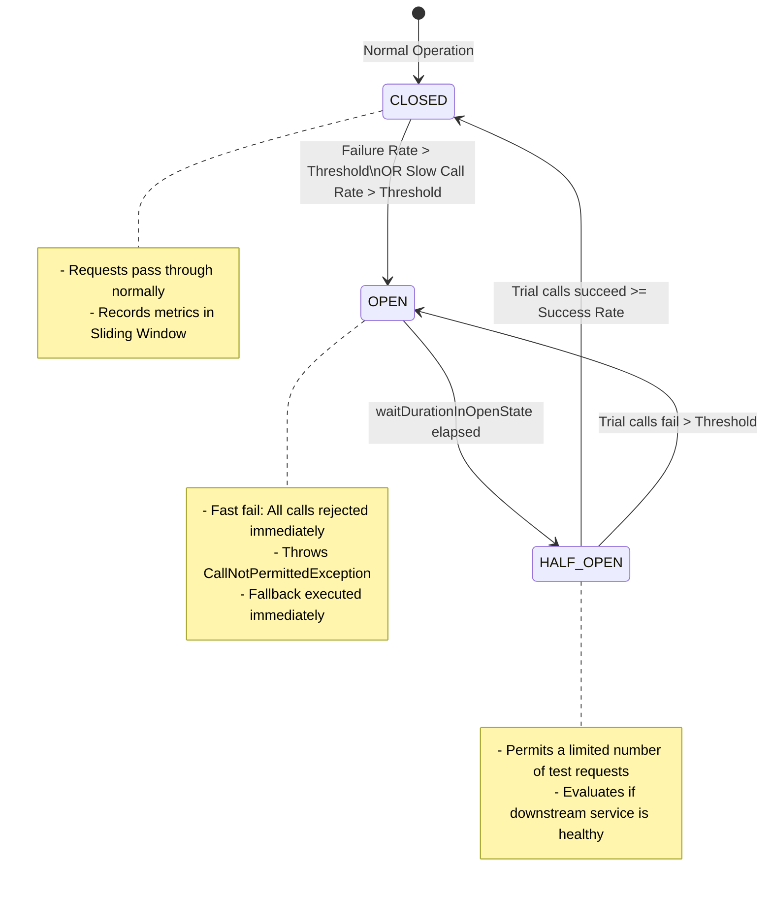
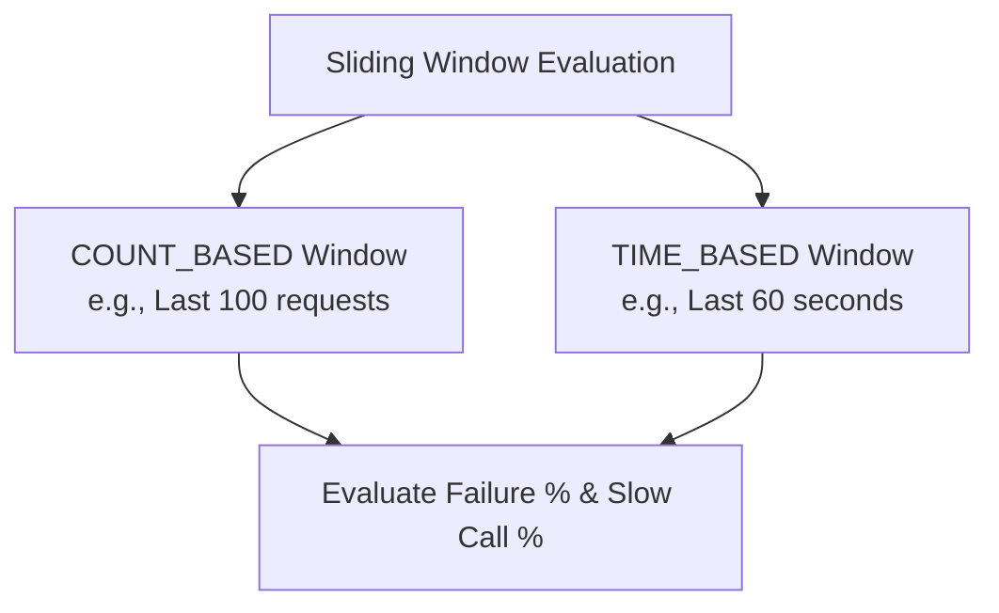
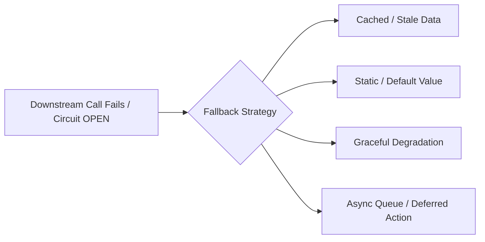
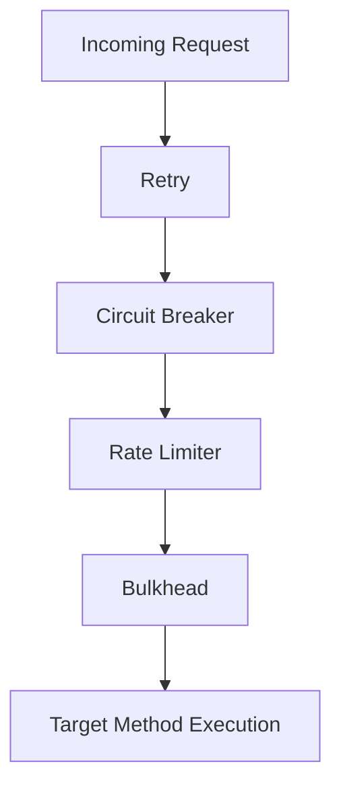

← [Back to Index](../README.md)

# Circuit Breaker Pattern & Fallback Mechanisms

In distributed architectures and microservices, remote network calls over HTTP, gRPC, or messaging queues will inevitably experience latency spikes, timeouts, or outright crashes. Without protection, a failure in a single downstream dependency can cause thread pool exhaustion, cascading failures, and take down the entire ecosystem.

The **Circuit Breaker pattern** prevents an application from repeatedly attempting an operation that is almost guaranteed to fail, allowing downstream services time to recover while degrading gracefully.

---

## 1. Anatomy of the Circuit Breaker

### State Machine



### The Three Core States

| State | Behavior | Request Flow | Next Transition |
| :--- | :--- | :--- | :--- |
| **CLOSED** | Downstream service is healthy. | Requests pass directly to downstream service. Call metrics (success, failure, latency) are recorded in a sliding window. | If failure rate or slow call rate exceeds configured threshold $\rightarrow$ **OPEN**. |
| **OPEN** | Downstream service is unhealthy. | Fast-fail: calls are rejected immediately without hitting the network (`CallNotPermittedException`). Fallback executes immediately. | After `waitDurationInOpenState` elapses $\rightarrow$ **HALF-OPEN**. |
| **HALF-OPEN** | Probing downstream service recovery. | Permits a small, configurable number of trial requests (`permittedNumberOfCallsInHalfOpenState`). Other requests fail-fast. | If trial calls succeed $\rightarrow$ **CLOSED**.<br/>If any trial call fails or threshold is breached $\rightarrow$ **OPEN**. |

---

## 2. Key Configuration Parameters

A modern circuit breaker evaluates calls using **Sliding Windows**:



1. **Sliding Window Type:**
   - `COUNT_BASED`: Evaluates the last $N$ calls (e.g., last 100 requests).
   - `TIME_BASED`: Evaluates calls made over the last $N$ seconds (e.g., last 60 seconds).
2. **Failure Rate Threshold (`failureRateThreshold`):**
   - Percentage of failed calls (e.g., `50%`) that triggers the switch from CLOSED to OPEN.
3. **Slow Call Rate Threshold (`slowCallRateThreshold`):**
   - Percentage of calls whose execution time exceeds `slowCallDurationThreshold` (e.g., > 2s considered slow, trips breaker if > 70% are slow).
4. **Minimum Number of Calls (`minimumNumberOfCalls`):**
   - The minimum volume of calls required in a window before the circuit breaker calculates the failure rate. Prevents tripping on 1 failure out of 1 request (100% false alarm).
5. **Wait Duration in Open State (`waitDurationInOpenState`):**
   - Time to stay OPEN before transitioning to HALF-OPEN (e.g., 10 seconds).
6. **Permitted Calls in Half-Open (`permittedNumberOfCallsInHalfOpenState`):**
   - Number of probe requests allowed through to test health during HALF-OPEN (e.g., 5 calls).

---

## 3. Fallback Mechanism

A fallback is the **graceful degradation** response when a call fails, times out, or when the circuit is OPEN.

### Fallback Strategies



- **Cached / Stale Data:** Return yesterday's currency rates or cached product catalog.
- **Static Default:** Return default recommendation list or empty reviews array.
- **Graceful Degradation:** Return partial page response (e.g., user profile loads, but personalized ads are omitted).
- **Asynchronous Queueing:** Push failed transaction/event to Dead Letter Queue (DLQ) or Kafka topic for deferred retry.

> [!CAUTION]
> **Cardinal Rule of Fallbacks:** A fallback method must NEVER make an external network call! If the primary service is failing due to downstream outages or network issues, making a secondary network call in the fallback can cause a secondary cascading failure. Fallbacks must return in-memory values, cached data, or throw a clear business exception.

---

## 4. Netflix Hystrix vs. Resilience4j

| Feature | Netflix Hystrix (Legacy) | Resilience4j (Modern Standard) |
| :--- | :--- | :--- |
| **Status** | Maintenance mode since late 2018 | Active, officially recommended by Spring |
| **Architecture** | Heavyweight command pattern (`HystrixCommand`) | Lightweight functional programming & decorators |
| **Concurrency Overhead** | Dedicated thread pools per command | Operates on the caller thread using semaphores/atomic counters |
| **Dependencies** | Heavy (RxJava 1.x, Archaius) | Lightweight (Java 8/17 functional interfaces, Vavr) |
| **Modular Design** | Monolithic jar | Modular (`circuitbreaker`, `ratelimiter`, `retry`, `bulkhead`, `timelimiter`) |

---

## 5. Implementation with Resilience4j & Spring Boot 3

### 1. Maven Dependencies (`pom.xml`)
```xml
<dependencies>
    <!-- Resilience4j Spring Boot Starter -->
    <dependency>
        <groupId>io.github.resilience4j</groupId>
        <artifactId>resilience4j-spring-boot3</artifactId>
        <version>2.2.0</version>
    </dependency>

    <!-- Spring AOP for annotations -->
    <dependency>
        <groupId>org.springframework.boot</groupId>
        <artifactId>spring-boot-starter-aop</artifactId>
    </dependency>

    <!-- Spring Boot Actuator for Metrics & Health -->
    <dependency>
        <groupId>org.springframework.boot</groupId>
        <artifactId>spring-boot-starter-actuator</artifactId>
    </dependency>
</dependencies>
```

---

### 2. Configuration (`application.yml`)
```yaml
resilience4j:
  circuitbreaker:
    configs:
      default:
        slidingWindowType: COUNT_BASED
        slidingWindowSize: 20
        minimumNumberOfCalls: 10
        failureRateThreshold: 50.0
        slowCallRateThreshold: 70.0
        slowCallDurationThreshold: 2s
        waitDurationInOpenState: 15s
        permittedNumberOfCallsInHalfOpenState: 5
        automaticTransitionFromOpenToHalfOpenEnabled: true
        recordExceptions:
          - org.springframework.web.client.HttpServerErrorException
          - java.io.IOException
          - java.util.concurrent.TimeoutException
        ignoreExceptions:
          - com.example.exceptions.InvalidInputException # Don't trip for 4xx client errors!
    instances:
      paymentService:
        baseConfig: default
        waitDurationInOpenState: 10s
```

---

### 3. Java Service Implementation with `@CircuitBreaker`
```java
package com.example.service;

import io.github.resilience4j.circuitbreaker.annotation.CircuitBreaker;
import io.github.resilience4j.circuitbreaker.CallNotPermittedException;
import org.slf4j.Logger;
import org.slf4j.LoggerFactory;
import org.springframework.stereotype.Service;
import org.springframework.web.client.RestClient;

@Service
public class PaymentClientService {
    private static final Logger log = LoggerFactory.getLogger(PaymentClientService.class);
    private final RestClient restClient;

    public PaymentClientService(RestClient.Builder builder) {
        this.restClient = builder.baseUrl("https://payment-gateway.internal").build();
    }

    /**
     * Protected call. If payments fail repeatedly, the breaker trips to OPEN.
     */
    @CircuitBreaker(name = "paymentService", fallbackMethod = "processPaymentFallback")
    public PaymentResponse processPayment(PaymentRequest request) {
        log.info("Dispatching payment request for order: {}", request.orderId());
        return restClient.post()
                .uri("/api/v1/charge")
                .body(request)
                .retrieve()
                .body(PaymentResponse.class);
    }

    /**
     * Fallback Method Rules:
     * 1. MUST have identical method signature as original method, plus a Throwable parameter at the end.
     * 2. Return type MUST match original method.
     * 3. Kept in the same class (or a fallback factory).
     */
    public PaymentResponse processPaymentFallback(PaymentRequest request, CallNotPermittedException ex) {
        log.warn("Payment circuit is OPEN! Fast failing order: {}", request.orderId());
        return new PaymentResponse(request.orderId(), PaymentStatus.DEFERRED_PENDING_GATEWAY_RECOVERY);
    }

    public PaymentResponse processPaymentFallback(PaymentRequest request, Throwable ex) {
        log.error("Payment call failed due to: {}. Routing to fallback queue.", ex.getMessage());
        return new PaymentResponse(request.orderId(), PaymentStatus.FAILED_QUEUED_FOR_RETRY);
    }
}
```

---

## 6. Decorator Order in Resilience4j

When combining multiple resiliency annotations, execution order matters:



Default priority order:
1. `Retry` (outermost: retries may trigger breaker or rate limiter)
2. `CircuitBreaker` (if circuit is open, rejects before touching rate limiter)
3. `RateLimiter` (prevents overwhelming target)
4. `TimeLimiter` (enforces timeout)
5. `Bulkhead` (limits concurrent executions to isolate thread pools)

---

## 7. Observability & Monitoring

Resilience4j integrates natively with **Micrometer**, **Prometheus**, and **Spring Actuator**:

### Actuator Endpoints
- `GET /actuator/health`: Exposes circuit breaker status (`UP`, `CIRCUIT_OPEN`).
- `GET /actuator/circuitbreakers`: Lists all registered circuit breakers and their current states.
- `GET /actuator/circuitbreakerevents`: Event stream of state transitions and rejected calls.

### Prometheus Metrics
```text
# Circuit Breaker state: 0 = CLOSED, 1 = OPEN, 2 = HALF_OPEN
resilience4j_circuitbreaker_state{name="paymentService", state="open"} 0
resilience4j_circuitbreaker_state{name="paymentService", state="closed"} 1

# Call rates
resilience4j_circuitbreaker_calls_seconds_count{name="paymentService", kind="successful"} 1420
resilience4j_circuitbreaker_calls_seconds_count{name="paymentService", kind="failed"} 3
resilience4j_circuitbreaker_not_permitted_calls_total{name="paymentService"} 0
```

---

## 8. Common Interview Questions & Gotchas

### Q1: Should 4xx Client Errors trip a Circuit Breaker?
**Answer:** **NO!** 4xx errors (like `400 Bad Request`, `401 Unauthorized`, `404 Not Found`) represent client mistakes, not server or network instability. Downstream is healthy and responding properly. Always configure `ignoreExceptions` for 4xx errors (`HttpClientErrorException`), otherwise invalid client input will trip the breaker and block legitimate users.

### Q2: What is the difference between Bulkhead and Circuit Breaker?
**Answer:**
- **Bulkhead Pattern (Isolation):** Limits the number of concurrent requests to a specific service (using semaphores or separate thread pools). If Service A is slow, it only consumes its dedicated 10 threads, preventing it from consuming all 200 Tomcat worker threads.
- **Circuit Breaker Pattern (Fail Fast):** Measures failure rate over time. When failure rate exceeds a threshold, it stops making requests entirely, allowing the failing service to recover.

### Q3: What happens if `waitDurationInOpenState` is set too short vs. too long?
- **Too short (e.g. 500ms):** The breaker rapidly flips between OPEN and HALF-OPEN, continuously bombarding a struggling downstream service before it has time to recover.
- **Too long (e.g. 10 minutes):** Even after the downstream service recovers, the circuit stays OPEN, unnecessarily returning degraded/fallback responses to users.

### Q4: How do you handle idempotency when combining Circuit Breaker with Retry?
**Answer:** Retries must only be executed for **idempotent operations** (e.g., `GET`, or `POST` requests bearing a unique `Idempotency-Key` header). If a non-idempotent payment request times out, retrying without an idempotency key can cause double charging!
