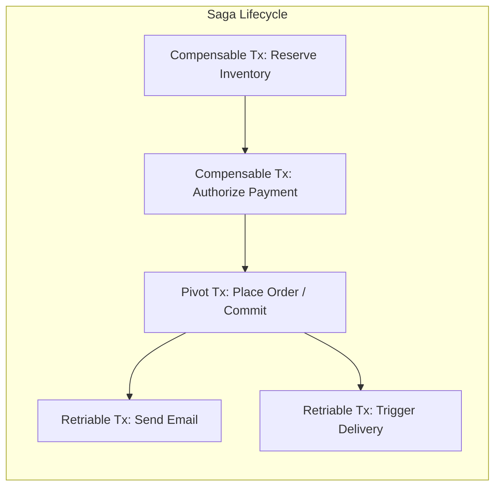
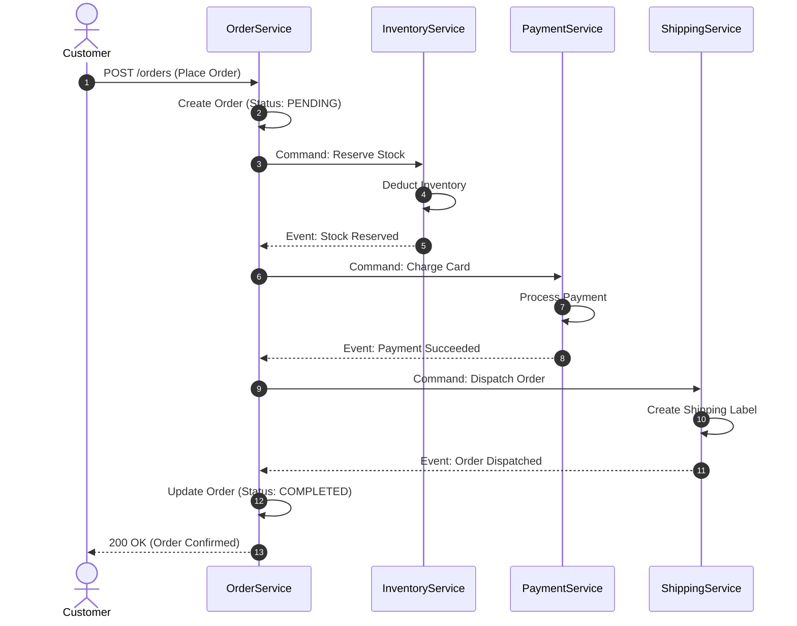
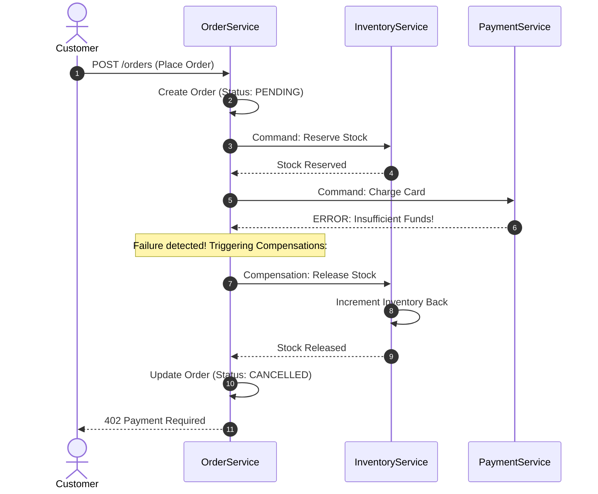
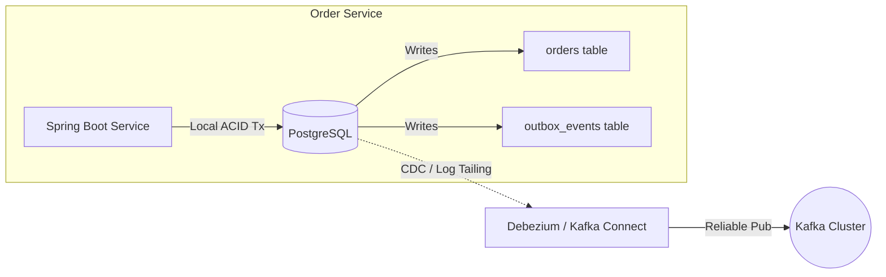

← [Back to Index](../README.md)

# Saga Pattern for Distributed Transactions

In microservices architecture, each microservice owns its private database (the **Database-per-Service** pattern) to maintain loose coupling and independent scalability. While this provides team autonomy, it destroys traditional single-database ACID transactions spanning multiple business boundaries.

The **Saga Pattern** provides an eventual consistency mechanism across distributed services by coordinating a sequence of local transactions and semantic compensations.

---

## 1. The Distributed Transactions Dilemma: Why 2PC Fails

In monolithic architectures, ACID guarantees are provided by the relational database engine:
```text
BEGIN TRANSACTION;
  UPDATE inventory SET stock = stock - 1 WHERE item_id = 101;
  INSERT INTO orders (id, amount) VALUES (1, 100);
  UPDATE accounts SET balance = balance - 100 WHERE user_id = 42;
COMMIT; -- All or nothing guarantee
```

In microservices, these operations live in three separate databases over network boundaries:
- `Inventory Database`
- `Order Database`
- `Payment Database`

### Why Two-Phase Commit (2PC / XA) Fails at Modern Scale:
1. **Synchronous Blocking:** 2PC locks database rows across network boundaries during Phase 1 (Prepare) until Phase 2 (Commit). Latency skyrockets as the system waits for the slowest network node.
2. **Single Point of Failure:** If the central transaction coordinator crashes during the commit phase, resource locks are held indefinitely.
3. **Incompatible with Modern Tech Stacks:** Non-relational databases (MongoDB, DynamoDB, Cassandra) and message brokers (Kafka, RabbitMQ) do not support XA protocols.
4. **CAP Theorem Trade-Off:** 2PC chooses Consistency (C) at the severe expense of Availability (A) and Partition Tolerance (P).

---

## 2. What is a Saga?

Originally formulated by Hector Garcia-Molina and Kenneth Salem in 1987, a **Saga** is a sequence of local transactions:
$$S = [T_1, T_2, T_3, \dots, T_n]$$

- Each transaction $T_i$ updates data in a single service and commits locally using standard ACID transactions.
- Upon completion, $T_i$ publishes an event or message that triggers the next local transaction $T_{i+1}$.
- If any local transaction $T_k$ fails, the Saga executes **compensating transactions** $[C_{k-1}, \dots, C_1]$ in reverse order to undo the changes made by preceding steps:

$$\text{Rollback Sequence: } C_{k-1} \rightarrow C_{k-2} \rightarrow \dots \rightarrow C_1$$

---

## 3. Transaction Types in a Saga



1. **Compensable Transactions:**
   - Transactions that can potentially be reversed or undone if a subsequent step fails. Must have an associated compensating transaction $C_i$.
2. **Pivot Transaction:**
   - The "point of no return" in the Saga. If the pivot transaction commits, the Saga is guaranteed to proceed to completion. It is neither compensable nor retriable.
3. **Retriable Transactions:**
   - Transactions that follow the pivot transaction. They are guaranteed to succeed eventually and do not require compensation (e.g., sending notifications, printing shipping labels). They must be idempotent.

---

## 4. Choreography vs. Orchestration

There are two primary architectural styles for implementing Sagas:

```mermaid
graph TD
    subgraph Choreography (Decentralized Pub/Sub)
        O1[Order Service] -->|OrderCreated| K1((Kafka Topic))
        K1 --> P1[Payment Service]
        P1 -->|PaymentProcessed| K2((Kafka Topic))
        K2 --> I1[Inventory Service]
    end

    subgraph Orchestration (Central Controller)
        ORCH[Order Saga Orchestrator] -->|Command: Charge| P2[Payment Service]
        P2 -->|Reply: Paid| ORCH
        ORCH -->|Command: Reserve| I2[Inventory Service]
        I2 -->|Reply: Reserved| ORCH
    end
```

### Detailed Comparison Matrix

| Attribute | Choreography (Event-Driven) | Orchestration (Command-Driven) |
| :--- | :--- | :--- |
| **Coordination** | Decentralized; services react to domain events. | Centralized; a dedicated Orchestrator coordinates steps. |
| **Communication** | Asynchronous Pub/Sub (Kafka, RabbitMQ, AWS SNS/SQS). | Direct commands and reply channels (REST, gRPC, or message queues). |
| **Coupling** | Loosely coupled; services know events, not destinations. | Participants don't know the workflow, but Orchestrator depends on participants. |
| **Best For** | Simple workflows (2–4 microservices). | Complex workflows (5+ services, branching logic, conditional retries). |
| **Visibility / Debugging**| Hard to track end-to-end flow; requires distributed tracing (Jaeger/Zipkin). | Single place to inspect state, progress, and historical failures. |
| **Drawbacks** | Risk of cyclic event dependencies and spaghetti logic. | Risk of orchestrator becoming an overweight "God Object". |

---

## 5. End-to-End E-Commerce Example

### A. Successful Order Saga (Happy Path)



---

### B. Failed Order Saga (Compensating Flow)
If the **Payment Service fails** (e.g., credit card declined), the reserved inventory must be refunded:



---

## 6. Compensating Transactions: Critical Properties

### 1. Semantic vs. Physical Rollback
Because local transactions have already committed to the database and can be seen by other queries, you **cannot** execute a `ROLLBACK`. A compensation is a new forward transaction that logically neutralizes the effect of the previous transaction.
- Action: `Charge $100` $\rightarrow$ Compensation: `Refund $100`.
- Action: `Insert user row` $\rightarrow$ Compensation: `Update status = DELETED`.

### 2. Mandatory Idempotency
Message brokers provide **at-least-once** delivery. Network timeouts might cause a compensation command to be delivered two or three times. 
```java
// IDEMPOTENT COMPENSATION
public void releaseStock(String orderId, String productId, int quantity) {
    if (compensationHistoryRepository.existsByOrderIdAndAction(orderId, "RELEASE_STOCK")) {
        log.info("Compensation already processed for order: {}", orderId);
        return; // Safe exit
    }
    inventoryRepository.incrementStock(productId, quantity);
    compensationHistoryRepository.save(new CompensationLog(orderId, "RELEASE_STOCK"));
}
```

---

## 7. Spring Boot Implementation: Transactional Outbox Pattern

A major pitfall in Sagas is the **Dual-Write Problem**: modifying the local database AND publishing an event to Kafka. If the database commit succeeds but the network crashes before Kafka accepts the event, the Saga stalls forever.

### The Outbox Solution



### Outbox Implementation Example
```java
@Service
public class OrderService {
    private final OrderRepository orderRepository;
    private final OutboxEventRepository outboxRepository;
    private final ObjectMapper objectMapper;

    @Transactional // Single local ACID boundary
    public Order createOrder(CreateOrderRequest request) {
        Order order = new Order(UUID.randomUUID().toString(), request.customerId(), OrderStatus.PENDING);
        orderRepository.save(order);

        // Record outbox event within the exact same DB transaction
        OutboxEvent outboxEvent = new OutboxEvent(
                UUID.randomUUID().toString(),
                "ORDER_CREATED",
                objectMapper.writeValueAsString(new OrderCreatedEvent(order.getId(), request.items()))
        );
        outboxRepository.save(outboxEvent);

        return order;
    }
}
```

---

## 8. Dealing with Lack of Isolation (ACID vs. BASE)

The Saga pattern guarantees **Atomicity, Consistency, and Durability**, but completely lacks **Isolation (I)**! Changes are immediately visible to concurrent transactions before the Saga finishes.

### Common Isolation Anomalies:
1. **Dirty Reads:** Service A updates stock $\rightarrow$ Client reads updated stock $\rightarrow$ Service A fails and compensates $\rightarrow$ Client saw phantom stock.
2. **Lost Updates:** Saga 1 deducts balance $\rightarrow$ Saga 2 overrides balance before Saga 1 completes.

### Practical Countermeasures:
- **Semantic Lock (Flagging):** Set a field like `status = PENDING_RESERVATION`. Other transactions check this status and refuse to manipulate the row until the Saga finishes.
- **Commutative Updates:** Design operations such that order does not matter (e.g., `account.deposit()` and `account.withdraw()` can arrive in any order).
- **Pessimistic View:** Reserve funds into an `escrow` balance rather than directly deducting the main balance.

---

## 9. 2PC vs. Saga: Final Comparison

| Dimension | Two-Phase Commit (2PC) | Saga Pattern |
| :--- | :--- | :--- |
| **Consistency Model** | Immediate / Strong Consistency (ACID) | Eventual Consistency (BASE) |
| **Isolation** | Full Serializability (Row/Table locks held) | None by default (Requires semantic locks) |
| **Performance & Latency** | Low throughput; high latency due to distributed locks | High throughput; asynchronous, non-blocking |
| **Availability (CAP)** | Prioritizes Consistency (Low Availability) | Prioritizes Availability & Partition Tolerance |
| **Scalability** | Poor; struggles past a handful of services | Excellent; industry standard for large microservice systems |
| **Complexity** | Low business code complexity (handled by DB engine) | High business code complexity (compensations, idempotency, outbox) |

---

## 10. Production Frameworks for Sagas

Instead of coding manual state machines and compensations from scratch, enterprise teams rely on mature workflow orchestration engines:
1. **Temporal.io / Cadence:** Developer-first, code-as-configuration orchestrator. Workflows and compensations are written as plain Java code with deterministic replay.
2. **Camunda (BPMN / Zeebe):** Visual workflow modeler with high-throughput cloud-native execution engine.
3. **Axon Framework:** Built specifically for CQRS, Event Sourcing, and Sagas in Spring Boot.
4. **Eventuate Tram:** Purpose-built transactional messaging framework implementing Sagas and the Outbox pattern.

---

## 11. Frequently Asked Interview Questions

### Q1: What happens if a Compensating Transaction fails?
**Answer:** Compensating transactions **cannot be allowed to fail permanently**.
1. **Automatic Retry with Backoff:** System retries the compensation indefinitely until transient issues (network glitch, database lock) clear.
2. **Idempotency Guarantee:** Repeated compensations must have the same effect as a single run.
3. **Dead Letter Queue (DLQ):** If compensation fails after maximum retries (e.g., bug or data corruption), the message is routed to a DLQ and an alert triggers manual operator intervention or automated reconciliation jobs.

### Q2: What is the "Pivot Transaction" and why does it matter?
**Answer:** The pivot transaction is the commit point of the Saga. All transactions before the pivot must have compensations. Once the pivot transaction commits, all subsequent transactions **must not be compensable**—they must be retriable until they succeed (e.g., payment has cleared; order delivery cannot be aborted by an internal roll back).

### Q3: Why is the Transactional Outbox pattern required in Sagas?
**Answer:** Without the outbox pattern, microservices face the dual-write problem (DB write + Message queue produce). Since network calls cannot be atomically bound to local database transactions, one operation can succeed while the other fails, breaking the Saga trigger chain. The Outbox pattern ensures atomic persistence into a local table, read by CDC engines like Debezium.
