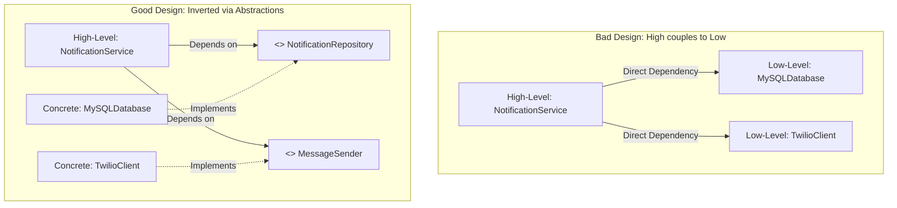

← [Back to Index](../README.md)

# SOLID Principles in Software Engineering

The **SOLID** principles are five design guidelines introduced by Robert C. Martin ("Uncle Bob") that form the foundation of clean, maintainable, understandable, and flexible Object-Oriented Software Architecture.


---

## 1. Single Responsibility Principle (SRP)

> **Definition:** *"A class should have one, and only one, reason to change."*
> In other words, a class should be responsible to one, and only one, actor (user or stakeholder).

### Real-World Analogy
Think of a professional kitchen. A chef prepares meals, a dishwasher cleans plates, and an accountant manages billing. If the chef is also required to do accounting and wash dishes, any change in tax law might force the chef to alter their routine, jeopardizing cooking quality.

---

### Bad Example: The "God" Service
```java
// VIOLATION: Has at least 4 reasons to change:
// 1. User validation rules change
// 2. Database schema/SQL changes
// 3. Email provider/template changes
// 4. Activity log formatting changes
public class UserService {
    public void registerUser(String username, String email, String password) {
        // 1. Validation Logic
        if (!email.contains("@")) {
            throw new IllegalArgumentException("Invalid email format");
        }

        // 2. Database Persistence Logic
        String sql = "INSERT INTO users (username, email, password) VALUES (?, ?, ?)";
        try (Connection conn = DriverManager.getConnection("jdbc:mysql://localhost:3306/db")) {
            PreparedStatement ps = conn.prepareStatement(sql);
            ps.setString(1, username);
            ps.setString(2, email);
            ps.setString(3, hashPassword(password));
            ps.executeUpdate();
        } catch (SQLException e) {
            e.printStackTrace();
        }

        // 3. Email Notification Logic
        String emailBody = "Welcome to our platform, " + username + "!";
        SmtpClient.sendEmail(email, "Welcome", emailBody);

        // 4. Audit Logging Logic
        FileLogger.log("User registered: " + username + " at " + LocalDateTime.now());
    }

    private String hashPassword(String password) {
        return BCrypt.hashpw(password, BCrypt.gensalt());
    }
}
```

---

### Good Example: Segregated Responsibilities
```java
// 1. Dedicated domain entity
public record User(String id, String username, String email, String passwordHash) {}

// 2. Validator
public class UserValidator {
    public void validate(String username, String email, String password) {
        if (email == null || !email.contains("@")) {
            throw new IllegalArgumentException("Invalid email format");
        }
    }
}

// 3. Persistence abstraction
public interface UserRepository {
    void save(User user);
}

// 4. Notification abstraction
public interface NotificationService {
    void sendWelcomeEmail(String email, String username);
}

// 5. Password hashing service
public class PasswordHasher {
    public String hash(String rawPassword) {
        return BCrypt.hashpw(rawPassword, BCrypt.gensalt());
    }
}

// 6. Orchestration Service (Only 1 reason to change: registration workflow)
public class UserRegistrationService {
    private final UserValidator validator;
    private final PasswordHasher hasher;
    private final UserRepository repository;
    private final NotificationService notificationService;

    public UserRegistrationService(UserValidator validator, PasswordHasher hasher,
                                   UserRepository repository, NotificationService notificationService) {
        this.validator = validator;
        this.hasher = hasher;
        this.repository = repository;
        this.notificationService = notificationService;
    }

    public void register(String username, String email, String rawPassword) {
        validator.validate(username, email, rawPassword);
        String hash = hasher.hash(rawPassword);
        User user = new User(UUID.randomUUID().toString(), username, email, hash);
        repository.save(user);
        notificationService.sendWelcomeEmail(email, username);
    }
}
```

---

## 2. Open/Closed Principle (OCP)

> **Definition:** *"Software entities (classes, modules, functions, etc.) should be open for extension, but closed for modification."*
> You should be able to add new functionality without touching existing, tested source code.

### Real-World Analogy
A smartphone with an operating system and app store. When you want to add music streaming or ride booking to your phone, you don't crack open the phone's case and solder new chips to the motherboard (modification). You install an application that conforms to the OS API (extension).

---

### Bad Example: Switch/Conditional Modification
```java
// VIOLATION: Adding a new payment method requires modifying this class
// and recompiling/testing existing payment channels.
public class PaymentProcessor {
    public void processPayment(String paymentType, double amount) {
        if ("CREDIT_CARD".equalsIgnoreCase(paymentType)) {
            System.out.println("Processing credit card payment of $" + amount);
        } else if ("PAYPAL".equalsIgnoreCase(paymentType)) {
            System.out.println("Processing PayPal payment of $" + amount);
        } else if ("CRYPTO".equalsIgnoreCase(paymentType)) {
            System.out.println("Processing Crypto payment of $" + amount);
        } else {
            throw new UnsupportedOperationException("Unknown payment method");
        }
    }
}
```

---

### Good Example: Strategy Pattern via Polymorphism
```java
// Extensible abstraction
public interface PaymentMethod {
    void pay(double amount);
}

// Implementations can be added freely without modifying existing code
public class CreditCardPayment implements PaymentMethod {
    @Override
    public void pay(double amount) {
        System.out.println("Charging $" + amount + " to Credit Card");
    }
}

public class PayPalPayment implements PaymentMethod {
    @Override
    public void pay(double amount) {
        System.out.println("Authorizing $" + amount + " through PayPal API");
    }
}

public class CryptoPayment implements PaymentMethod {
    @Override
    public void pay(double amount) {
        System.out.println("Transferring $" + amount + " in cryptocurrency");
    }
}

// Open for extension, closed for modification
public class PaymentService {
    public void executePayment(PaymentMethod method, double amount) {
        method.pay(amount);
    }
}
```

> [!TIP]
> In Spring Boot, OCP is often implemented by injecting a map of beans:
> `Map<String, PaymentMethod> paymentMethods` automatically resolves bean names to strategies without any `if-else`!

---

## 3. Liskov Substitution Principle (LSP)

> **Definition:** *"Subtypes must be substitutable for their base types without altering the correctness of the program."* (Formulated by Barbara Liskov, 1987).

Formal contract requirements:
- **Preconditions** cannot be strengthened in a subtype.
- **Postconditions** cannot be weakened in a subtype.
- **Invariants** must be preserved in a subtype.

### Real-World Analogy
If it looks like a duck and quacks like a duck, but needs batteries to work, you have the wrong abstraction! Substituting a real duck with a toy duck will fail if someone expects it to lay eggs or fly south for winter.

---

### Bad Example: The Classic Rectangle vs. Square
```java
public class Rectangle {
    protected int width;
    protected int height;

    public void setWidth(int width) { this.width = width; }
    public void setHeight(int height) { this.height = height; }
    public int getArea() { return width * height; }
}

public class Square extends Rectangle {
    @Override
    public void setWidth(int width) {
        this.width = width;
        this.height = width; // Violates user expectation of Rectangle
    }

    @Override
    public void setHeight(int height) {
        this.width = height;
        this.height = height; // Violates user expectation of Rectangle
    }
}

// Client code demonstrating LSP failure:
public class AreaTester {
    public void verify(Rectangle r) {
        r.setWidth(5);
        r.setHeight(4);
        // Expectation for Rectangle: 5 * 4 = 20
        // If 'r' is a Square, area is 4 * 4 = 16! Test fails!
        assert r.getArea() == 20 : "LSP Violation detected!";
    }
}
```

#### Another Common Violation: Throwing `UnsupportedOperationException`
```java
public class ReadOnlyList<E> extends ArrayList<E> {
    @Override
    public boolean add(E e) {
        // VIOLATION: Weakens the contract of List by failing on standard method
        throw new UnsupportedOperationException("Read-only list");
    }
}
```

---

### Good Example: Proper Hierarchy & Interfaces
```java
// Common abstraction based on true capabilities
public interface Shape {
    int getArea();
}

public class Rectangle implements Shape {
    private final int width;
    private final int height;

    public Rectangle(int width, int height) {
        this.width = width;
        this.height = height;
    }

    @Override public int getArea() { return width * height; }
}

public class Square implements Shape {
    private final int side;

    public Square(int side) {
        this.side = side;
    }

    @Override public int getArea() { return side * side; }
}
```

---

## 4. Interface Segregation Principle (ISP)

> **Definition:** *"Clients should not be forced to depend upon interfaces that they do not use."*
> Prefer many small, client-specific role interfaces over a single fat/bloated interface.

### Real-World Analogy
A multi-function office machine (printer, scanner, fax, laminator). If you only need a basic black-and-white home printer, you shouldn't be forced to implement an interface that requires managing toner cartridges, stapler jams, fax line connectivity, and scanning resolutions.

---

### Bad Example: Fat Interface
```java
// VIOLATION: Fat interface forces implementers to provide empty or throwing stubs
public interface MultiFunctionDevice {
    void print(String document);
    void scan(String document);
    void fax(String document);
    void staple(String document);
}

public class SimpleDeskjetPrinter implements MultiFunctionDevice {
    @Override
    public void print(String document) {
        System.out.println("Printing: " + document);
    }

    @Override
    public void scan(String document) {
        throw new UnsupportedOperationException("Scanning not supported!");
    }

    @Override
    public void fax(String document) {
        throw new UnsupportedOperationException("Fax not supported!");
    }

    @Override
    public void staple(String document) {
        throw new UnsupportedOperationException("Stapling not supported!");
    }
}
```

---

### Good Example: Segregated Role Interfaces
```java
public interface Printer {
    void print(String document);
}

public interface Scanner {
    void scan(String document);
}

public interface Fax {
    void fax(String document);
}

// Basic printer only implements what it can do
public class BasicPrinter implements Printer {
    @Override
    public void print(String document) {
        System.out.println("Printing document: " + document);
    }
}

// Enterprise machine combines interfaces via composition or multiple inheritance
public class EnterpriseOfficeCenter implements Printer, Scanner, Fax {
    @Override public void print(String document) { System.out.println("Print: " + document); }
    @Override public void scan(String document) { System.out.println("Scan: " + document); }
    @Override public void fax(String document) { System.out.println("Fax: " + document); }
}
```

> [!NOTE]
> JDK standard library adheres strictly to ISP: `Runnable`, `Callable`, `Closeable`, `AutoCloseable`, `Comparable`, and `Comparator` are all focused single-method interfaces.

---

## 5. Dependency Inversion Principle (DIP)

> **Definition:**
> 1. *"High-level modules should not depend on low-level modules. Both should depend on abstractions."*
> 2. *"Abstractions should not depend on details. Details should depend on abstractions."*



### Real-World Analogy
An electrical power plug. When you plug a laptop into a wall outlet, your laptop's charging cable does not solder directly to copper wiring inside the walls of your building. Both the wall outlet and the charger conform to a standard electrical interface (e.g., standard AC outlet specs).

---

### Bad Example: High-Level Module Tightly Coupled to Low-Level Modules
```java
// VIOLATION: NotificationService directly creates concrete low-level dependencies
public class NotificationService {
    // Direct tight coupling to MySQL and SendGrid
    private final MySQLDatabase database = new MySQLDatabase();
    private final SendGridEmailClient emailClient = new SendGridEmailClient();

    public void notifyCustomer(String customerId, String message) {
        String email = database.getCustomerEmail(customerId);
        emailClient.send(email, message);
    }
}
```
*Problems:*
- Cannot unit test `NotificationService` without running MySQL and SendGrid.
- Changing from MySQL to MongoDB or SendGrid to AWS SES requires rewriting `NotificationService`.

---

### Good Example: Inversion via Abstractions and Dependency Injection
```java
// Abstractions
public interface CustomerRepository {
    String findEmailById(String customerId);
}

public interface MessageSender {
    void sendMessage(String recipient, String message);
}

// High-level service depends strictly on abstractions
public class NotificationService {
    private final CustomerRepository customerRepository;
    private final MessageSender messageSender;

    // Injected via Constructor (Dependency Injection)
    public NotificationService(CustomerRepository customerRepository, MessageSender messageSender) {
        this.customerRepository = customerRepository;
        this.messageSender = messageSender;
    }

    public void notifyCustomer(String customerId, String message) {
        String email = customerRepository.findEmailById(customerId);
        messageSender.sendMessage(email, message);
    }
}

// Low-level implementations
public class MongoCustomerRepository implements CustomerRepository {
    @Override
    public String findEmailById(String customerId) {
        return "user@example.com";
    }
}

public class AwsSesSender implements MessageSender {
    @Override
    public void sendMessage(String recipient, String message) {
        System.out.println("AWS SES sent to " + recipient + ": " + message);
    }
}
```

---

## 6. DIP vs. IoC vs. DI (Clarification Matrix)

These terms are frequently confused in technical interviews:

| Concept | What It Is | Role / Description |
| :--- | :--- | :--- |
| **DIP (Dependency Inversion Principle)** | **Architectural Principle** | High-level rule stating code should depend on abstractions, not concretions. |
| **IoC (Inversion of Control)** | **Design Technique** | Inverting the flow of control (e.g., Framework calls your code instead of your code calling libraries). |
| **DI (Dependency Injection)** | **Design Pattern** | Concrete pattern to achieve IoC and DIP by passing dependencies into a class from outside (constructor, setter, field). |
| **IoC Container** | **Tool / Framework** | Framework component (like Spring `ApplicationContext`) that automates instantiating, wiring, and managing object graphs. |

---

## 7. Common SOLID Code Smells & Anti-Patterns

| Smell / Anti-Pattern | Principle Violated | Symptoms |
| :--- | :--- | :--- |
| **God Object / Big Ball of Mud** | **SRP** | Massive class (1,000+ lines), huge constructor, too many unrelated dependencies. |
| **Shotgun Surgery** | **SRP** | Making a single business change requires editing dozens of different classes. |
| **Cascading `if/else` or `switch`** | **OCP** | Modifying business logic requires changing branching logic across the application. |
| **`instanceof` and Type Casting** | **LSP** | Client checks runtime types (`if (shape instanceof Square)`) before calling methods. |
| **Empty Overrides / `UnsupportedOperationException`** | **LSP & ISP** | Subclasses throw exceptions for methods they are forced to inherit. |
| **Direct `new` in Business Services** | **DIP** | Business logic instantiates HTTP clients, database connections, or loggers directly. |

---

## 8. Frequently Asked Interview Questions

### Q1: How do you balance SRP without creating an excessive number of tiny classes?
**Answer:** SRP defines responsibility in terms of **actors / reasons to change**, not individual operations or single methods. Classes should possess high cohesion. If two operations change together for the same business stakeholder, they belong together. Create a new class only when separate roles, actors, or external system boundaries dictate independent lifecycles.

### Q2: What is the relation between OCP and Design Patterns?
**Answer:** OCP is the fundamental motivation behind many GoF structural and behavioral patterns:
- **Strategy Pattern:** Enables adding algorithms without modifying callers.
- **Decorator Pattern:** Adds behaviors to components without editing original classes.
- **Factory Method:** Subclasses decide object creation without modifying creator pipelines.
- **Observer Pattern:** Adds new subscribers without modifying publisher code.

### Q3: How does Liskov Substitution Principle relate to Java's inheritance rules?
**Answer:** Java compiler enforces syntactic subtyping (return type covariance, parameter type contravariance, checked exception restrictions). However, LSP enforces **behavioral subtyping** which the compiler cannot verify:
- Subtypes must not violate class invariants of the parent.
- Subtypes must not throw unchecked exceptions that violate the parent's contractual semantics.

### Q4: Can a class satisfy DIP without using Spring Framework?
**Answer:** Yes! DIP is an object-oriented design principle, not a Spring feature. Simply writing constructors that accept Java interfaces (Constructor Injection) satisfies DIP completely:
```java
OrderService service = new OrderServiceImpl(new PostgresOrderDao());
```
Spring is merely a tool that automates this wiring.
