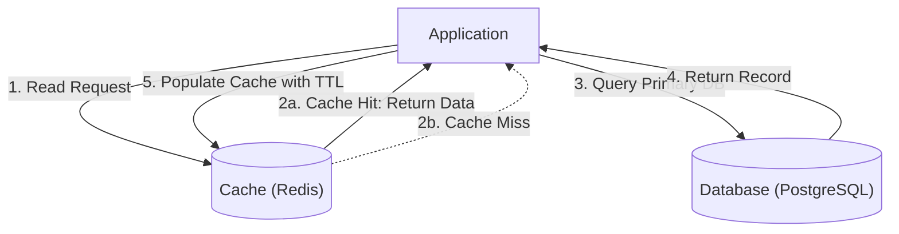
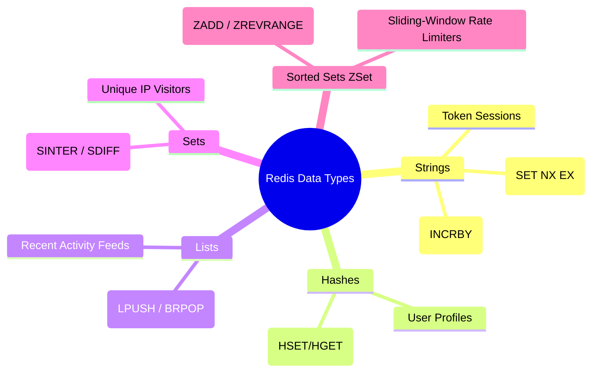
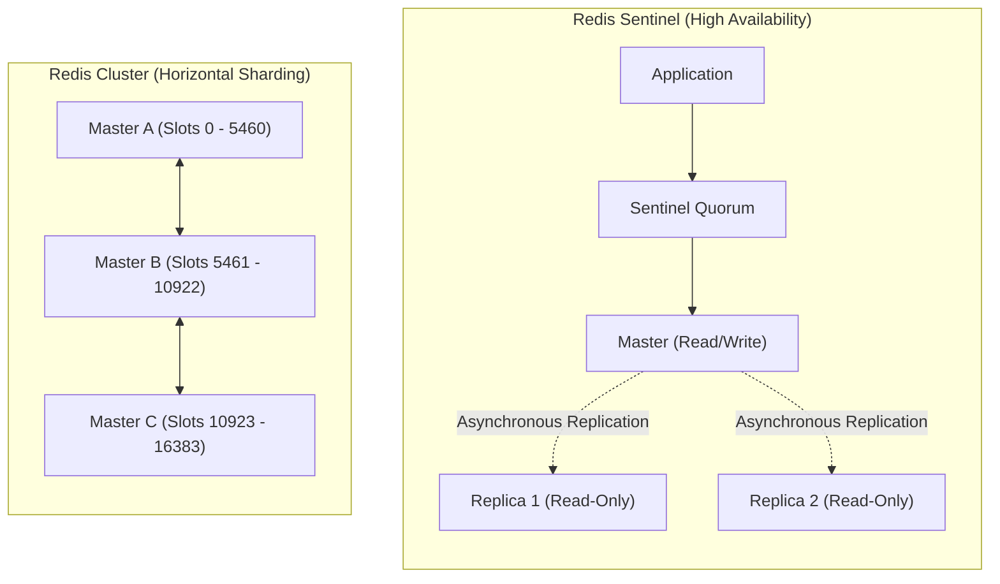
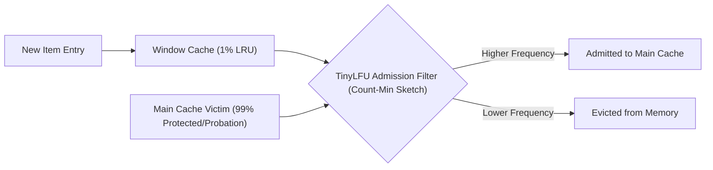
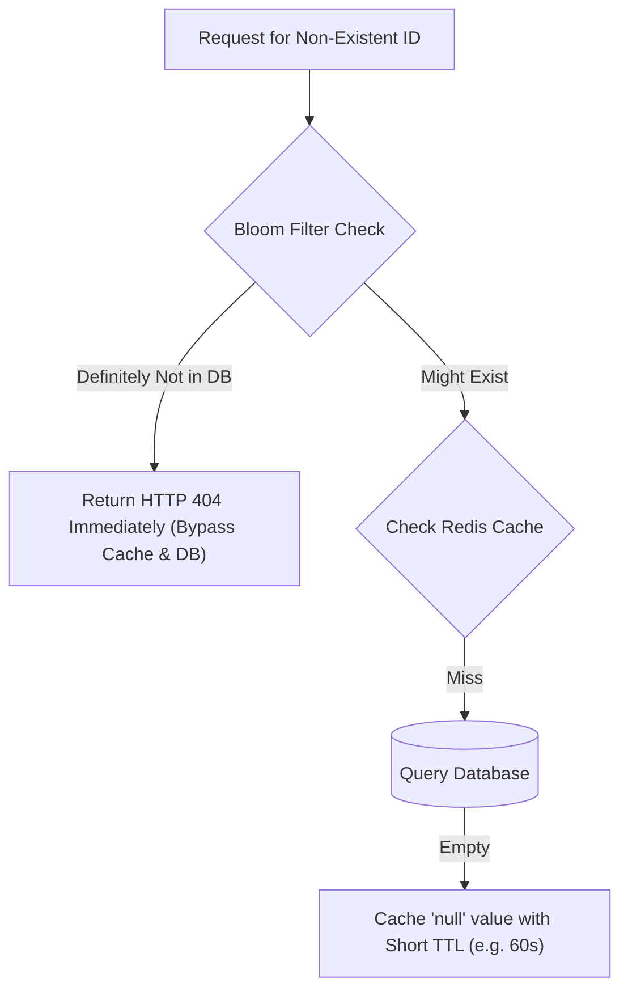
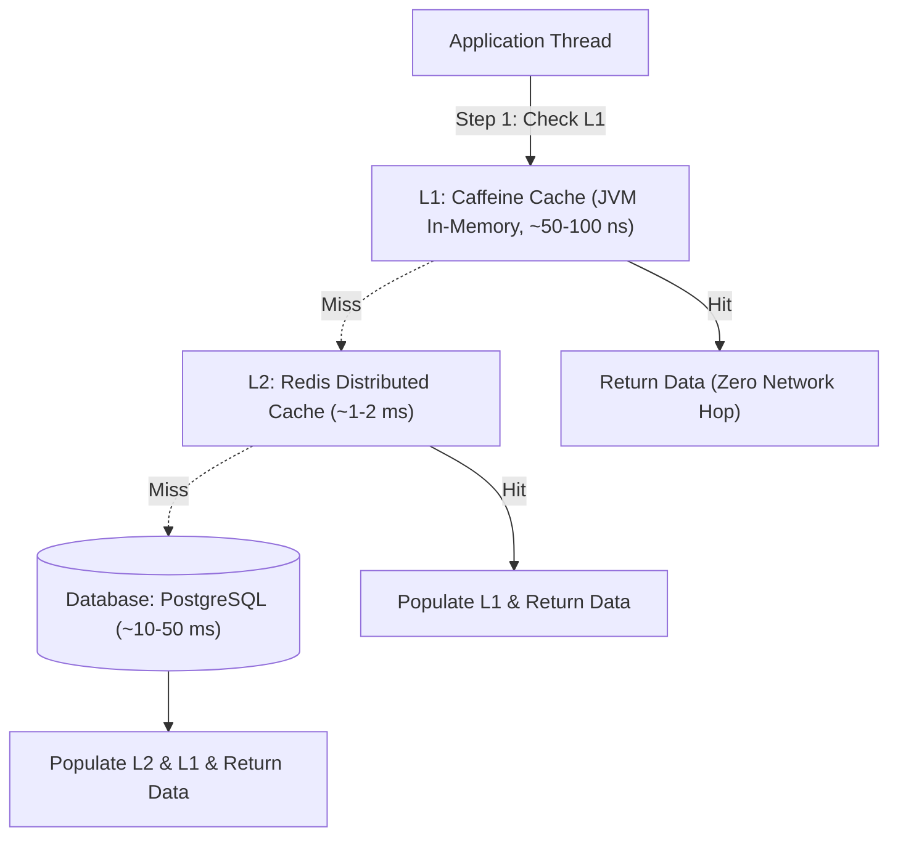
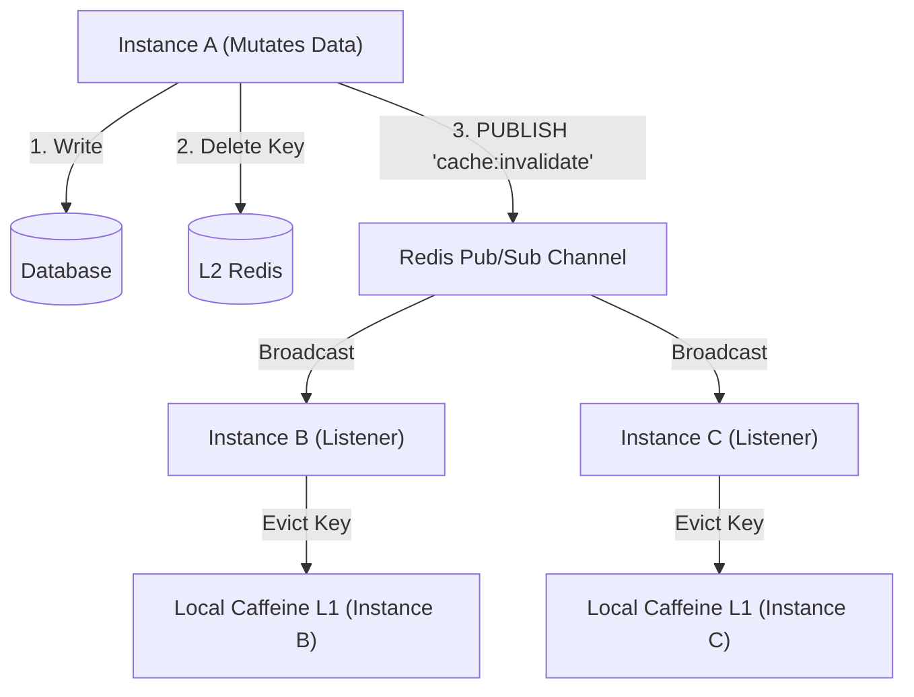

← [Back to Index](../README.md)

# Caching Strategies & Distributed Caching for Senior Engineers

A comprehensive architectural and JVM-level deep dive into caching patterns, Spring Cache abstraction, Redis internals, Caffeine high-performance local caching, distributed cache failure modes, and multi-tier (L1/L2) caching architectures.

---

## Table of Contents
1. [Core Caching Patterns](#1-core-caching-patterns)
   - [Cache-Aside (Lazy Loading)](#cache-aside-lazy-loading)
   - [Read-Through](#read-through)
   - [Write-Through](#write-through)
   - [Write-Behind (Write-Back)](#write-behind-write-back)
   - [Refresh-Ahead](#refresh-ahead)
2. [Spring Cache Abstraction Deep Dive](#2-spring-cache-abstraction-deep-dive)
   - [Annotations: `@Cacheable`, `@CachePut`, `@CacheEvict`, `@Caching`](#annotations-cacheable-cacheput-cacheevict-caching)
   - [Advanced SpEL Expressions: `key`, `condition`, `unless`](#advanced-spel-expressions-key-condition-unless)
   - [Configuring Custom `CacheManager` Beans](#configuring-custom-cachemanager-beans)
3. [Redis Architecture & High Availability](#3-redis-architecture--high-availability)
   - [Core Data Structures & Senior Engineering Use Cases](#core-data-structures--senior-engineering-use-cases)
   - [Key Expiration (Active vs Passive) & Memory Eviction Policies](#key-expiration-active-vs-passive--memory-eviction-policies)
   - [Redis Sentinel vs Redis Cluster (16,384 Hash Slots)](#redis-sentinel-vs-redis-cluster-16384-hash-slots)
   - [Production `RedisTemplate` & JSON Serialization Config](#production-redistemplate--json-serialization-config)
4. [High-Performance Local Caches: Caffeine](#4-high-performance-local-caches-caffeine)
   - [Window TinyLFU Eviction Algorithm](#window-tinylfu-eviction-algorithm)
   - [Caffeine Configuration: Size, TTL vs TTI, RefreshAfterWrite](#caffeine-configuration-size-ttl-vs-tti-refreshafterwrite)
   - [Caffeine vs Guava Cache Comparison](#caffeine-vs-guava-cache-comparison)
5. [Cache Invalidation Strategies](#5-cache-invalidation-strategies)
   - [TTL Expiration vs Event-Driven Invalidation](#ttl-expiration-vs-event-driven-invalidation)
   - [Versioned Keys & Dynamic Namespaces](#versioned-keys--dynamic-namespaces)
6. [Distributed Caching Pathologies & Mitigations](#6-distributed-caching-pathologies--mitigations)
   - [Cache Penetration: Bloom Filters & Null Caching](#cache-penetration-bloom-filters--null-caching)
   - [Cache Breakdown: Mutex Distributed Locks & Soft TTL](#cache-breakdown-mutex-distributed-locks--soft-ttl)
   - [Cache Avalanche: TTL Jitter / Entropy](#cache-avalanche-ttl-jitter--entropy)
   - [Cache Stampede / Thundering Herd: Probabilistic Early Expiration (XFetch)](#cache-stampede--thundering-herd-probabilistic-early-expiration-xfetch)
   - [Hot Key Contention: Read Replicas & Salted Keys](#hot-key-contention-read-replicas--salted-keys)
   - [Cache-DB Consistency: Delete vs Update & Delayed Double Deletion](#cache-db-consistency-delete-vs-update--delayed-double-deletion)
7. [Multi-Level Caching (L1 Local + L2 Distributed)](#7-multi-level-caching-l1-local--l2-distributed)
   - [Architecture & Latency Hierarchy](#architecture--latency-hierarchy)
   - [Distributed L1 Sync via Redis Pub/Sub](#distributed-l1-sync-via-redis-pubsub)
   - [Production Multi-Level Cache Implementation](#production-multi-level-cache-implementation)
8. [Senior Interview Questions & Architectural Gotchas](#8-senior-interview-questions--architectural-gotchas)

---

## 1. Core Caching Patterns

### Cache-Aside (Lazy Loading)

The application code is directly responsible for coordinating reads and writes between the cache and the primary datastore.



- **Pros**: Resilient against cache outages (falls back to DB); only requested data is cached (lazy loading).
- **Cons**: Cache misses incur three round-trips; potential for stale data if database updates bypass the cache.

---

### Read-Through

The application queries the **cache provider** directly. On a cache miss, the cache itself synchronously loads data from the database and returns it transparently to the caller.

```mermaid
flowchart LR
    App["Application"] -->|1. get(key)| Cache["Cache Provider (e.g., Caffeine LoadingCache)"]
    Cache -->|2. On Miss: Auto-load| DB[("Database")]
    DB -->|3. Return Record| Cache
    Cache -->|4. Store & Return Value| App
```

---

### Write-Through

The application writes directly to the cache. The cache synchronously writes through to the underlying database before acknowledging success to the application.

```mermaid
flowchart LR
    App["Application"] -->|1. write(key, value)| Cache["Cache Provider"]
    Cache -->|2. Synchronous Write| DB[("Database")]
    DB -->|3. Commit Acknowledged| Cache
    Cache -->|4. Write Success| App
```

- **Pros**: Cache is never stale relative to the database; simplified application code.
- **Cons**: Write latency increases because every write incurs two network round-trips (cache + DB).

---

### Write-Behind (Write-Back)

The application writes directly to the cache, which acknowledges immediately. The cache buffers writes in memory/queue and asynchronously batches them to the database.

```mermaid
flowchart LR
    App["Application"] -->|1. write(data)| Cache["Cache (In-Memory Buffer)"]
    Cache -->|2. Immediate ACK| App
    Cache -.->|3. Async Batch Flush (Every 5s)| DB[("Database")]
```

- **Pros**: Blazing write throughput; absorbs write bursts (e.g. high-frequency tracking, financial ledger ticks).
- **Cons**: **Data loss risk** if the cache node crashes before flushing dirty buffers to the database.

---

### Refresh-Ahead

The cache monitors access frequency and proactively reloads entries before their TTL expires if they are determined to be "hot".

- Prevents cache misses and stampedes for predictable cyclic reads.
- Requires predictive access heuristics; inaccurate predictions waste network and CPU resources.

---

## 2. Spring Cache Abstraction Deep Dive

Spring provides a declarative caching abstraction via proxies.

### Annotations: `@Cacheable`, `@CachePut`, `@CacheEvict`, `@Caching`

| Annotation | Execution Timing | Purpose |
| :--- | :--- | :--- |
| **`@Cacheable`** | Before method | Checks cache; skips method invocation on cache hit. Runs method on miss and populates cache. |
| **`@CachePut`** | After method | **Always** executes method and updates the cache with the returned result. |
| **`@CacheEvict`** | Method execution | Removes one or all entries from the target cache. |
| **`@Caching`** | Compound | Groups multiple caching annotations on a single method. |

---

### Advanced SpEL Expressions: `key`, `condition`, `unless`

- **`key`**: SpEL expression defining the cache key.
- **`condition`**: Evaluated **before** method execution. If `false`, caching is skipped entirely.
- **`unless`**: Evaluated **after** method execution. If `true`, the result is **not** cached (e.g., skips caching empty or null results).

```java
package com.example.service;

import com.example.model.UserProfile;
import com.example.repository.UserRepository;
import org.springframework.cache.annotation.CacheConfig;
import org.springframework.cache.annotation.CacheEvict;
import org.springframework.cache.annotation.CachePut;
import org.springframework.cache.annotation.Cacheable;
import org.springframework.stereotype.Service;

@Service
@CacheConfig(cacheNames = "users") // Default cache namespace for this class
public class UserService {

    private final UserRepository userRepository;

    public UserService(UserRepository userRepository) {
        this.userRepository = userRepository;
    }

    // Condition: only cache active accounts; Unless: do not cache null results
    @Cacheable(
        key = "#userId",
        condition = "#isActive == true",
        unless = "#result == null"
    )
    public UserProfile getUserProfile(String userId, boolean isActive) {
        return userRepository.findById(userId).orElse(null);
    }

    // Always executes method and synchronizes cache with updated state
    @CachePut(key = "#profile.id()")
    public UserProfile updateUserProfile(UserProfile profile) {
        return userRepository.save(profile);
    }

    // Evicts specific user from cache on deletion
    @CacheEvict(key = "#userId", beforeInvocation = false)
    public void deleteUser(String userId) {
        userRepository.deleteById(userId);
    }

    // Bulk invalidation: evicts all entries in the 'users' cache
    @CacheEvict(allEntries = true)
    public void clearAllUserCaches() {
        // Administrative cache purge
    }
}
```

> [!WARNING]
> **Spring AOP Self-Invocation Pitfall**: If a method in `UserService` calls `this.getUserProfile(id, true)`, the `@Cacheable` annotation is **bypassed** because the call does not pass through the Spring CGLIB/JDK dynamic proxy.

---

### Configuring Custom `CacheManager` Beans

```java
package com.example.config;

import com.github.benmanes.caffeine.cache.Caffeine;
import org.springframework.cache.CacheManager;
import org.springframework.cache.annotation.EnableCaching;
import org.springframework.cache.caffeine.CaffeineCacheManager;
import org.springframework.context.annotation.Bean;
import org.springframework.context.annotation.Configuration;
import org.springframework.context.annotation.Primary;

import java.time.Duration;

@Configuration
@EnableCaching
public class CacheConfiguration {

    @Bean
    @Primary
    public CacheManager caffeineCacheManager() {
        CaffeineCacheManager cacheManager = new CaffeineCacheManager("users", "products");
        cacheManager.setCaffeine(Caffeine.newBuilder()
                .initialCapacity(500)
                .maximumSize(10_000)
                .expireAfterWrite(Duration.ofMinutes(15))
                .recordStats()); // Enables Micrometer cache metrics
        return cacheManager;
    }
}
```

---

## 3. Redis Architecture & High Availability

### Core Data Structures & Senior Engineering Use Cases



#### Sliding Window Rate Limiter via Redis Sorted Set (ZSet)
```java
public boolean isAllowed(String userId, int maxRequests, long windowMs) {
    long now = System.currentTimeMillis();
    long windowStart = now - windowMs;
    String key = "rate_limit:" + userId;

    // Execute atomically via Redis Transaction or Lua Script
    redisTemplate.execute(new SessionCallback<List<Object>>() {
        @Override
        public List<Object> execute(RedisOperations operations) {
            operations.multi();
            // 1. Remove all timestamps older than current window
            operations.opsForZSet().removeRangeByScore(key, 0, windowStart);
            // 2. Add current request timestamp
            operations.opsForZSet().add(key, UUID.randomUUID().toString(), now);
            // 3. Count requests in current window
            operations.opsForZSet().zCard(key);
            // 4. Set TTL to clean up idle keys
            operations.expire(key, Duration.ofMillis(windowMs));
            return operations.exec();
        }
    });
    // Check if zCard count <= maxRequests...
    return true;
}
```

---

### Key Expiration (Active vs Passive) & Memory Eviction Policies

Redis uses a hybrid expiration model:
1. **Passive Expiration**: When a client accesses a key, Redis checks its TTL. If expired, it deletes the key and returns `nil`.
2. **Active Periodic Expiration**: Every 100ms, Redis randomly samples 20 keys with an associated TTL. It evicts all expired keys found. If more than 25% of the sampled keys are expired, it repeats immediately.

#### Memory Eviction Policies (`maxmemory-policy`)
When memory reaches `maxmemory`, Redis evicts keys according to the configured policy:

| Policy | Scope | Algorithm | Use Case |
| :--- | :--- | :--- | :--- |
| **`allkeys-lru`** | All keys | Approximated Least Recently Used | Standard general caching |
| **`volatile-lru`**| Keys with TTL | Approximated Least Recently Used | Preserve persistent keys without TTL |
| **`allkeys-lfu`** | All keys | Least Frequently Used (access counter) | Protects popular keys against scan pollution |
| **`volatile-lfu`**| Keys with TTL | Least Frequently Used | LFU for transient data |
| **`volatile-ttl`**| Keys with TTL | Shortest remaining TTL first | Evict soon-to-expire data first |
| **`noeviction`**  | None | No eviction. Throws OOM on write | Critical data where data loss is unacceptable |

---

### Redis Sentinel vs Redis Cluster (16,384 Hash Slots)



- **Redis Sentinel**: Single master, multiple read replicas. Sentinels monitor nodes and perform **automatic failover** when the master becomes unreachable. Max throughput is limited to a single master's write capacity.
- **Redis Cluster**: Shards data across up to 1,000 masters using **16,384 Hash Slots**.
  $$\text{slot} = \text{CRC16}(\text{key}) \pmod{16384}$$
  Enables multi-terabyte datasets and horizontal scaling across multiple master nodes.
- **Hash Tags**: Enforce related keys to hash to the same slot using `{...}` syntax (e.g. `{user:101}:profile` and `{user:101}:orders`).

---

### Production `RedisTemplate` & JSON Serialization Config

Default Spring `RedisTemplate` uses `JdkSerializationRedisSerializer`, which produces unreadable binary strings and creates security vulnerabilities with Java object deserialization.

```java
package com.example.config;

import com.fasterxml.jackson.annotation.JsonTypeInfo;
import com.fasterxml.jackson.databind.ObjectMapper;
import com.fasterxml.jackson.databind.jsontype.impl.LaissezFaireSubTypeValidator;
import org.springframework.context.annotation.Bean;
import org.springframework.context.annotation.Configuration;
import org.springframework.data.redis.connection.RedisConnectionFactory;
import org.springframework.data.redis.core.RedisTemplate;
import org.springframework.data.redis.serializer.GenericJackson2JsonRedisSerializer;
import org.springframework.data.redis.serializer.StringRedisSerializer;

@Configuration
public class RedisConfig {

    @Bean
    public RedisTemplate<String, Object> redisTemplate(RedisConnectionFactory connectionFactory) {
        RedisTemplate<String, Object> template = new RedisTemplate<>();
        template.setConnectionFactory(connectionFactory);

        ObjectMapper om = new ObjectMapper();
        // Preserve polymorphic type information safely for JSON deserialization
        om.activateDefaultTyping(
                LaissezFaireSubTypeValidator.instance,
                ObjectMapper.DefaultTyping.NON_FINAL,
                JsonTypeInfo.As.PROPERTY
        );
        GenericJackson2JsonRedisSerializer jsonSerializer = new GenericJackson2JsonRedisSerializer(om);

        // String keys, JSON values
        template.setKeySerializer(new StringRedisSerializer());
        template.setValueSerializer(jsonSerializer);
        template.setHashKeySerializer(new StringRedisSerializer());
        template.setHashValueSerializer(jsonSerializer);

        template.afterPropertiesSet();
        return template;
    }
}
```

---

## 4. High-Performance Local Caches: Caffeine

Caffeine is a near-optimal, high-performance in-memory caching library for Java, providing near-hardware speeds and hit rates superior to Guava Cache.

### Window TinyLFU Eviction Algorithm

Traditional LRU evicts recently unaccessed entries, making it vulnerable to **scan pollution** (a batch scan evicts the entire working set of hot items). Traditional LFU requires massive memory to track access frequency counters and adapts poorly to shifts in traffic patterns.

**Window TinyLFU (W-TinyLFU)** combines the best of both:
1. **Window Cache (LRU)**: Absorbs bursts of brand-new entries (~1% of total capacity).
2. **Main Cache (Segmented LRU)**: Holds items with established frequency (~99% of total capacity).
3. **TinyLFU Admission Filter**: Uses a **4-bit Count-Min Sketch** to estimate item access frequencies using minimal memory. When the cache is full, a candidate from the Window Cache competes with a victim from the Main Cache; the item with higher frequency survives.



---

### Caffeine Configuration: Size, TTL vs TTI, RefreshAfterWrite

```java
LoadingCache<String, Product> productCache = Caffeine.newBuilder()
    .maximumSize(50_000)
    // TTI (Time-To-Idle): Evicts if no read OR write occurs for 10 minutes
    .expireAfterAccess(Duration.ofMinutes(10))
    // TTL (Time-To-Live): Evicts 30 minutes after creation
    .expireAfterWrite(Duration.ofMinutes(30))
    // Refresh-Ahead: Asynchronously reloads entry 5 minutes after write
    // Reader threads continue to receive the old value without blocking!
    .refreshAfterWrite(Duration.ofMinutes(5))
    .recordStats()
    .build(productId -> loadProductFromDatabase(productId));
```

---

### Caffeine vs Guava Cache Comparison

| Feature | Guava Cache | Caffeine Cache |
| :--- | :--- | :--- |
| **Eviction Algorithm** | Standard LRU / Segment-level locking | **Window TinyLFU** (near-optimal hit ratio) |
| **Concurrency Design** | Segmented locks (similar to Java 7 CHM) | Lock-free reading + ring buffers for amortized maintenance |
| **Asynchronous Support**| Basic `ListenableFuture` | Native `AsyncLoadingCache` (`CompletableFuture`) |
| **Throughput** | Moderate | **3x to 6x higher read/write throughput** |

---

## 5. Cache Invalidation Strategies

> *"There are only two hard things in Computer Science: cache invalidation and naming things."* — Phil Karlton

### TTL Expiration vs Event-Driven Invalidation

```mermaid
flowchart TD
    subgraph TTLModel ["TTL-Based Invalidation"]
        App1["Client"] --> C1["Cache (TTL = 5m)"]
        C1 -.->|Passive timeout| Expiry["Key Expires automatically"]
    end

    subgraph EventDrivenModel ["Event-Driven Invalidation"]
        DBMod["Database Change"] --> CDC["Debezium / Domain Event"]
        CDC --> Kafka["Kafka Topic: user-invalidations"]
        Kafka --> Invalidator["Cache Invalidator Worker"]
        Invalidator -->|redis.del(key)| DistCache[("Redis Cache")]
    end
```

- **TTL Expiration**: Simple; tolerates eventual consistency up to the TTL window. Fails if data changes unexpectedly and strict consistency is required.
- **Event-Driven Invalidation**: Near real-time consistency. Services emit events upon state mutations; dedicated consumers purge or refresh specific cache keys immediately.

---

### Versioned Keys & Dynamic Namespaces

Instead of deleting millions of related keys (which can block Redis if using `KEYS *`), change the cache key prefix:

```java
public class VersionedCatalogService {

    private final StringRedisTemplate redisTemplate;

    public VersionedCatalogService(StringRedisTemplate redisTemplate) {
        this.redisTemplate = redisTemplate;
    }

    // Bump catalog version to invalidate all cached catalog items instantly!
    public void invalidateEntireCatalog() {
        redisTemplate.opsForValue().increment("catalog:version");
    }

    public String buildProductKey(String productId) {
        String version = redisTemplate.opsForValue().get("catalog:version");
        if (version == null) version = "1";
        return "catalog:v" + version + ":product:" + productId;
    }
}
```

---

## 6. Distributed Caching Pathologies & Mitigations

### Cache Penetration: Bloom Filters & Null Caching

**The Problem**: Malicious or erratic clients repeatedly query non-existent keys (e.g. `userId = -99999`). Because the key never exists in the cache, every single request bypasses the cache and hits the database, exhausting connection pools.



#### Mitigations:
1. **Cache Null Values**: When the database returns empty, store a sentinel value (`""` or `"NULL"`) with a short TTL (30–60s) to absorb subsequent requests.
2. **Bloom Filter**: Maintain a Bloom Filter in front of the cache. If the Bloom filter indicates the key is absent, reject the request immediately without touching the cache or database.

---

### Cache Breakdown: Mutex Distributed Locks & Soft TTL

**The Problem**: A single **ultra-hot key** (e.g. flash-sale product) expires. At that exact microsecond, thousands of concurrent threads experience a cache miss and execute the heavy database query simultaneously.

#### Mitigation: Mutex Distributed Lock (Singleflight)
Only the single thread that acquires the lock queries the database; all other threads await cache population:

```java
public Product getProductWithMutex(String productId) {
    String cacheKey = "product:" + productId;
    Product product = (Product) redisTemplate.opsForValue().get(cacheKey);
    if (product != null) return product;

    String lockKey = "lock:" + cacheKey;
    // SET lock:key true NX PX 3000
    Boolean acquired = redisTemplate.opsForValue()
            .setIfAbsent(lockKey, "LOCKED", Duration.ofSeconds(3));

    if (Boolean.TRUE.equals(acquired)) {
        try {
            // Winner thread queries DB and populates cache
            product = productRepository.findById(productId).orElse(null);
            redisTemplate.opsForValue().set(cacheKey, product, Duration.ofMinutes(10));
            return product;
        } finally {
            redisTemplate.delete(lockKey);
        }
    } else {
        // Loser threads sleep briefly and retry from cache
        try { Thread.sleep(50); } catch (InterruptedException e) { Thread.currentThread().interrupt(); }
        return getProductWithMutex(productId);
    }
}
```

---

### Cache Avalanche: TTL Jitter / Entropy

**The Problem**: Many keys are cached with the exact same TTL (e.g., set to expire in 1 hour). When that hour elapses, thousands of keys expire simultaneously, causing a massive traffic tsunami onto the database.

**The Fix**: Add random jitter/entropy to the expiration time:

$$\text{Actual TTL} = \text{Base TTL} + \text{RandomJitter}(0, 300\text{ seconds})$$

```java
Duration baseTtl = Duration.ofHours(1);
long jitterSeconds = ThreadLocalRandom.current().nextLong(0, 300);
Duration finalTtl = baseTtl.plusSeconds(jitterSeconds);

redisTemplate.opsForValue().set(key, value, finalTtl);
```

---

### Cache Stampede / Thundering Herd: Probabilistic Early Expiration (XFetch)

Instead of waiting for a hot key to completely expire, recalculate it proactively based on a probability function as it nears expiry:

$$-\beta \times \delta \times \ln(\text{random}()) > \text{remainingTTL}$$

Where:
- $\delta$ is the computation time taken to reload the key from the DB.
- $\beta > 0$ is an aggressiveness tuning multiplier.
- As remaining TTL approaches 0, the probability of an early refresh approaches 1.0. The first thread to trigger this refreshes the cache before it ever expires, ensuring zero downstream stampedes.

---

### Hot Key Contention: Read Replicas & Salted Keys

**The Problem**: A single key experiences millions of reads per second, overwhelming the single Redis node or cluster slot hosting that key.

#### Mitigation: Key Salting / Sharding
Replicate the key across $N$ shards by appending a random salt index:

```java
// Write path: write to all salted keys
public void setHotData(String baseKey, Object data) {
    for (int i = 0; i < 5; i++) {
        redisTemplate.opsForValue().set(baseKey + ":" + i, data, Duration.ofMinutes(30));
    }
}

// Read path: randomly select one shard to distribute traffic evenly
public Object getHotData(String baseKey) {
    int randomShard = ThreadLocalRandom.current().nextInt(5);
    return redisTemplate.opsForValue().get(baseKey + ":" + randomShard);
}
```

---

### Cache-DB Consistency: Delete vs Update & Delayed Double Deletion

#### Why "Delete Cache" is Preferred Over "Update Cache"
1. **Concurrency Race**:
   - Thread A updates DB to value 1.
   - Thread B updates DB to value 2.
   - Thread B updates cache to value 2.
   - Thread A network lag delays its write; Thread A updates cache to value 1.
   - **Result**: Database holds 2, but Cache permanently holds 1 (corrupted state).
2. **Lazy Efficiency**: Many updated items are never read again before their next modification. Deleting avoids wasted serialization and memory overhead.

#### Delayed Double Deletion (Cache-Aside Pattern)
Used when database read replicas introduce replication lag:
1. Delete cache key.
2. Update master database.
3. Wait for DB read replicas to sync (e.g. 500ms sleep).
4. Delete cache key a second time to purge any stale reads read from lagging replicas during step 2.

---

## 7. Multi-Level Caching (L1 Local + L2 Distributed)

### Architecture & Latency Hierarchy



---

### Distributed L1 Sync via Redis Pub/Sub

When Instance A modifies an entity, it updates the database and deletes from L2 Redis. However, Instance B and Instance C still have the old value cached in their local L1 Caffeine caches.

**Solution**: Broadcast an eviction message over a Redis Pub/Sub topic to clear local L1 caches across all cluster instances.



---

### Production Multi-Level Cache Implementation

```java
package com.example.cache;

import com.github.benmanes.caffeine.cache.Cache;
import com.github.benmanes.caffeine.cache.Caffeine;
import org.slf4j.Logger;
import org.slf4j.LoggerFactory;
import org.springframework.data.redis.core.RedisTemplate;
import org.springframework.data.redis.listener.ChannelTopic;
import org.springframework.stereotype.Component;

import java.time.Duration;
import java.util.function.Supplier;

@Component
public class TwoTierCacheManager {
    private static final Logger log = LoggerFactory.getLogger(TwoTierCacheManager.class);
    private static final String INVALIDATION_TOPIC = "cache:invalidation:events";

    // L1: Caffeine Local Memory Cache
    private final Cache<String, Object> l1Cache = Caffeine.newBuilder()
            .maximumSize(10_000)
            .expireAfterWrite(Duration.ofMinutes(5))
            .build();

    private final RedisTemplate<String, Object> redisTemplate;
    private final ChannelTopic invalidationTopic = new ChannelTopic(INVALIDATION_TOPIC);

    public TwoTierCacheManager(RedisTemplate<String, Object> redisTemplate) {
        this.redisTemplate = redisTemplate;
    }

    @SuppressWarnings("unchecked")
    public <T> T get(String key, Class<T> clazz, Supplier<T> dbFallback, Duration l2Ttl) {
        // 1. Check L1 Caffeine Cache
        Object l1Value = l1Cache.getIfPresent(key);
        if (l1Value != null) {
            log.debug("L1 Cache Hit for key: {}", key);
            return (T) l1Value;
        }

        // 2. Check L2 Redis Cache
        Object l2Value = redisTemplate.opsForValue().get(key);
        if (l2Value != null) {
            log.debug("L2 Cache Hit for key: {}", key);
            l1Cache.put(key, l2Value); // Backfill L1
            return (T) l2Value;
        }

        // 3. Cache Miss: Execute DB Fallback
        log.debug("L1/L2 Cache Miss for key: {}. Loading from Database...", key);
        T dbValue = dbFallback.get();
        if (dbValue != null) {
            // Populate L2 with TTL
            redisTemplate.opsForValue().set(key, dbValue, l2Ttl);
            // Populate L1
            l1Cache.put(key, dbValue);
        }
        return dbValue;
    }

    public void evict(String key) {
        // 1. Evict local L1
        l1Cache.invalidate(key);
        // 2. Evict L2 Redis
        redisTemplate.delete(key);
        // 3. Broadcast invalidation to all other instances via Pub/Sub
        redisTemplate.convertAndSend(invalidationTopic.getTopic(), key);
        log.info("Evicted key [{}] across L1, L2 and broadcasted invalidation event.", key);
    }

    // Invoked by Redis MessageListener when invalidation broadcast arrives
    public void handleRemoteEviction(String key) {
        l1Cache.invalidate(key);
        log.debug("Evicted key [{}] from local L1 due to remote pub/sub notification.", key);
    }
}
```

---

## 8. Senior Interview Questions & Architectural Gotchas

### Q1: In a distributed system, why should you delete the cache after committing the database transaction, rather than updating it?
**Answer**:
1. **Race Conditions**: In high-concurrency environments, two concurrent update requests can result in out-of-order cache updates where the slower thread overwrites the cache with obsolete data.
2. **Resource Wastage**: In write-heavy applications, updating the cache on every modification serializes objects that may never be read again before the next update occurs.
3. **Transaction Rollback Hazards**: If you update the cache *before* DB commit and the database rolls back due to a constraint violation, the cache now stores uncommitted dirty data.

---

### Q2: What is the difference between Cache Breakdown and Cache Avalanche?
**Answer**:
- **Cache Breakdown**: Occurs when a **single, specific ultra-hot key** expires, and thousands of concurrent requests for that specific key simultaneously hit the primary database.
  - *Fix*: Mutex distributed locks (`SETNX`) or probabilistic early refresh (XFetch).
- **Cache Avalanche**: Occurs when a **large swath of keys** expire simultaneously or the entire Redis cluster crashes, causing a general surge of traffic across multiple domains that overwhelms the database.
  - *Fix*: Randomized TTL jitter, Redis Sentinel/Cluster HA, and circuit breakers (Resilience4j).

---

### Q3: How does Caffeine's Window TinyLFU prevent cache scan pollution?
**Answer**:
Standard LRU stores newly read items at the head of the list. A batch query that scans 100,000 cold rows will flush the entire cache of hot items.
Caffeine divides its memory:
- New items enter an admission **Window Cache** (1% of capacity).
- When evicted from the Window Cache, they must compete with the victim of the **Main Cache** through a **TinyLFU filter** (a 4-bit Count-Min Sketch frequency table).
- If the new item has a lower historical access frequency than the existing main cache resident, it is immediately discarded. This ensures temporary batch scans cannot displace long-term hot entries.

---

### Q4: How do you handle cache consistency when using Redis with database read replicas (replication lag)?
**Answer**:
If you delete the cache key immediately upon DB master update, a concurrent reader might immediately experience a cache miss, query a **lagging read replica**, fetch the stale data, and write that stale data right back into Redis.
**Mitigation: Delayed Double Deletion**:
1. Evict cache key.
2. Commit changes to master database.
3. Schedule an asynchronous delayed task (e.g. after 500ms–1000ms, greater than replica lag) to delete the cache key a second time. Any stale entry populated by lagging replica reads is wiped clean.
