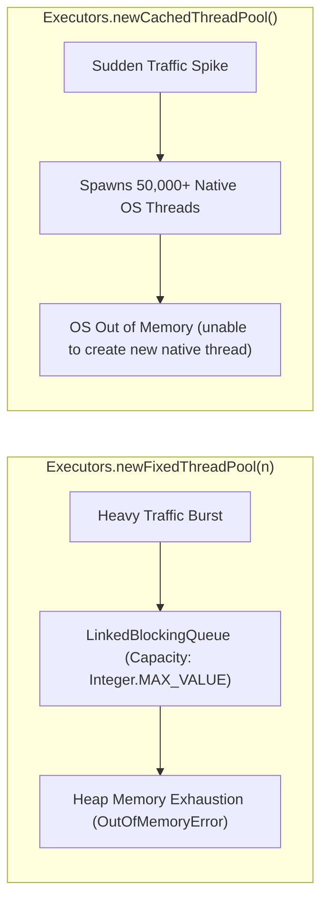
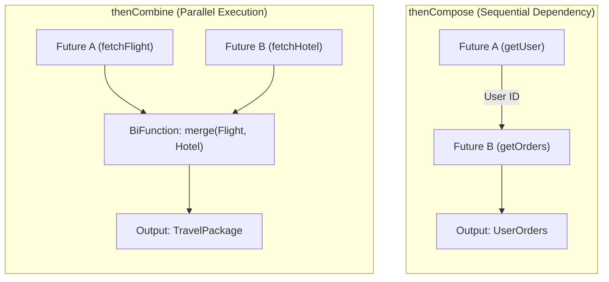
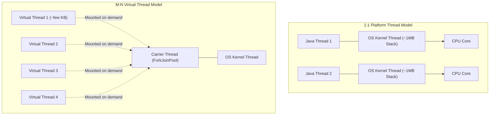
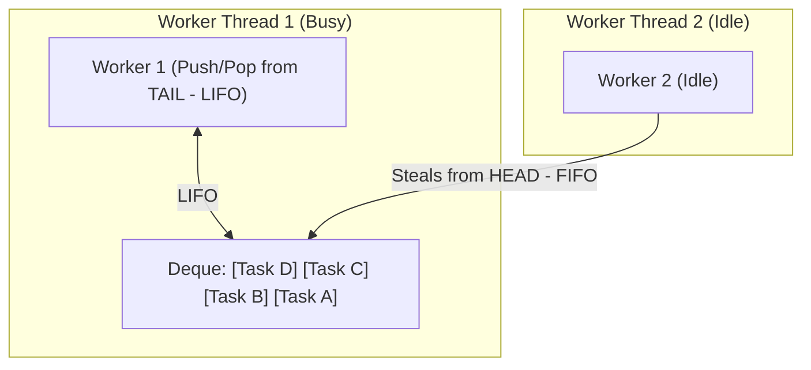
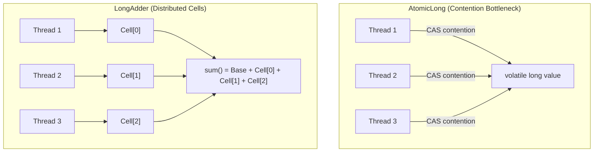
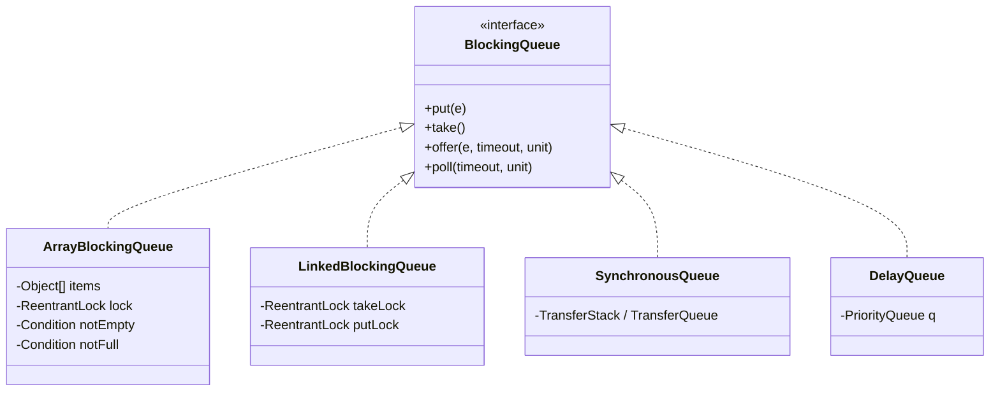
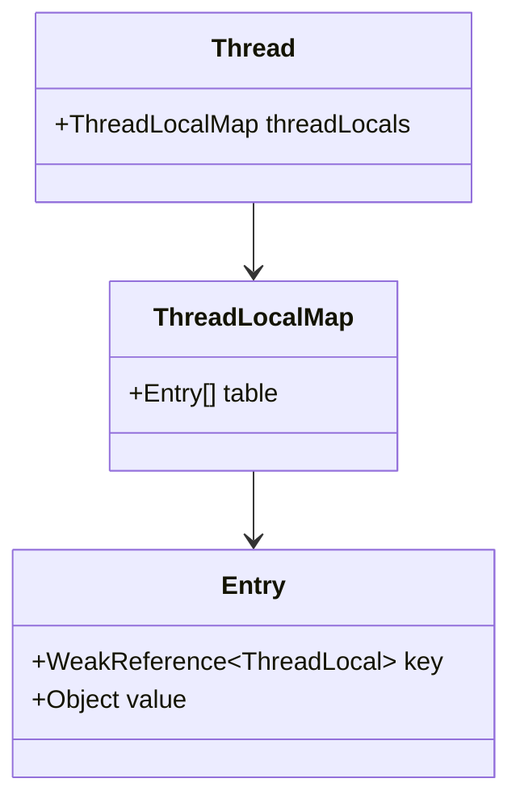

← [Back to Index](../README.md)

# Advanced Java Concurrency: The Senior Engineer's Guide

A comprehensive architectural and JVM-level deep dive into advanced Java concurrency. Designed for senior engineers (8+ years experience), covering production thread pool sizing, `CompletableFuture` orchestration, Java 21 Virtual Threads, lock-free data structures, memory model semantics, and deadlock mitigation patterns.

---

## Table of Contents
1. [Thread Pool & Executor Framework](#1-thread-pool--executor-framework)
   - [ThreadPoolExecutor Internals & Core Parameters](#threadpoolexecutor-internals--core-parameters)
   - [Work Queue Types & Saturation Policies](#work-queue-types--saturation-policies)
   - [Why `Executors` Factory Methods Are Dangerous in Production](#why-executors-factory-methods-are-dangerous-in-production)
   - [Production-Grade Custom ThreadPoolExecutor Implementation](#production-grade-custom-threadpoolexecutor-implementation)
2. [CompletableFuture Deep Dive](#2-completablefuture-deep-dive)
   - [Asynchronous Pipelines: Creation & Transformation](#asynchronous-pipelines-creation--transformation)
   - [Composition vs Combination: `thenCompose` vs `thenCombine`](#composition-vs-combination-thencompose-vs-thencombine)
   - [Multiple Futures Aggregation: `allOf` and `anyOf`](#multiple-futures-aggregation-allof-and-anyof)
   - [Resilient Error Handling: `exceptionally`, `handle`, `whenComplete`](#resilient-error-handling-exceptionally-handle-whencomplete)
   - [Production Multi-Service Scatter-Gather Pattern](#production-multi-service-scatter-gather-pattern)
3. [Virtual Threads (Java 21 / Project Loom)](#3-virtual-threads-java-21--project-loom)
   - [Platform Threads vs Virtual Threads](#platform-threads-vs-virtual-threads)
   - [Carrier Threads, Continuations, and Scheduler](#carrier-threads-continuations-and-scheduler)
   - [The Pinning Problem (`synchronized` vs `ReentrantLock`)](#the-pinning-problem-synchronized-vs-reentrantlock)
   - [Best Practices & Antipatterns](#best-practices--antipatterns)
4. [ForkJoinPool & Work-Stealing](#4-forkjoinpool--work-stealing)
   - [Work-Stealing Architecture](#work-stealing-architecture)
   - [`RecursiveTask` vs `RecursiveAction`](#recursivetask-vs-recursiveaction)
   - [Common Pool Hazards with Parallel Streams](#common-pool-hazards-with-parallel-streams)
5. [Explicit Locks: ReentrantLock, ReadWriteLock & StampedLock](#5-explicit-locks-reentrantlock-readwritelock--stampedlock)
   - [`ReentrantLock`: Fair vs Non-Fair, Conditions, Interruptible](#reentrantlock-fair-vs-non-fair-conditions-interruptible)
   - [`ReentrantReadWriteLock`: Read/Write Separation & Lock Downgrading](#reentrantreadwritelock-readwrite-separation--lock-downgrading)
   - [`StampedLock`: Optimistic Reads & Stamp Validation](#stampedlock-optimistic-reads--stamp-validation)
6. [Atomic Classes & Lock-Free Internals](#6-atomic-classes--lock-free-internals)
   - [Hardware CAS (`CMPXCHG`) & Volatile Semantics](#hardware-cas-cmpxchg--volatile-semantics)
   - [`AtomicReference` & The ABA Problem (`AtomicStampedReference`)](#atomicreference--the-aba-problem-atomicstampedreference)
   - [`LongAdder` vs `AtomicLong`: Cell Striping & False Sharing](#longadder-vs-atomiclong-cell-striping--false-sharing)
7. [Concurrent Collections Internals](#7-concurrent-collections-internals)
   - [`ConcurrentHashMap`: Java 7 Segments vs Java 8+ Node Locking & Treeification](#concurrenthashmap-java-7-segments-vs-java-8-node-locking--treeification)
   - [`CopyOnWriteArrayList`: Snapshot Isolation vs Write Amplification](#copyonwritearraylist-snapshot-isolation-vs-write-amplification)
   - [BlockingQueue Implementations Comparison](#blockingqueue-implementations-comparison)
8. [ThreadLocal, Memory Leaks & ScopedValue (Java 21)](#8-threadlocal-memory-leaks--scopedvalue-java-21)
   - [How `ThreadLocalMap` Works & Memory Leak Vectors](#how-threadlocalmap-works--memory-leak-vectors)
   - [`InheritableThreadLocal` and Thread Pool Hazards](#inheritablethreadlocal-and-thread-pool-hazards)
   - [Modern Alternative: `ScopedValue` (JEP 446)](#modern-alternative-scopedvalue-jep-446)
9. [Concurrency Bugs: Diagnostics & Fixes](#9-concurrency-bugs-diagnostics--fixes)
   - [Deadlock: Coffman Conditions, Thread Dumps, Lock Ordering](#deadlock-coffman-conditions-thread-dumps-lock-ordering)
   - [Livelock: Active Stalling & Exponential Jitter Fix](#livelock-active-stalling--exponential-jitter-fix)
   - [Starvation: Fair Scheduling Mitigation](#starvation-fair-scheduling-mitigation)
   - [Race Conditions: Check-Then-Act vs Read-Modify-Write](#race-conditions-check-then-act-vs-read-modify-write)
10. [Senior Interview Questions & Architectural Gotchas](#10-senior-interview-questions--architectural-gotchas)

---

## 1. Thread Pool & Executor Framework

### ThreadPoolExecutor Internals & Core Parameters

At the heart of Java's asynchronous task execution is `java.util.concurrent.ThreadPoolExecutor`. Understanding the exact step-by-step task admission algorithm is a baseline requirement for senior engineers:

```
Incoming Task ──► [ Running Threads < corePoolSize ? ] ──YES──► Create Worker Thread with FirstTask
                           │
                           NO
                           ▼
                  [ workQueue.offer(task) ? ] ─────────YES──► Enqueued in workQueue
                           │
                           NO (Queue is Full)
                           ▼
                  [ Running Threads < maximumPoolSize ? ] ──YES──► Create Worker Thread (Non-core)
                           │
                           NO (Threads saturated)
                           ▼
                  Invoke RejectedExecutionHandler (Abort, CallerRuns, Discard, DiscardOldest)
```

> [!IMPORTANT]
> A common misconception is that threads scale up to `maximumPoolSize` *before* buffering tasks in the queue. **This is false.** `ThreadPoolExecutor` will **never** spawn more than `corePoolSize` threads unless the `workQueue` explicitly returns `false` on `offer()`.

#### The 7 Constructor Parameters
```java
public ThreadPoolExecutor(
    int corePoolSize,                      // Min number of alive workers
    int maximumPoolSize,                   // Max number of alive workers
    long keepAliveTime,                    // Idle time before non-core thread terminates
    TimeUnit unit,                         // Time unit for keepAliveTime
    BlockingQueue<Runnable> workQueue,     // Task buffer before reaching maximumPoolSize
    ThreadFactory threadFactory,           // Factory to name threads, set daemon status
    RejectedExecutionHandler handler       // Saturation policy when queue and pool are saturated
)
```

1. **`corePoolSize`**: Base worker threads maintained even if idle (unless `allowCoreThreadTimeOut(true)` is enabled).
2. **`maximumPoolSize`**: Upper ceiling of concurrent OS platform threads.
3. **`keepAliveTime` & `unit`**: When worker count exceeds `corePoolSize`, idle workers terminate if they wait longer than this duration for new tasks.
4. **`workQueue`**: The `BlockingQueue<Runnable>` holding tasks waiting for thread availability.
5. **`threadFactory`**: Configures thread names, priority, uncaught exception handlers, and daemon status.
6. **`handler`**: Invoked when thread pool and queue are both saturated or when the executor has been shut down.

---

### Work Queue Types & Saturation Policies

| Queue Type | Characteristics | Behavior Under Load |
| :--- | :--- | :--- |
| **`SynchronousQueue`** | Capacity = 0. Handoff queue. A `put()` must wait for a `take()`. | Bypasses queueing. If all core threads are busy, immediately spawns new threads up to `maximumPoolSize`. Used by `Executors.newCachedThreadPool()`. |
| **`LinkedBlockingQueue`** | Default unbounded (`Integer.MAX_VALUE`). Can be bounded. | If unbounded, `maximumPoolSize` is **completely ignored** because `offer()` never fails. |
| **`ArrayBlockingQueue`** | Bounded array structure. Pre-allocates elements. | Predictable memory footprint. Squeezes queue overflow to non-core threads, then triggers rejection. |

#### The 4 Standard Saturation Policies (`RejectedExecutionHandler`)
- **`ThreadPoolExecutor.AbortPolicy` (Default)**: Throws `RejectedExecutionException`. Fails fast, ideal when callers must know processing failed immediately.
- **`ThreadPoolExecutor.CallerRunsPolicy`**: The thread invoking `execute()` runs the task itself. Provides natural **backpressure**, slowing down producer ingestion rate.
- **`ThreadPoolExecutor.DiscardPolicy`**: Silently drops the rejected task without notification. Dangerous for transactional workflows.
- **`ThreadPoolExecutor.DiscardOldestPolicy`**: Drops the oldest unhandled task at the head of the queue, then retries `execute()`. Suitable for real-time sensor or market tick data where freshest data matters.

---

### Why `Executors` Factory Methods Are Dangerous in Production

Static helper methods in `java.util.concurrent.Executors` are widely banned in production codebases (e.g., in SonarQube, Google, and Alibaba Java coding standards):

```java
// DANGER 1: newFixedThreadPool uses unbounded LinkedBlockingQueue
public static ExecutorService newFixedThreadPool(int nThreads) {
    return new ThreadPoolExecutor(nThreads, nThreads,
                                  0L, TimeUnit.MILLISECONDS,
                                  new LinkedBlockingQueue<Runnable>()); // Capacity = 2^31 - 1
}

// DANGER 2: newCachedThreadPool has unbounded maximumPoolSize
public static ExecutorService newCachedThreadPool() {
    return new ThreadPoolExecutor(0, Integer.MAX_VALUE,
                                  60L, TimeUnit.SECONDS,
                                  new SynchronousQueue<Runnable>()); // Spawns unlimited OS threads
}
```



---

### Production-Grade Custom ThreadPoolExecutor Implementation

Here is an enterprise-grade configuration featuring named threads, bounded queue, caller-runs backpressure, graceful JVM shutdown hooks, and execution metric monitoring:

```java
package com.example.concurrency;

import org.slf4j.Logger;
import org.slf4j.LoggerFactory;

import java.util.concurrent.*;
import java.util.concurrent.atomic.AtomicInteger;

public class ProductionThreadPool {
    private static final Logger log = LoggerFactory.getLogger(ProductionThreadPool.class);

    public static ThreadPoolExecutor createOrderProcessingPool() {
        int cpuCores = Runtime.getRuntime().availableProcessors();
        
        // Sizing formula for I/O bound tasks: Cores * (1 + Wait_Time / Service_Time)
        // Assuming Wait_Time / Service_Time ~ 3 for DB and external HTTP queries
        int corePoolSize = cpuCores * 2;
        int maxPoolSize = cpuCores * 4;
        long keepAliveTime = 60L;
        int queueCapacity = 1_000;

        BlockingQueue<Runnable> queue = new ArrayBlockingQueue<>(queueCapacity);

        ThreadFactory namedFactory = new CustomThreadFactory("order-processor");

        // Use CallerRunsPolicy for graceful backpressure
        RejectedExecutionHandler rejectedHandler = new ThreadPoolExecutor.CallerRunsPolicy();

        ThreadPoolExecutor executor = new MonitoredThreadPoolExecutor(
                corePoolSize,
                maxPoolSize,
                keepAliveTime,
                TimeUnit.SECONDS,
                queue,
                namedFactory,
                rejectedHandler
        );

        // Allow idle core threads to terminate during prolonged quiet periods
        executor.allowCoreThreadTimeOut(true);

        registerGracefulShutdown(executor, "order-processor-pool");
        return executor;
    }

    private static void registerGracefulShutdown(ExecutorService executor, String poolName) {
        Runtime.getRuntime().addShutdownHook(new Thread(() -> {
            log.info("Initiating graceful shutdown for pool: {}", poolName);
            executor.shutdown(); // Stop accepting new tasks
            try {
                if (!executor.awaitTermination(30, TimeUnit.SECONDS)) {
                    log.warn("Pool {} did not terminate in 30s. Forcing shutdown now...", poolName);
                    executor.shutdownNow(); // Cancel executing tasks
                    if (!executor.awaitTermination(10, TimeUnit.SECONDS)) {
                        log.error("Pool {} failed to terminate completely.", poolName);
                    }
                }
            } catch (InterruptedException ie) {
                executor.shutdownNow();
                Thread.currentThread().interrupt();
            }
        }));
    }

    // Custom ThreadFactory to name threads and catch uncaught runtime exceptions
    static class CustomThreadFactory implements ThreadFactory {
        private final String prefix;
        private final AtomicInteger threadNumber = new AtomicInteger(1);

        public CustomThreadFactory(String prefix) {
            this.prefix = prefix;
        }

        @Override
        public Thread newThread(Runnable r) {
            Thread t = new Thread(r, prefix + "-thread-" + threadNumber.getAndIncrement());
            t.setDaemon(false);
            t.setPriority(Thread.NORM_PRIORITY);
            t.setUncaughtExceptionHandler((thread, ex) ->
                    log.error("Uncaught exception in thread {}", thread.getName(), ex));
            return t;
        }
    }

    // Instrumented Executor tracking task duration
    static class MonitoredThreadPoolExecutor extends ThreadPoolExecutor {
        private final ThreadLocal<Long> startTime = new ThreadLocal<>();

        public MonitoredThreadPoolExecutor(int corePoolSize, int maximumPoolSize,
                                           long keepAliveTime, TimeUnit unit,
                                           BlockingQueue<Runnable> workQueue,
                                           ThreadFactory threadFactory,
                                           RejectedExecutionHandler handler) {
            super(corePoolSize, maximumPoolSize, keepAliveTime, unit, workQueue, threadFactory, handler);
        }

        @Override
        protected void beforeExecute(Thread t, Runnable r) {
            super.beforeExecute(t, r);
            startTime.set(System.nanoTime());
        }

        @Override
        protected void afterExecute(Runnable r, Throwable t) {
            try {
                long duration = (System.nanoTime() - startTime.get()) / 1_000_000;
                log.debug("Task completed in {} ms. Active: {}, QueueSize: {}",
                        duration, getActiveCount(), getQueue().size());
            } finally {
                startTime.remove(); // Prevent ThreadLocal memory leaks!
                super.afterExecute(r, t);
            }
        }
    }
}
```

---

## 2. CompletableFuture Deep Dive

Introduced in Java 8 and enhanced in Java 9+, `CompletableFuture<T>` provides non-blocking, composable, monadic programming for asynchronous computations.

### Asynchronous Pipelines: Creation & Transformation

- **`supplyAsync(Supplier<U>, Executor)`**: Initiates async execution returning a value.
- **`runAsync(Runnable, Executor)`**: Initiates async execution returning `Void`.
- **`thenApply(Function<T, R>)`**: Synchronously transforms the result of the previous stage (runs in same thread as completion or calling thread).
- **`thenApplyAsync(Function<T, R>, Executor)`**: Transforms the result asynchronously in the specified pool.
- **`thenAccept(Consumer<T>)`**: Terminal consumer consuming the output without returning a value (`CompletableFuture<Void>`).
- **`thenRun(Runnable)`**: Runs an action upon completion without accessing previous results.

---

### Composition vs Combination: `thenCompose` vs `thenCombine`

A classic interview question: *What is the difference between `thenApply`, `thenCompose`, and `thenCombine`?*

- **`thenApply` (like `map`)**: Transforms `T -> U`. If your function returns a `CompletableFuture<U>`, `thenApply` gives you `CompletableFuture<CompletableFuture<U>>` (nested).
- **`thenCompose` (like `flatMap`)**: Flattens nested futures. Connects two dependent async operations sequentially where Stage 2 needs the output of Stage 1.
- **`thenCombine` (like `zip`)**: Takes two independent futures running in parallel, waits for both to finish, and combines their results with a `BiFunction<T, U, V>`.



---

### Multiple Futures Aggregation: `allOf` and `anyOf`

- **`CompletableFuture.allOf(CompletableFuture<?>... cfs)`**: Returns a `CompletableFuture<Void>` that completes only when **all** input futures complete. If any future completes exceptionally, `allOf` still waits for all to finish before failing.
- **`CompletableFuture.anyOf(CompletableFuture<?>... cfs)`**: Returns `CompletableFuture<Object>` completing as soon as **any** of the futures finishes (with value or error). Useful for fastest-mirror queries.

---

### Resilient Error Handling: `exceptionally`, `handle`, `whenComplete`

| Method | Signature | Can Recover Value? | Runs on Success? | Runs on Error? |
| :--- | :--- | :--- | :--- | :--- |
| **`exceptionally`** | `Function<Throwable, T>` | Yes (acts as fallback) | No | Yes |
| **`handle`** | `BiFunction<T, Throwable, R>` | Yes (transforms result or error) | Yes | Yes |
| **`whenComplete`**| `BiConsumer<T, Throwable>` | No (pure side-effect, passes result through)| Yes | Yes |

---

### Production Multi-Service Scatter-Gather Pattern

```java
package com.example.concurrency;

import java.util.List;
import java.util.concurrent.*;
import java.util.stream.Collectors;

public class ScatterGatherAggregator {

    public record UserProfile(String id, String name) {}
    public record OrderHistory(String id, List<String> orders) {}
    public record CreditScore(String id, int score) {}
    public record Customer360(UserProfile profile, OrderHistory orders, CreditScore credit) {}

    private final ExecutorService ioExecutor = Executors.newFixedThreadPool(16);

    public Customer360 aggregateCustomerData(String customerId) {
        // Step 1: Fire three parallel requests with independent fallbacks and timeouts
        CompletableFuture<UserProfile> profileFuture = CompletableFuture
                .supplyAsync(() -> fetchUserProfile(customerId), ioExecutor)
                .orTimeout(2, TimeUnit.SECONDS) // Java 9+
                .exceptionally(ex -> new UserProfile(customerId, "Guest User"));

        CompletableFuture<OrderHistory> ordersFuture = CompletableFuture
                .supplyAsync(() -> fetchOrderHistory(customerId), ioExecutor)
                .orTimeout(3, TimeUnit.SECONDS)
                .exceptionally(ex -> new OrderHistory(customerId, List.of()));

        CompletableFuture<CreditScore> creditFuture = CompletableFuture
                .supplyAsync(() -> fetchCreditScore(customerId), ioExecutor)
                .orTimeout(1, TimeUnit.SECONDS)
                .exceptionally(ex -> new CreditScore(customerId, 0));

        // Step 2: Combine using allOf without blocking individual threads
        CompletableFuture<Void> allAggregation = CompletableFuture.allOf(
                profileFuture, ordersFuture, creditFuture
        );

        // Step 3: Join results once all have completed safely
        return allAggregation.thenApply(v -> new Customer360(
                profileFuture.join(),
                ordersFuture.join(),
                creditFuture.join()
        )).join();
    }

    private UserProfile fetchUserProfile(String id) {
        sleep(500); return new UserProfile(id, "Alice");
    }

    private OrderHistory fetchOrderHistory(String id) {
        sleep(1200); return new OrderHistory(id, List.of("ORD-101", "ORD-102"));
    }

    private CreditScore fetchCreditScore(String id) {
        sleep(300); return new CreditScore(id, 750);
    }

    private static void sleep(long ms) {
        try { Thread.sleep(ms); } catch (InterruptedException e) { Thread.currentThread().interrupt(); }
    }
}
```

---

## 3. Virtual Threads (Java 21 / Project Loom)

Java 21 revolutionized high-throughput concurrent I/O with **Virtual Threads** (JEP 444).

### Platform Threads vs Virtual Threads



| Dimension | Platform Thread (OS Thread) | Virtual Thread (Java 21) |
| :--- | :--- | :--- |
| **Mapping** | $1 : 1$ with OS Kernel Thread | $M : N$ mapped onto Carrier Platform Threads |
| **Stack Size** | Fixed & monolithic (~1 MB reserved OS stack memory) | Dynamic in JVM heap (starts at ~few hundred bytes) |
| **Context Switch** | OS kernel mode transition (~1–10 microseconds) | User-space memory copy (~few nanoseconds) |
| **Max Quantity** | Thousands before OS OOM (`Cannot create native thread`) | Millions without degrading system stability |
| **Primary Target**| CPU-bound number crunching | High-throughput, I/O-bound blocking calls (HTTP/JDBC) |

---

### Carrier Threads, Continuations, and Scheduler

Virtual threads are managed by a JVM-internal `ForkJoinPool` of carrier threads (typically equal to `Runtime.getRuntime().availableProcessors()`).

When a virtual thread executes a blocking operation (such as `SocketChannel.read()` or `Thread.sleep()`):
1. The virtual thread yields its underlying continuation.
2. Its call stack frames are unmounted from the carrier thread and copied into the JVM heap.
3. The carrier thread becomes immediately free to execute other runnable virtual threads.
4. When the OS signals that the I/O event is ready (via `epoll`/`kqueue`/`IOCP`), the JVM reschedules the virtual thread, mounting it onto any available carrier thread to resume execution.

```java
// Creating Virtual Threads in Java 21
Thread vThread = Thread.ofVirtual().name("vt-worker-", 0).start(() -> {
    System.out.println("Running on: " + Thread.currentThread());
});

// Using ExecutorService with Virtual Threads (Auto-closes at end of scope via try-with-resources)
try (ExecutorService executor = Executors.newVirtualThreadPerTaskExecutor()) {
    IntStream.range(0, 10_000).forEach(i -> executor.submit(() -> {
        Thread.sleep(Duration.ofMillis(100)); // Non-blocking to carrier thread!
        return i;
    }));
} // Automatically awaits termination of all submitted tasks
```

---

### The Pinning Problem (`synchronized` vs `ReentrantLock`)

A virtual thread is **pinned** to its carrier thread when it cannot unmount during a blocking operation. When pinned, the carrier platform thread is held hostage, defeating the scalability of virtual threads.

**Two Main Causes of Pinning:**
1. Running a blocking operation inside a `synchronized` block or method (due to intrinsic monitor tied to native thread frames).
2. Running native code (JNI) or foreign functions.

```java
// BAD: Causes Carrier Thread Pinning!
public synchronized String fetchRemoteDataBad() {
    // Blocking socket call while holding intrinsic lock pins the carrier thread
    return httpClient.send(request, HttpResponse.BodyHandlers.ofString()).body();
}

// GOOD: Safe for Virtual Threads using ReentrantLock
private final ReentrantLock lock = new ReentrantLock();

public String fetchRemoteDataGood() {
    lock.lock();
    try {
        // ReentrantLock park/unpark unmounts cleanly without pinning
        return httpClient.send(request, HttpResponse.BodyHandlers.ofString()).body();
    } finally {
        lock.unlock();
    }
}
```

> [!TIP]
> Detect carrier thread pinning in production using the JVM flag:  
> `-Djdk.tracePinnedThreads=full` or via JDK Mission Control (JFR event: `jdk.VirtualThreadPinned`).

---

### Best Practices & Antipatterns

1. **Do NOT Pool Virtual Threads**: Never write a pool for virtual threads. Pooling exists solely because platform threads are expensive to create. Virtual threads are cheap and disposable: create one per task and let GC collect it.
2. **Beware of Large `ThreadLocal` Objects**: Having 1,000,000 virtual threads each holding a 1 MB cache in `ThreadLocal` will cause 1 TB heap consumption and catastrophic OOM.
3. **Use Semaphores for Throttling**: Instead of sizing a thread pool to limit database connections to 20, use a `Semaphore(20)` guarding the virtual thread execution:

```java
// Limiting DB access concurrency to 20 across thousands of virtual threads
public class DatabaseAccessThrottler {
    private final Semaphore dbThrottle = new Semaphore(20);

    public void executeDbQuery(Runnable queryTask) {
        try {
            dbThrottle.acquire();
            queryTask.run();
        } catch (InterruptedException e) {
            Thread.currentThread().interrupt();
        } finally {
            dbThrottle.release();
        }
    }
}
```

---

## 4. ForkJoinPool & Work-Stealing

### Work-Stealing Architecture

The `ForkJoinPool` is designed for divide-and-conquer parallelism. Each worker thread maintains its own double-ended queue (deque):
- **Worker thread owner**: Pushes and pops subtasks from the **tail** of its own deque in **LIFO** (Last-In, First-Out) order to maintain cache locality and reduce stack depth.
- **Thieving worker threads**: When a worker runs out of local work, it steals tasks from the **head** of another worker's deque in **FIFO** (First-In, First-Out) order to minimize contention with the owner.



---

### `RecursiveTask` vs `RecursiveAction`

- **`RecursiveTask<V>`**: Computes a subtask and returns a result `V` via `.join()`.
- **`RecursiveAction`**: Computes a subtask without returning a result (void).

```java
package com.example.concurrency;

import java.util.concurrent.ForkJoinPool;
import java.util.concurrent.RecursiveTask;

public class ParallelArraySum extends RecursiveTask<Long> {
    private static final int THRESHOLD = 10_000;
    private final long[] array;
    private final int start;
    private final int end;

    public ParallelArraySum(long[] array, int start, int end) {
        this.array = array;
        this.start = start;
        this.end = end;
    }

    @Override
    protected Long compute() {
        int length = end - start;
        if (length <= THRESHOLD) {
            long sum = 0;
            for (int i = start; i < end; i++) {
                sum += array[i];
            }
            return sum;
        }

        int mid = start + length / 2;
        ParallelArraySum leftTask = new ParallelArraySum(array, start, mid);
        ParallelArraySum rightTask = new ParallelArraySum(array, mid, end);

        // Fork the left subtask asynchronously into the deque
        leftTask.fork();

        // Compute the right subtask directly on the current thread!
        Long rightResult = rightTask.compute();

        // Await the completion of the left task
        Long leftResult = leftTask.join();

        return leftResult + rightResult;
    }

    public static void main(String[] args) {
        long[] data = new long[1_000_000];
        for (int i = 0; i < data.length; i++) data[i] = i;

        try (ForkJoinPool pool = new ForkJoinPool()) {
            Long total = pool.invoke(new ParallelArraySum(data, 0, data.length));
            System.out.println("Total: " + total);
        }
    }
}
```

> [!WARNING]
> **Fork/Join Anti-Pattern**: Never call `leftTask.fork(); rightTask.fork(); leftTask.join(); rightTask.join();`. Always call `leftTask.fork(); rightTask.compute(); leftTask.join();` so the current thread continues doing work instead of sitting idle.

---

### Common Pool Hazards with Parallel Streams

Java's `collection.parallelStream()` uses the static singleton `ForkJoinPool.commonPool()`, which has `Runtime.getRuntime().availableProcessors() - 1` worker threads.

**The Danger**: If any parallel stream invokes blocking I/O (e.g., HTTP call or DB query), it starves the shared common pool, freezing *all* parallel streams across your entire JVM application.

**Mitigation**: Isolate CPU-bound parallel streams, or submit to a dedicated `ForkJoinPool`:

```java
ForkJoinPool customPool = new ForkJoinPool(8);
try {
    List<String> results = customPool.submit(() ->
        urls.parallelStream()
            .map(this::fetchSafely)
            .toList()
    ).join();
} finally {
    customPool.shutdown();
}
```

---

## 5. Explicit Locks: ReentrantLock, ReadWriteLock & StampedLock

### `ReentrantLock`: Fair vs Non-Fair, Conditions, Interruptible

Built on `AbstractQueuedSynchronizer` (AQS), `ReentrantLock` provides advanced capabilities beyond `synchronized`.

- **Non-Fair (Default)**: Higher throughput. Allows lock barging where a calling thread can acquire the lock immediately if it is free, bypassing the AQS waiting queue.
- **Fair (`new ReentrantLock(true)`)**: Threads acquire the lock in strict FIFO queue arrival order. Prevents thread starvation, but introduces a 5x–10x throughput penalty due to frequent thread context switches.
- **`tryLock(long timeout, TimeUnit unit)`**: Prevents deadlocks by aborting if the lock is unavailable within the allotted duration.
- **`lockInterruptibly()`**: Acquires the lock unless the current thread is interrupted, allowing cancelable tasks.

```java
public class BoundedBuffer<T> {
    private final Object[] items = new Object[100];
    private int putPtr, takePtr, count;

    private final ReentrantLock lock = new ReentrantLock();
    private final Condition notFull  = lock.newCondition();
    private final Condition notEmpty = lock.newCondition();

    public void put(T x) throws InterruptedException {
        lock.lockInterruptibly();
        try {
            while (count == items.length) {
                notFull.await(); // Releases lock, enters condition wait queue
            }
            items[putPtr] = x;
            if (++putPtr == items.length) putPtr = 0;
            count++;
            notEmpty.signal(); // Signal one waiting consumer
        } finally {
            lock.unlock();
        }
    }

    @SuppressWarnings("unchecked")
    public T take() throws InterruptedException {
        lock.lockInterruptibly();
        try {
            while (count == 0) {
                notEmpty.await();
            }
            T x = (T) items[takePtr];
            if (++takePtr == items.length) takePtr = 0;
            count--;
            notFull.signal(); // Signal one waiting producer
            return x;
        } finally {
            lock.unlock();
        }
    }
}
```

---

### `ReentrantReadWriteLock`: Read/Write Separation & Lock Downgrading

Allows multiple concurrent readers or exactly one writer.

- **Lock Downgrading**: Allowed (Write Lock -> Read Lock -> Release Write Lock).
- **Lock Upgrading**: **Not allowed** (Read Lock -> Write Lock will block indefinitely / deadlock if multiple readers attempt it simultaneously).

```java
public class CachedData {
    private final ReentrantReadWriteLock rwl = new ReentrantReadWriteLock();
    private final Lock r = rwl.readLock();
    private final Lock w = rwl.writeLock();
    private volatile boolean cacheValid;
    private String data;

    public String processCachedData() {
        r.lock();
        if (!cacheValid) {
            // Must release read lock before acquiring write lock (No lock upgrading!)
            r.unlock();
            w.lock();
            try {
                // Re-check state because another thread might have acquired write lock first
                if (!cacheValid) {
                    data = fetchFromDb();
                    cacheValid = true;
                }
                // Lock Downgrading: acquire read lock before releasing write lock
                r.lock();
            } finally {
                w.unlock(); // Downgraded to read-only lock
            }
        }
        try {
            return use(data);
        } finally {
            r.unlock();
        }
    }

    private String fetchFromDb() { return "payload"; }
    private String use(String d) { return d.toUpperCase(); }
}
```

---

### `StampedLock`: Optimistic Reads & Stamp Validation

Introduced in Java 8 to address write starvation in `ReadWriteLock`. Provides an **optimistic reading** mode where readers do not block writers and acquire no lock at all. Instead, they obtain a 64-bit `stamp` and subsequently validate whether a write occurred during reading.

> [!WARNING]
> `StampedLock` is **NOT reentrant**! Attempting to acquire a lock twice by the same thread results in an immediate self-deadlock. It also does not support `Condition` variables.

```java
public class OptimisticPoint {
    private double x, y;
    private final StampedLock sl = new StampedLock();

    public void move(double deltaX, double deltaY) {
        long stamp = sl.writeLock(); // Exclusive lock
        try {
            x += deltaX;
            y += deltaY;
        } finally {
            sl.unlockWrite(stamp);
        }
    }

    public double distanceFromOrigin() {
        // 1. Try Optimistic Read (Does not acquire a lock; purely lock-free!)
        long stamp = sl.tryOptimisticRead();
        double currentX = x;
        double currentY = y;

        // 2. Validate if a write occurred since obtaining the stamp
        if (!sl.validate(stamp)) {
            // 3. Fallback to Pessimistic Read Lock if write intervened
            stamp = sl.readLock();
            try {
                currentX = x;
                currentY = y;
            } finally {
                sl.unlockRead(stamp);
            }
        }
        return Math.sqrt(currentX * currentX + currentY * currentY);
    }
}
```

---

## 6. Atomic Classes & Lock-Free Internals

### Hardware CAS (`CMPXCHG`) & Volatile Semantics

Atomic classes (e.g., `AtomicInteger`, `AtomicReference`) bypass OS-level thread blocking using CPU instruction **CAS (Compare-And-Swap)**, typically emitted as `LOCK CMPXCHG` on x86 architectures.

```mermaid
flowchart TD
    A["Thread reads Memory Value (V)"] --> B["Computes New Value (N = V + 1)"]
    B --> C{"CAS(Memory, Expected=V, New=N)"}
    C -->|Matches (V == Memory)| D["Write N atomically. Success!"]
    C -->|Differs (Another thread modified)| E["Spin Loop: Re-read Memory Value"]
    E --> B
```

A lock-free CAS loop operates without putting the calling thread to sleep, avoiding expensive thread context switches (~thousands of CPU cycles).

---

### `AtomicReference` & The ABA Problem (`AtomicStampedReference`)

**The ABA Problem**:
1. Thread 1 reads memory location with value `A`.
2. Thread 2 preempts Thread 1, changes `A -> B`, then changes `B -> A`.
3. Thread 1 resumes and executes `CAS(Expected: A, New: C)`.
4. CAS succeeds because value is `A`, yet the internal state / references may have completely changed (fatal in lock-free linked nodes and memory recycling).

**Solution**: Use `AtomicStampedReference<V>` which couples an object reference with an integer version stamp.

```java
public class ABASolution {
    record Node(String value) {}

    public static void main(String[] args) {
        Node initialNode = new Node("A");
        int initialStamp = 0;

        AtomicStampedReference<Node> atomicRef =
                new AtomicStampedReference<>(initialNode, initialStamp);

        int[] stampHolder = new int[1];
        Node current = atomicRef.get(stampHolder); // current = "A", stamp = 0

        // Thread 2 mutates A -> B -> A
        atomicRef.compareAndSet(current, new Node("B"), stampHolder[0], stampHolder[0] + 1);
        atomicRef.compareAndSet(atomicRef.getReference(), initialNode, 1, 2);

        // Thread 1 attempts update with old stamp 0
        boolean success = atomicRef.compareAndSet(
                initialNode,
                new Node("C"),
                stampHolder[0],     // expectedStamp = 0
                stampHolder[0] + 1  // newStamp = 1
        );

        System.out.println("CAS Succeeded? " + success); // Prints false! ABA prevented!
    }
}
```

---

### `LongAdder` vs `AtomicLong`: Cell Striping & False Sharing

In highly concurrent write environments (e.g., metric counters handling millions of updates/sec), `AtomicLong` suffers severe performance degradation because all threads contend on a single memory location, causing constant CAS spin failures and CPU cache invalidations.

`java.util.concurrent.atomic.LongAdder` solves this through **Cell Striping**:
- Under low contention, updates modify a base value.
- Under high contention, threads hash to an internal array of `Cell` objects.
- Each thread updates its own cell independently via CAS.
- When `sum()` is called, it aggregates the base and all cell values.



#### Preventing False Sharing with `@Contended`
In `LongAdder`, cells are annotated with `@jdk.internal.vm.annotation.Contended`, which instructs the JVM to pad 128 bytes around each cell, ensuring no two cells share the same 64-byte L1/L2 CPU Cache Line.

---

## 7. Concurrent Collections Internals

### `ConcurrentHashMap`: Java 7 Segments vs Java 8+ Node Locking & Treeification

| Feature | Java 7 ConcurrentHashMap | Java 8+ ConcurrentHashMap |
| :--- | :--- | :--- |
| **Locking Mechanism** | Array of 16 `Segment` objects, each extending `ReentrantLock`. Fixed concurrency level. | Node-level synchronization. Synchronizes on the first node (`head`) of each bucket + CAS on empty buckets. |
| **Data Structure** | Array of Segments -> HashEntry table | Array of `Node<K, V>` -> Linked list transformed into **Red-Black Tree** when bucket length $\ge 8$. |
| **Memory Footprint**| High (Segment objects overhead). | Low (same as standard `HashMap`). |
| **Size Computation**| Locked segments or multi-pass verification without locks. | Striped `CounterCell` array (similar to `LongAdder`) via `mappingCount()`. |

```java
// Java 8+ ConcurrentHashMap Bucket Locking Principle
final V putVal(K key, V value, boolean onlyIfAbsent) {
    int hash = spread(key.hashCode());
    for (Node<K,V>[] tab = table;;) {
        Node<K,V> f; int n, i, fh;
        if (tab == null || (n = tab.length) == 0)
            tab = initTable();
        else if ((f = tabAt(tab, i = (n - 1) & hash)) == null) {
            // 1. Bucket is empty: insert lock-free using CAS!
            if (casTabAt(tab, i, null, new Node<K,V>(hash, key, value, null)))
                break;
        }
        else {
            // 2. Bucket is occupied: synchronize ONLY on the head node of this bucket!
            synchronized (f) {
                if (tabAt(tab, i) == f) {
                    // Traverse linked list or Red-Black Tree and insert/update
                }
            }
        }
    }
}
```

---

### `CopyOnWriteArrayList`: Snapshot Isolation vs Write Amplification

- **Mechanism**: Every mutating operation (`add`, `set`, `remove`) clones the entire backing array under an internal lock, replaces the pointer, and releases the lock.
- **Read Operations**: Purely lock-free, reading the volatile array reference directly.
- **Iterators**: Capture a snapshot of the array at iteration start. They will **never** throw `ConcurrentModificationException` and do not reflect subsequent writes.
- **Best For**: Infrequent writes, massive concurrent reads (e.g., event listeners, routing tables).

---

### BlockingQueue Implementations Comparison



> [!NOTE]
> `LinkedBlockingQueue` uses **two separate locks** (`takeLock` and `putLock`), allowing a consumer to take items concurrently while a producer is putting items. In contrast, `ArrayBlockingQueue` uses a **single shared lock** for both reads and writes.

---

## 8. ThreadLocal, Memory Leaks & ScopedValue (Java 21)

### How `ThreadLocalMap` Works & Memory Leak Vectors

Each `Thread` object retains an internal instance variable `ThreadLocal.ThreadLocalMap threadLocals`.



The `Entry` extends `WeakReference<ThreadLocal<?>>`:
- The **key** is weakly referenced. If the `ThreadLocal` variable reference goes out of scope, GC reclaims the key, turning it into `null`.
- The **value** is **strongly referenced** from the worker thread.

**The Memory Leak Vector**: When using a thread pool, threads never terminate. If `threadLocal.remove()` is not called in a `finally` block:
1. The weak key is garbage collected.
2. The entry becomes a zombie (`null -> ValueObject`).
3. The value cannot be garbage collected because the alive thread maintains a reference to `ThreadLocalMap`, which references `Entry`, which references `ValueObject`.

```java
// Production Idiom: ALWAYS clean up in finally
public class SecurityContextHolder {
    private static final ThreadLocal<UserContext> context = new ThreadLocal<>();

    public static void runAs(UserContext user, Runnable task) {
        context.set(user);
        try {
            task.run();
        } finally {
            context.remove(); // MANDATORY: Prevents OOM in thread pools
        }
    }
}
```

---

### `InheritableThreadLocal` and Thread Pool Hazards

`InheritableThreadLocal` copies values from the parent thread to a child thread **only at thread creation time**.
- In thread pools, threads are reused rather than spawned for each task.
- Tasks executed by pooled threads will see stale context inherited from whoever originally created the worker thread. Do **not** use `InheritableThreadLocal` with managed thread pools.

---

### Modern Alternative: `ScopedValue` (JEP 446)

Java 21 introduces `ScopedValue` as a lightweight, immutable, structurally bound replacement for `ThreadLocal`:

```java
public class ModernContextHandler {
    public static final ScopedValue<String> TENANT_ID = ScopedValue.newInstance();

    public void handleRequest(String tenant, Runnable handler) {
        // Structurally scoped: Automatically bounded to the execution of run()
        ScopedValue.where(TENANT_ID, tenant).run(handler);
        // Once run() exits, the value is completely unmounted. Zero leak possibility!
    }

    public void serviceMethod() {
        if (TENANT_ID.isBound()) {
            System.out.println("Processing for tenant: " + TENANT_ID.get());
        }
    }
}
```

---

## 9. Concurrency Bugs: Diagnostics & Fixes

### Deadlock: Coffman Conditions, Thread Dumps, Lock Ordering

A deadlock requires all 4 Coffman conditions to hold simultaneously:
1. **Mutual Exclusion**: Exclusive resource access.
2. **Hold and Wait**: Thread holds one resource while waiting for another.
3. **No Preemption**: Resources cannot be forcibly revoked.
4. **Circular Wait**: Thread A waits for B, while B waits for A.

#### Deadlock Code & Fix via Strict Resource Ordering
```java
public class AccountTransferService {
    // DEADLOCK PRONE: Depending on invocation order, transfers can cross-lock
    public void transferVulnerable(Account from, Account to, double amount) {
        synchronized (from) {
            synchronized (to) {
                from.debit(amount);
                to.credit(amount);
            }
        }
    }

    // DEADLOCK FREE: Global deterministic lock acquisition ordering
    public void transferSafe(Account from, Account to, double amount) {
        Account firstLock = from.getId() < to.getId() ? from : to;
        Account secondLock = from.getId() < to.getId() ? to : from;

        synchronized (firstLock) {
            synchronized (secondLock) {
                from.debit(amount);
                to.credit(amount);
            }
        }
    }
}
```

#### Programmatic Deadlock Detection
```java
ThreadMXBean threadMXBean = ManagementFactory.getThreadMXBean();
long[] deadlockedThreads = threadMXBean.findDeadlockedThreads();
if (deadlockedThreads != null) {
    ThreadInfo[] infos = threadMXBean.getThreadInfo(deadlockedThreads);
    for (ThreadInfo info : infos) {
        log.error("Deadlocked Thread: {} waiting on lock: {}",
                info.getThreadName(), info.getLockName());
    }
}
```

---

### Livelock: Active Stalling & Exponential Jitter Fix

Unlike a deadlocked thread (which is blocked and consumes 0% CPU), a **livelocked** thread actively changes state and consumes 100% CPU, but makes no forward progress because two or more threads continuously react to each other's actions.

```java
// Fix: Add randomized backoff / jitter to break symmetry
public boolean attemptTransaction(Lock lockA, Lock lockB) {
    while (true) {
        if (lockA.tryLock()) {
            try {
                if (lockB.tryLock()) {
                    try {
                        doWork();
                        return true;
                    } finally {
                        lockB.unlock();
                    }
                }
            } finally {
                lockA.unlock();
            }
        }
        // Jitter: random backoff prevents lock-step retries
        try {
            long jitter = ThreadLocalRandom.current().nextLong(10, 50);
            Thread.sleep(jitter);
        } catch (InterruptedException e) {
            Thread.currentThread().interrupt();
            return false;
        }
    }
}
```

---

### Starvation: Fair Scheduling Mitigation

Starvation occurs when a thread is perpetually denied CPU time or lock acquisition because greedy or higher-priority threads jump ahead.
- **Cause**: Non-fair locks with high contention, or inappropriate `Thread.setPriority()`.
- **Fix**: Use fair locks (`new ReentrantLock(true)`) or fair semaphores, and avoid adjusting thread priorities.

---

### Race Conditions: Check-Then-Act vs Read-Modify-Write

- **Check-Then-Act**: A condition is checked, but state changes before the action occurs.
- **Read-Modify-Write**: Value is fetched, modified locally, and written back without atomicity.

```java
// VULNERABLE: Check-then-act
if (!map.containsKey(key)) {
    map.put(key, computeValue(key)); // Another thread might have inserted!
}

// FIX: Atomic compound operation
map.computeIfAbsent(key, this::computeValue);
```

---

## 10. Senior Interview Questions & Architectural Gotchas

### Q1: What happens if a task submitted to an ExecutorService throws an uncaught RuntimeException? Does the thread die?
**Answer**:
- If submitted via **`executor.execute(Runnable)`**: The uncaught exception terminates the worker thread. The `UncaughtExceptionHandler` is invoked, and `ThreadPoolExecutor` replaces the dead worker by spawning a fresh thread to preserve `corePoolSize`.
- If submitted via **`executor.submit(Callable/Runnable)`**: The exception is caught internally by `FutureTask` and swallowed. The worker thread **remains alive** and returns to the pool. The exception is re-thrown only when the caller invokes `future.get()`, wrapped in an `ExecutionException`.

---

### Q2: Why does `Thread.sleep()` not release intrinsic locks, while `Object.wait()` does?
**Answer**:
- `Thread.sleep()` is a thread-lifecycle method that instructs the OS scheduler to suspend the thread without relinquishing any acquired monitor locks or explicit locks.
- `Object.wait()` is an object-monitor synchronization primitive. Its express purpose is thread coordination: it atomically unmounts the calling thread from the monitor lock, enters the object's `WaitSet`, and allows other threads to acquire the lock to change state and call `notify()`.

---

### Q3: Why is Double-Checked Locking (DCL) broken without the `volatile` keyword?
**Answer**:
Without `volatile`, the CPU/JIT compiler can reorder instructions during object creation:
```
1. Allocate memory block
2. Invoke constructor (<init>)
3. Assign reference to instance variable
```
Due to instruction reordering, Step 3 may execute before Step 2. Another thread can observe a non-null reference to a **partially initialized object**, leading to catastrophic corrupted state. `volatile` enforces a **happens-before** store-store memory barrier.

---

### Q4: In Java 21, what happens if an application with 100,000 Virtual Threads connects to an unthrottled PostgreSQL database?
**Answer**:
The database will experience instantaneous connection pool exhaustion and crash. While the JVM can easily sustain 100,000 virtual threads, PostgreSQL cannot sustain 100,000 active backend processes.
**Fix**: Do not throttle virtual threads using thread pools. Throttle database interactions using a bounded `Semaphore` (e.g., `new Semaphore(50)`) or a bounded HikariCP connection pool.

---

### Q5: Can `CompletableFuture.join()` or `get()` cause thread starvation if executed inside the same executor pool?
**Answer**:
**Yes.** If your pool has 8 threads, and 8 parent tasks are submitted that each spawn a child task onto the same pool and call `childFuture.join()`, the 8 parent tasks will block the 8 threads waiting for child tasks that sit queued in the `workQueue` unable to acquire a worker thread. This creates a distributed pool deadlock.
**Rule**: Always use separate, dedicated thread pools for upstream coordinators vs downstream asynchronous I/O subtasks.
