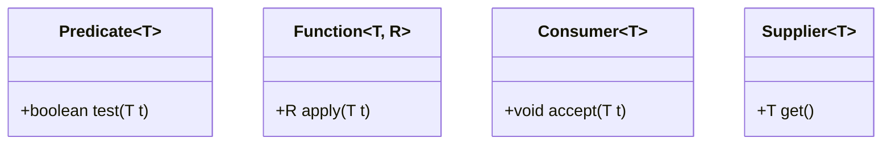
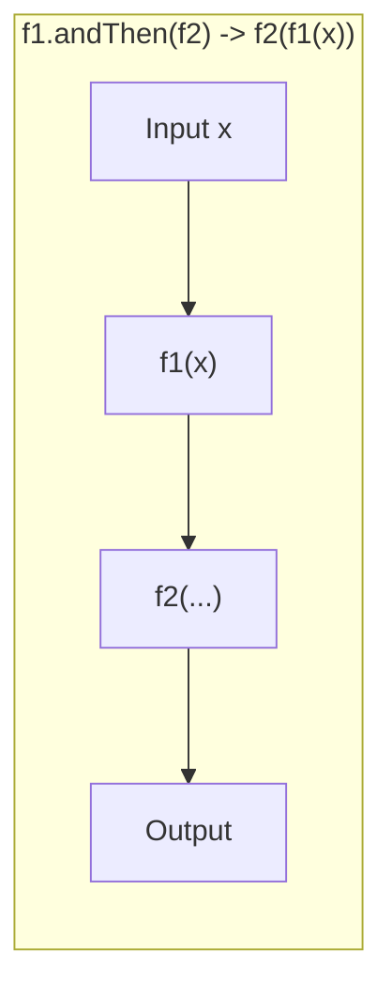
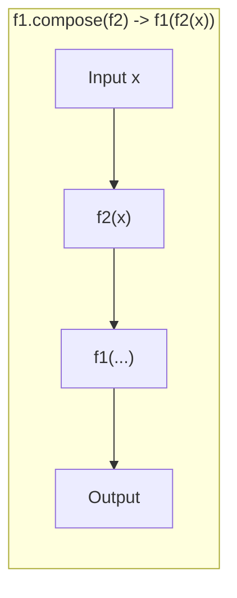

← [Back to Index](../README.md)

# Functional Interfaces in Java

An in-depth, interview-ready guide covering the foundations of functional programming in Java: the Single Abstract Method (SAM) contract, the `@FunctionalInterface` annotation, built-in functional interfaces, composition, method references, and low-level JVM mechanics.

---

## Table of Contents
1. [Core Concept & The SAM Contract](#1-core-concept--the-sam-contract)
   - [What is a Functional Interface?](#what-is-a-functional-interface)
   - [The `@FunctionalInterface` Annotation](#the-functionalinterface-annotation)
   - [The `java.lang.Object` Method Exemption](#the-javalangobject-method-exemption)
   - [Default and Static Methods in Functional Interfaces](#default-and-static-methods-in-functional-interfaces)
2. [Built-in Functional Interfaces (`java.util.function`)](#2-built-in-functional-interfaces-javautilfunction)
   - [Core Four: Predicate, Function, Consumer, Supplier](#core-four-predicate-function-consumer-supplier)
   - [Two-Arity Variants: BiPredicate, BiFunction, BiConsumer](#two-arity-variants-bipredicate-bifunction-biconsumer)
   - [Operators: UnaryOperator & BinaryOperator](#operators-unaryoperator--binaryoperator)
   - [Primitive Specializations (Avoiding Autoboxing Overhead)](#primitive-specializations-avoiding-autoboxing-overhead)
   - [Summary Reference Matrix](#summary-reference-matrix)
3. [Function Composition & Chaining](#3-function-composition--chaining)
   - [`Function.andThen()` vs `Function.compose()`](#functionandthen-vs-functioncompose)
   - [Composing Predicates (`and`, `or`, `negate`)](#composing-predicates-and-or-negate)
   - [Chaining Consumers (`andThen`)](#chaining-consumers-andthen)
4. [Custom Functional Interfaces](#4-custom-functional-interfaces)
   - [Designing Generic Interfaces](#designing-generic-interfaces)
   - [Handling Checked Exceptions in Lambdas](#handling-checked-exceptions-in-lambdas)
5. [Lambdas vs Anonymous Inner Classes: JVM Internals](#5-lambdas-vs-anonymous-inner-classes-jvm-internals)
   - [Bytecode Comparison: `invokedynamic` vs `new`](#bytecode-comparison-invokedynamic-vs-new)
   - [Scope of `this` and Lexical Scoping](#scope-of-this-and-lexical-scoping)
6. [Method References Deep Dive](#6-method-references-deep-dive)
7. [Common Interview Questions & Gotchas](#7-common-interview-questions--gotchas)

---

## 1. Core Concept & The SAM Contract

### What is a Functional Interface?
A **functional interface** is an interface that declares **exactly one abstract method**. Because it contains only one abstract method, it represents a single, unambiguous contract, commonly known as a **SAM (Single Abstract Method)** type.

Any instance of a functional interface can be instantiated using a **lambda expression**, a **method reference**, or an anonymous class.

### The `@FunctionalInterface` Annotation
- It is an **informative annotation** introduced in Java 8.
- It triggers a **compile-time check** ensuring the annotated interface adheres strictly to the SAM rule.
- If an interface has zero abstract methods or more than one abstract method, the compiler flags an error: `Unexpected @FunctionalInterface annotation`.
- **Note:** An interface with exactly one abstract method is a functional interface *even if it lacks the `@FunctionalInterface` annotation*. However, omitting the annotation risks accidental breakage if another developer adds an abstract method later.

```java
@FunctionalInterface
public interface Transformer<T, R> {
    R transform(T input); // Exactly one abstract method
}
```

### The `java.lang.Object` Method Exemption
An interface method does **not** count toward the SAM limit if it overrides any public method of `java.lang.Object` (such as `equals`, `hashCode`, or `toString`).

```java
@FunctionalInterface
public interface CustomComparator<T> {
    // 1. Single Abstract Method
    int compare(T o1, T o2);

    // 2. Overriding public method from java.lang.Object (DOES NOT count toward SAM)
    @Override
    boolean equals(Object obj);

    @Override
    String toString();
}
```
> **Why?** Any implementation of the interface will automatically inherit default implementations of `equals()`, `hashCode()`, and `toString()` from `java.lang.Object`. Hence, they never need to be supplied by the lambda expression.

### Default and Static Methods in Functional Interfaces
A functional interface may contain **any number of `default` or `static` methods** without violating the SAM rule.

```java
@FunctionalInterface
public interface Validator<T> {
    // The single abstract method
    boolean validate(T item);

    // Default method - does not count toward SAM
    default Validator<T> and(Validator<T> other) {
        return item -> this.validate(item) && other.validate(item);
    }

    // Static helper method - does not count toward SAM
    static <T> Validator<T> alwaysValid() {
        return item -> true;
    }
}
```

---

## 2. Built-in Functional Interfaces (`java.util.function`)

Java 8 provides 43 built-in functional interfaces in the `java.util.function` package. They cover almost all standard functional programming use cases.

### Core Four: Predicate, Function, Consumer, Supplier



#### 1. `Predicate<T>`: Evaluates a condition
- **SAM:** `boolean test(T t)`
- **Input:** One argument of type `T`
- **Output:** `boolean`
- **Typical Use:** Filtering collections (`Stream.filter`).

```java
Predicate<String> isEmailValid = email -> email != null && email.contains("@");
boolean isValid = isEmailValid.test("dev@example.com"); // true
```

#### 2. `Function<T, R>`: Transforms an input to an output
- **SAM:** `R apply(T t)`
- **Input:** Type `T`
- **Output:** Type `R` (may be distinct or the same)
- **Typical Use:** Mapping elements (`Stream.map`).

```java
Function<String, Integer> stringLength = String::length;
Integer len = stringLength.apply("Microservices"); // 13
```

#### 3. `Consumer<T>`: Accepts input and performs side-effects
- **SAM:** `void accept(T t)`
- **Input:** Type `T`
- **Output:** `void` (no return value)
- **Typical Use:** Printing, logging, mutating external state (`Stream.forEach`).

```java
Consumer<String> logger = msg -> System.out.println("[INFO] " + msg);
logger.accept("Application booted successfully");
```

#### 4. `Supplier<T>`: Produces a value without input
- **SAM:** `T get()`
- **Input:** None
- **Output:** Type `T`
- **Typical Use:** Factory methods, lazy initialization, `Optional.orElseGet()`.

```java
Supplier<Double> randomScore = Math::random;
Double score = randomScore.get();
```

---

### Two-Arity Variants: BiPredicate, BiFunction, BiConsumer

When operations require **two inputs**:

| Interface | Method Signature | Use Case Example |
| :--- | :--- | :--- |
| `BiPredicate<T, U>` | `boolean test(T t, U u)` | Comparing two objects: `(str, len) -> str.length() == len` |
| `BiFunction<T, U, R>` | `R apply(T t, U u)` | Merging maps: `(oldVal, newVal) -> oldVal + newVal` |
| `BiConsumer<T, U>` | `void accept(T t, U u)` | Iterating maps: `map.forEach((k, v) -> ...)` |

```java
BiFunction<String, Integer, String> repeatFunction = (str, count) -> str.repeat(count);
String repeated = repeatFunction.apply("Java", 3); // "JavaJavaJava"

BiConsumer<String, Integer> printMapEntry = (k, v) -> System.out.println(k + " -> " + v);
Map.of("A", 1, "B", 2).forEach(printMapEntry);
```

---

### Operators: UnaryOperator & BinaryOperator

Operators are special cases of `Function` where **the argument types and return type are identical**.

#### `UnaryOperator<T>` (extends `Function<T, T>`)
- **SAM:** `T apply(T t)`
```java
UnaryOperator<String> toTrimmedUpper = s -> s.trim().toUpperCase();
String result = toTrimmedUpper.apply("   clean architecture   "); // "CLEAN ARCHITECTURE"
```

#### `BinaryOperator<T>` (extends `BiFunction<T, T, T>`)
- **SAM:** `T apply(T t1, T t2)`
- **Typical Use:** `Stream.reduce()`, calculating min/max.
```java
BinaryOperator<Integer> sum = (a, b) -> a + b;
Integer total = Stream.of(1, 2, 3, 4).reduce(0, sum); // 10

// Built-in comparator helpers:
BinaryOperator<Employee> topEarner = BinaryOperator.maxBy(Comparator.comparing(Employee::getSalary));
```

---

### Primitive Specializations (Avoiding Autoboxing Overhead)

Using `Function<Integer, Integer>` causes boxing from primitive `int` to `Integer` on entry and unboxing back on exit, creating unnecessary heap garbage. Java provides primitive specializations to eliminate boxing:

- **Predicates:** `IntPredicate`, `LongPredicate`, `DoublePredicate`
- **Consumers:** `IntConsumer`, `LongConsumer`, `DoubleConsumer`
- **Suppliers:** `IntSupplier`, `LongSupplier`, `DoubleSupplier`, `BooleanSupplier`
- **Functions:**
  - Primitive to Object: `IntFunction<R>`, `LongFunction<R>`, `DoubleFunction<R>`
  - Object to Primitive: `ToIntFunction<T>`, `ToLongFunction<T>`, `ToDoubleFunction<T>`
  - Primitive to Primitive: `IntToLongFunction`, `IntToDoubleFunction`, etc.

```java
// Anti-pattern: 1,000,000 Integer wrapper objects created on the heap
Function<Integer, Integer> boxedSquare = x -> x * x;

// Optimized pattern: Zero allocation, operates purely on CPU registers / stack
IntUnaryOperator primitiveSquare = x -> x * x;
int res = primitiveSquare.applyAsInt(15);
```

---

### Summary Reference Matrix

| Functional Interface | Arity | SAM Signature | Extends / Subtype of |
| :--- | :--- | :--- | :--- |
| `Predicate<T>` | 1 | `boolean test(T t)` | Independent |
| `BiPredicate<T, U>` | 2 | `boolean test(T t, U u)` | Independent |
| `Function<T, R>` | 1 | `R apply(T t)` | Independent |
| `BiFunction<T, U, R>`| 2 | `R apply(T t, U u)` | Independent |
| `UnaryOperator<T>` | 1 | `T apply(T t)` | `Function<T, T>` |
| `BinaryOperator<T>` | 2 | `T apply(T t1, T t2)` | `BiFunction<T, T, T>` |
| `Consumer<T>` | 1 | `void accept(T t)` | Independent |
| `BiConsumer<T, U>` | 2 | `void accept(T t, U u)` | Independent |
| `Supplier<T>` | 0 | `T get()` | Independent |
| `Runnable` | 0 | `void run()` | (From `java.lang`) |
| `Callable<V>` | 0 | `V call() throws Exception` | (From `java.util.concurrent`) |

---

## 3. Function Composition & Chaining

### `Function.andThen()` vs `Function.compose()`

This is one of the most common interview screening questions.





- **`f1.andThen(f2)`**: Executes `f1` **first**, then passes the result into `f2`.
  $$\text{Result} = f_2(f_1(x))$$
- **`f1.compose(f2)`**: Executes `f2` **first**, then passes the result into `f1`.
  $$\text{Result} = f_1(f_2(x))$$

```java
Function<Integer, Integer> multiplyBy2 = x -> x * 2;
Function<Integer, Integer> add3 = x -> x + 3;

// andThen: (5 * 2) + 3 = 10 + 3 = 13
int andThenResult = multiplyBy2.andThen(add3).apply(5);
System.out.println("andThen: " + andThenResult); // 13

// compose: (5 + 3) * 2 = 8 * 2 = 16
int composeResult = multiplyBy2.compose(add3).apply(5);
System.out.println("compose: " + composeResult); // 16
```

### Composing Predicates (`and`, `or`, `negate`)

```java
Predicate<String> isLongerThan5 = s -> s != null && s.length() > 5;
Predicate<String> containsLetterA = s -> s != null && s.contains("a");

// Combined predicates:
Predicate<String> isValid = isLongerThan5.and(containsLetterA);
Predicate<String> isInvalid = isValid.negate();
Predicate<String> satisfiesEither = isLongerThan5.or(containsLetterA);

System.out.println(isValid.test("banana")); // true (length 6, contains 'a')
System.out.println(isValid.test("apple"));  // false (fails length check)
```

### Chaining Consumers (`andThen`)
```java
Consumer<String> writeToConsole = msg -> System.out.println("Console: " + msg);
Consumer<String> writeToAuditLog = msg -> System.out.println("Audit: " + msg);

// Chain multiple side effects sequentially
Consumer<String> pipeline = writeToConsole.andThen(writeToAuditLog);
pipeline.accept("Order #9481 Placed");
```

---

## 4. Custom Functional Interfaces

### Designing Generic Interfaces
When domain logic requires a specific contract (e.g., three arguments or custom semantic naming):

```java
@FunctionalInterface
public interface TriFunction<T, U, V, R> {
    R apply(T t, U u, V v);

    default <K> TriFunction<T, U, V, K> andThen(Function<? super R, ? extends K> after) {
        Objects.requireNonNull(after);
        return (T t, U u, V v) -> after.apply(this.apply(t, u, v));
    }
}

// Usage:
TriFunction<String, Integer, Double, String> formatter = 
    (name, count, price) -> String.format("%s bought %d items for $%.2f", name, count, price);

String message = formatter.apply("Alice", 3, 49.99);
```

### Handling Checked Exceptions in Lambdas

Standard functional interfaces (`Function`, `Consumer`, etc.) **do not declare checked exceptions** on their SAM. Passing a method that throws a checked exception results in compilation errors.

#### The Clean Solution: Throwing Wrapper Utility
```java
@FunctionalInterface
public interface ThrowingFunction<T, R, E extends Exception> {
    R apply(T t) throws E;
}

public class LambdaExceptionUtils {
    // Adapter that wraps checked exceptions into RuntimeExceptions
    public static <T, R> Function<T, R> uncheck(ThrowingFunction<T, R, Exception> throwingFunction) {
        return i -> {
            try {
                return throwingFunction.apply(i);
            } catch (Exception e) {
                throw new RuntimeException(e);
            }
        };
    }
}

// Usage in a Stream pipeline:
List<String> filePaths = List.of("file1.txt", "file2.txt");

// Without wrapper: Files.readString throws IOException -> compilation error
// With wrapper: Clean, readable stream pipeline
List<String> contents = filePaths.stream()
    .map(LambdaExceptionUtils.uncheck(path -> Files.readString(Path.of(path))))
    .collect(Collectors.toList());
```

---

## 5. Lambdas vs Anonymous Inner Classes: JVM Internals

A very common senior backend interview question tests how lambdas actually run on the HotSpot JVM.

### Bytecode Comparison: `invokedynamic` vs `new`

```java
public class LambdaDemo {
    public static void main(String[] args) {
        Runnable r1 = new Runnable() {
            @Override public void run() { System.out.println("Inner"); }
        };
        Runnable r2 = () -> System.out.println("Lambda");
    }
}
```

When inspecting with `javap -c -p LambdaDemo`:
1. **Anonymous Inner Class:**
   ```bytecode
   new           #2   // class LambdaDemo$1
   dup
   invokespecial #3   // Method LambdaDemo$1."<init>":()V
   ```
   *Creates a physical class file `LambdaDemo$1.class` on disk and loads it into Metaspace.*

2. **Lambda Expression:**
   ```bytecode
   invokedynamic #4, 0 // InvokeDynamic #0:run:()Ljava/lang/Runnable;
   ```
   *Does **not** generate a separate `.class` file at compile time.*

#### What happens during `invokedynamic`?
1. On first execution, the JVM invokes the bootstrap method: `java.lang.invoke.LambdaMetafactory.metafactory(...)`.
2. `LambdaMetafactory` dynamically spins an inner class in memory (via JVM ASM bytecode generation).
3. The generated call site is linked directly into a `MethodHandle`.
4. Subsequent calls execute with almost **zero overhead** and can be aggressively inlined by the JIT compiler.

### Scope of `this` and Lexical Scoping
- In an **anonymous inner class**, `this` refers to the **instance of the anonymous class**.
- In a **lambda expression**, `this` refers to the **enclosing class instance** (lexical scope). A lambda has no `this` of its own.

```java
public class ScopeTest {
    private String name = "EnclosingScope";

    public void test() {
        Runnable anon = new Runnable() {
            String name = "AnonymousScope";
            @Override
            public void run() {
                System.out.println(this.name); // Prints "AnonymousScope"
            }
        };

        Runnable lambda = () -> {
            // "this" resolves lexically to the enclosing ScopeTest instance
            System.out.println(this.name); // Prints "EnclosingScope"
        };
        
        anon.run();
        lambda.run();
    }
}
```

---

## 6. Method References Deep Dive

Method references are syntactical shortcuts for lambdas that do nothing other than invoke an existing method.

```java
public class MethodRefCatalog {
    // 1. Static Method Reference
    // Lambda: (str) -> Integer.parseInt(str)
    Function<String, Integer> parser = Integer::parseInt;

    // 2. Bound Instance Method Reference (on an existing object)
    // Lambda: (msg) -> System.out.println(msg)
    PrintStream out = System.out;
    Consumer<String> boundPrinter = out::println;

    // 3. Unbound Instance Method Reference (on arbitrary object of a given type)
    // The first parameter becomes the receiver of the method call!
    // Lambda: (str) -> str.toLowerCase()
    Function<String, String> unboundLower = String::toLowerCase;
    // Lambda: (str1, str2) -> str1.compareToIgnoreCase(str2)
    Comparator<String> comp = String::compareToIgnoreCase;

    // 4. Constructor Reference
    // Lambda: () -> new ArrayList<>()
    Supplier<List<String>> listFactory = ArrayList::new;
    // Lambda: (capacity) -> new ArrayList<>(capacity)
    Function<Integer, List<String>> sizedListFactory = ArrayList::new;
    // Array Constructor: (size) -> new int[size]
    IntFunction<int[]> arrayFactory = int[]::new;
}
```

---

## 7. Common Interview Questions & Gotchas

### Q1: Why must local variables used in lambdas be final or effectively final?
**Answer:**
Because local variables live in the thread's **stack frame**. Lambdas can escape the thread or survive beyond the enclosing method's execution (e.g., passed to an executor service or returned as a function). If the lambda accessed the actual stack variable, it would read deallocated memory once the method returns.

Java solves this by making a **copy (capture)** of the variable's value inside the lambda instance. If the original local variable were allowed to change, the local variable and the copied value would become desynchronized, leading to subtle concurrency bugs. Marking them effectively final guarantees consistency.

### Q2: Can a functional interface extend another interface?
**Answer:**
Yes, as long as the resulting child interface has **at most one abstract method**.
- If parent interface `A` has `void run()`, child interface `B` can extend `A` without declaring any new abstract methods, and `B` remains a valid functional interface.
- If child interface `B` adds another abstract method `void stop()`, `B` now has two abstract methods and is **no longer a functional interface** (it will fail `@FunctionalInterface` compilation).

### Q3: Does `@FunctionalInterface` have any effect on runtime performance?
**Answer:**
No. It has `RetentionPolicy.RUNTIME`, but it is primarily a **compiler directive**. It does not alter bytecode generation or runtime speed; its purpose is ensuring early build-time detection of accidental contract breaks.

### Q4: What is the difference between `BiFunction<T, U, R>` and `BinaryOperator<T>`?
**Answer:**
`BinaryOperator<T>` is a subtype of `BiFunction<T, T, T>`.
- In `BiFunction<T, U, R>`, the two inputs and the output can all be of completely different types (e.g., `(String, Integer) -> Double`).
- In `BinaryOperator<T>`, both inputs and the return value **must be of the exact same type** `T` (e.g., `(Double, Double) -> Double`).

### Q5: Can a lambda mutate an object's state?
**Answer:**
Yes. The "effectively final" rule applies to the **reference variable**, not to the internal state of the referenced object:
```java
final List<String> list = new ArrayList<>();
Runnable r = () -> list.add("Item"); // Perfectly legal! Reference 'list' never reassigned.
// list = new LinkedList<>(); // Illegal: breaks effectively final condition.
```
*(However, mutating shared state inside parallel streams breaks idempotency and introduces race conditions).*
