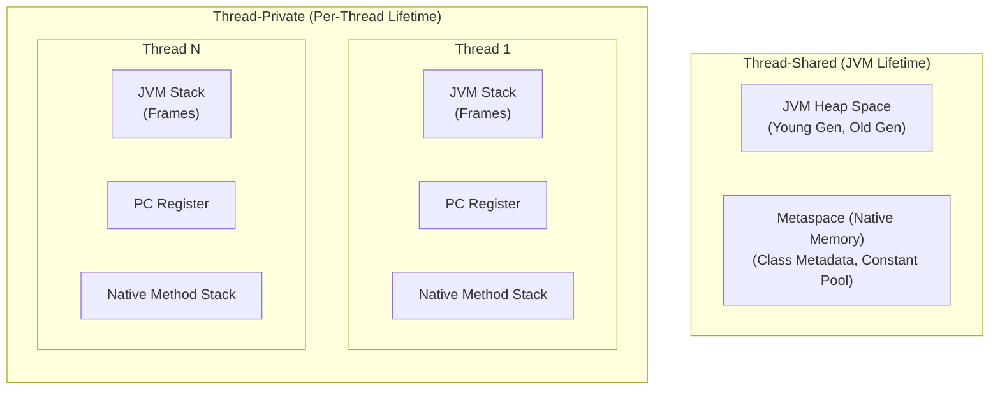
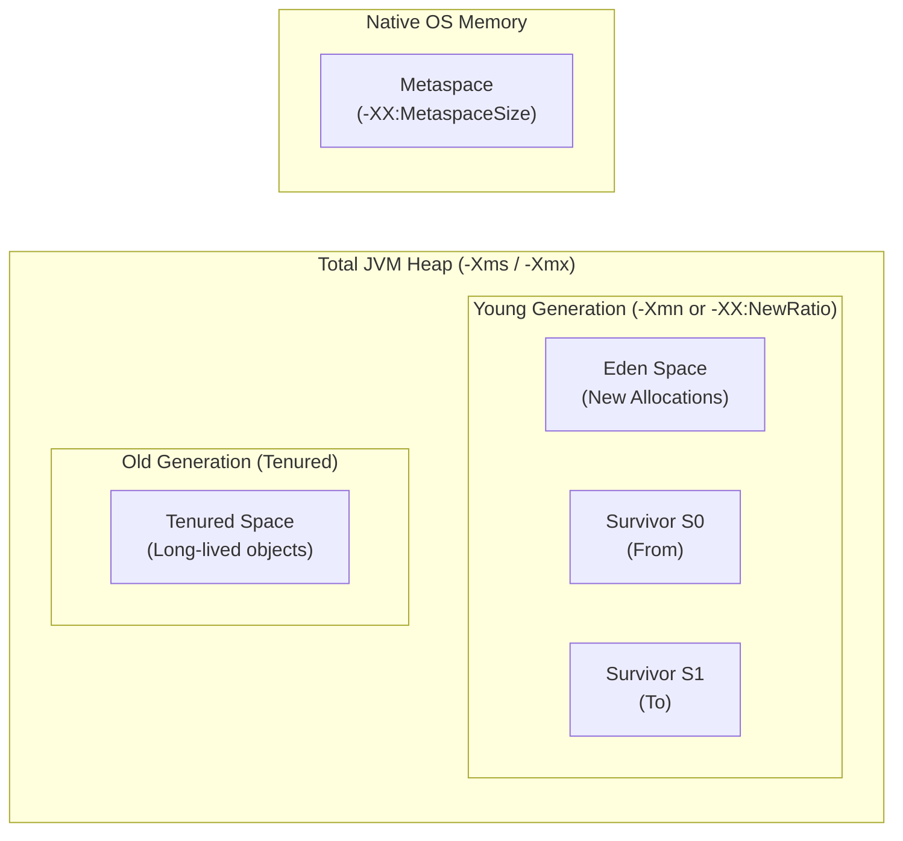
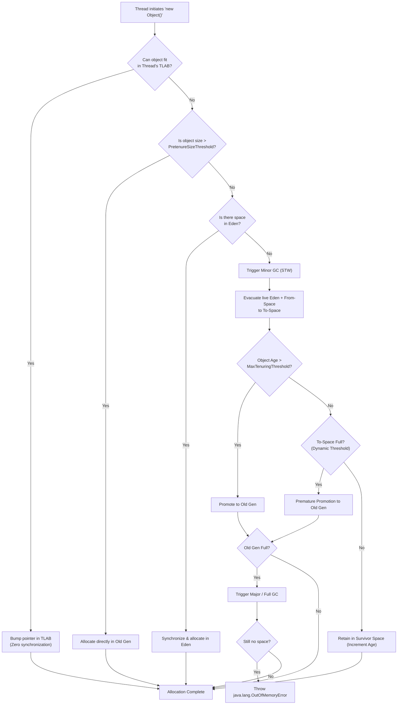

← [Back to Index](../README.md)

# JVM Heap Space Architecture & Memory Management

A comprehensive, production-grade guide to JVM memory organization, Heap generational layout, Stack vs Heap mechanics, Metaspace, memory allocation lifecycles, JVM flags, OutOfMemoryError diagnostics, and monitoring tools.

---

## Table of Contents
1. [JVM Runtime Data Areas Overview](#1-jvm-runtime-data-areas-overview)
2. [Stack vs Heap: Deep Architectural Comparison](#2-stack-vs-heap-deep-architectural-comparison)
3. [JVM Heap Architecture & Generations](#3-jvm-heap-architecture--generations)
   - [Young Generation (Eden, S0, S1)](#young-generation-eden-s0-s1)
   - [Thread-Local Allocation Buffers (TLAB)](#thread-local-allocation-buffers-tlab)
   - [Old Generation (Tenured Space)](#old-generation-tenured-space)
   - [Metaspace (Replacing PermGen in Java 8)](#metaspace-replacing-permgen-in-java-8)
4. [End-to-End Memory Allocation Flow](#4-end-to-end-memory-allocation-flow)
5. [Garbage Collection Across Regions](#5-garbage-collection-across-regions)
   - [Minor GC vs Major GC vs Full GC](#minor-gc-vs-major-gc-vs-full-gc)
6. [Essential JVM Memory Tuning Flags](#6-essential-jvm-memory-tuning-flags)
7. [Common `OutOfMemoryError` (OOM) Types & Root Causes](#7-common-outofmemoryerror-oom-types--root-causes)
8. [JVM Memory Diagnostics & Monitoring Tooling](#8-jvm-memory-diagnostics--monitoring-tooling)
9. [Interview Questions & Gotchas](#9-interview-questions--gotchas)

---

## 1. JVM Runtime Data Areas Overview

The JVM defines several runtime data areas specified in the Java Virtual Machine Specification (JVM Spec). Some areas are created at JVM startup and shared across all threads, while others are per-thread.



| Memory Area | Shared / Private | Stored Content | Failure Error |
| :--- | :--- | :--- | :--- |
| **JVM Heap** | Shared | Object instances, arrays, string pool | `OutOfMemoryError: Java heap space` |
| **Metaspace** | Shared | Loaded class metadata, method bytecode, annotations | `OutOfMemoryError: Metaspace` |
| **JVM Stack** | Thread-Private | Stack frames (local variables, operand stack, return address) | `StackOverflowError` / `OOM` |
| **Program Counter (PC)** | Thread-Private | Memory address of currently executing JVM instruction | None |
| **Native Method Stack** | Thread-Private | C/C++ native state for JNI calls | `StackOverflowError` / `OOM` |

---

## 2. Stack vs Heap: Deep Architectural Comparison

| Characteristic | JVM Stack | JVM Heap |
| :--- | :--- | :--- |
| **Purpose** | Method execution context and call hierarchy | Global dynamic object storage |
| **Lifetime** | Tied to thread execution and method entry/return | Managed by Garbage Collector; decoupled from method calls |
| **Thread Safety** | Inherently thread-safe (isolated to its thread) | Not thread-safe; shared across threads (requires synchronization) |
| **Allocation Mechanism**| Fast LIFO pointer push/pop (CPU stack pointer) | Dynamic allocation via free-lists or bump-the-pointer (TLAB) |
| **Access Speed** | Extremely fast (frequently cached in CPU L1/L2 cache) | Slower (pointer indirection, potential cache misses) |
| **Size Configuration** | `-Xss` (e.g., `-Xss1m`, default 1024KB) | `-Xms` (min) and `-Xmx` (max) |
| **Failure Mode** | `java.lang.StackOverflowError` (deep recursion) | `java.lang.OutOfMemoryError: Java heap space` |

### Escape Analysis & Scalar Replacement
Can objects ever be allocated on the Stack instead of the Heap?
> **Answer:** Technically, yes! In HotSpot JVM, the C2 JIT compiler performs **Escape Analysis**. If an object allocated inside a method never escapes the method scope (not returned, not stored in fields, not passed to other threads), the JIT compiler can perform **Scalar Replacement**: it breaks the object into its constituent primitive fields and maps them directly into **CPU registers or the Stack frame**, completely bypassing heap allocation and GC overhead!

---

## 3. JVM Heap Architecture & Generations

The heap is logically divided into distinct generations to leverage the **Weak Generational Hypothesis** (most objects die young).



---

### Young Generation (Eden, S0, S1)

The Young Generation is where newly created objects are born and where high-churn garbage collection happens frequently.

1. **Eden Space**:
   - The initial landing zone for almost all new objects (`new MyObject()`).
   - Sized via `-XX:SurvivorRatio` (e.g., `-XX:SurvivorRatio=8` means Eden is 8 parts, S0 is 1 part, S1 is 1 part $\to$ Eden is 80% of Young Gen).
2. **Survivor Spaces (S0 / S1 or From / To)**:
   - Two equally-sized regions used for the **Mark-Copy algorithm**.
   - **One survivor space is always empty at any given time.**
   - When a Minor GC occurs:
     - Live objects in **Eden** and the active survivor space (e.g., **S0**) are copied into the inactive survivor space (**S1**).
     - Object ages are incremented by 1.
     - Eden and S0 are wiped clean.
     - S0 and S1 swap roles (S1 becomes "From", S0 becomes "To").

> [!NOTE]
> **Why are there two Survivor spaces instead of one?**
> To completely **eliminate memory fragmentation**. If there were only one survivor space, deleting dead objects and leaving survivors in place would riddle the space with holes (external fragmentation). By having two spaces, the JVM always copies live objects contiguously into the empty space, leaving a perfectly compacted block of memory without needing a separate compaction pass.

---

### Thread-Local Allocation Buffers (TLAB)

In high-concurrency applications, multiple threads simultaneously allocating objects in Eden would cause severe lock contention on the heap allocation pointer.
- **The Solution:** HotSpot assigns each thread its own small dedicated slice of Eden memory called a **Thread-Local Allocation Buffer (TLAB)**.
- **How it works:** When a thread executes `new`, it allocates inside its private TLAB using a simple, thread-safe, lock-free **bump-the-pointer** operation.
- Only when a thread exhausts its current TLAB does it synchronize with the global Eden allocator to acquire a new TLAB block.

---

### Old Generation (Tenured Space)

The Old Generation stores long-lived objects. Objects reach the Old Generation through:

1. **Aging via Max Tenuring Threshold**:
   - Every time an object survives a Minor GC cycle, its age header in the Mark Word increments.
   - When an object's age exceeds `-XX:MaxTenuringThreshold` (default is typically 15; in G1 it defaults to 15), it is promoted to the Old Generation.
2. **Dynamic Age Calculation**:
   - If the total size of objects of the same age in a Survivor space exceeds **50% of the Survivor space** (configurable via `-XX:TargetSurvivorRatio=50`), objects with that age or older are promoted to Old Gen immediately, even if they have not reached `MaxTenuringThreshold`.
3. **Pretenure / Direct Allocation**:
   - Very large objects (e.g., large byte arrays) can exceed Eden's capacity. To prevent triggering repeated premature Minor GCs, objects exceeding `-XX:PretenureSizeThreshold` bypass Young Gen completely and are allocated directly in Old Gen.

---

### Metaspace (Replacing PermGen in Java 8)

| Characteristic | PermGen (Java 7 and earlier) | Metaspace (Java 8+) |
| :--- | :--- | :--- |
| **Location** | Inside contiguous JVM Heap | Allocated from **Native OS Memory** |
| **Size Boundary** | Fixed default maximum (`-XX:MaxPermSize=82m`) | Unbounded by default (expands to available OS RAM) |
| **Crash Reason** | Constant `java.lang.OutOfMemoryError: PermGen space` | Rarely crashes unless bounded by `-XX:MaxMetaspaceSize` |
| **Garbage Collection** | Bound to Full GC cycles; complex compaction | Automated metadata deallocation upon ClassLoader unloads |
| **Stored Content** | Class metadata, interned Strings, static variables | Class metadata, method bytecodes, constant pool *(Interned Strings & static fields moved to Heap!)* |

---

## 4. End-to-End Memory Allocation Flow



---

## 5. Garbage Collection Across Regions

### Minor GC vs Major GC vs Full GC

| Type | Target Region | Trigger | Pause Time (STW) | Typical Frequency |
| :--- | :--- | :--- | :--- | :--- |
| **Minor GC (Young GC)** | Eden + S0/S1 | Eden fills up completely | Low (tens of ms) | High (frequently, e.g. every few seconds) |
| **Major GC** | Old Generation | Old Gen fills up past occupancy threshold | Moderate to High | Low |
| **Full GC** | Entire JVM (Young + Old + Metaspace) | Old Gen full, Metaspace full, or `System.gc()` invoked | Very High (seconds to minutes) | Very Rare (warning sign of memory issues) |
| **Mixed GC (G1 only)**| All Young regions + selected candidate Old regions | G1 IHOP reached (`InitiatingHeapOccupancyPercent`) | Controlled (tuned to target pause time) | Periodic under load |

---

## 6. Essential JVM Memory Tuning Flags

### Standard Production Template (8GB Container / Host)
```bash
java -server \
  -Xms4g \
  -Xmx4g \
  -XX:+AlwaysPreTouch \
  -XX:+UseG1GC \
  -XX:MaxGCPauseMillis=200 \
  -XX:InitiatingHeapOccupancyPercent=45 \
  -XX:MetaspaceSize=256m \
  -XX:MaxMetaspaceSize=512m \
  -XX:+HeapDumpOnOutOfMemoryError \
  -XX:HeapDumpPath=/var/log/app/heap_dump.hprof \
  -Xlog:gc*,gc+phases=info:file=/var/log/app/gc.log:time,uptime,pid:filecount=5,filesize=100M \
  -jar application.jar
```

### Detailed Flag Descriptions
- `-Xms4g -Xmx4g`: Sets initial and maximum heap size. **Best Practice:** Keep `-Xms` equal to `-Xmx` to prevent runtime heap expansion/contraction pauses.
- `-XX:+AlwaysPreTouch`: Pre-zeros all allocated heap pages at startup, eliminating runtime page faults during traffic spikes.
- `-XX:NewRatio=2`: 1 part Young Gen to 2 parts Old Gen (Young = 33.3%, Old = 66.7%).
- `-XX:SurvivorRatio=8`: Ratio of Eden to one Survivor space (Eden = 80%, S0 = 10%, S1 = 10%).
- `-XX:MaxTenuringThreshold=15`: Maximum GC survivals before promotion to Old Gen.
- `-XX:+UseCompressedOops`: Enables 32-bit compressed ordinary object pointers on 64-bit systems for heaps < 32GB (saves ~30% heap space).

---

## 7. Common `OutOfMemoryError` (OOM) Types & Root Causes

### 1. `java.lang.OutOfMemoryError: Java heap space`
- **Cause:** Application allocated more live objects than `-Xmx` can hold.
- **Common Triggers:** Unbounded static collections/caches, unclosed DB result sets streaming millions of records into memory, memory leaks.
- **Remediation:** Profile heap dump with Eclipse MAT; adjust `-Xmx`.

### 2. `java.lang.OutOfMemoryError: Metaspace`
- **Cause:** Too many classes loaded into native Metaspace.
- **Common Triggers:** Dynamic bytecode generators (CGLIB, ByteBuddy, dynamic proxies), excessive hot re-deployments in application servers (Tomcat classloader leaks).
- **Remediation:** Increase `-XX:MaxMetaspaceSize`; ensure custom classloaders are garbage collected.

### 3. `java.lang.OutOfMemoryError: GC overhead limit exceeded`
- **Cause:** The JVM spent **more than 98% of total CPU time doing GC**, and recovered **less than 2% of the heap**.
- **Meaning:** The heap is critically saturated. The JVM stops the application to prevent thrashing and freezing the host system.
- **Remediation:** The application is functionally out of heap space; treat as a heap leak.

### 4. `java.lang.OutOfMemoryError: Direct buffer memory`
- **Cause:** Off-heap direct memory exhausted (`ByteBuffer.allocateDirect()`).
- **Common Triggers:** Netty, NIO network buffers, or gRPC communication leaking pooled buffers.
- **Remediation:** Increase `-XX:MaxDirectMemorySize`; check for unreleased Netty `ByteBuf.release()` calls.

### 5. `java.lang.OutOfMemoryError: Unable to create new native thread`
- **Cause:** The OS cannot allocate another OS thread.
- **Common Triggers:** Unbounded thread creation (`new Thread(...)` instead of thread pools), OS kernel limits (`/proc/sys/kernel/threads-max` or `ulimit -u`), thread stack size (`-Xss`) consuming too much process virtual memory.
- **Remediation:** Use bounded `ThreadPoolExecutor`; reduce `-Xss` from default 1024k to 512k.

---

## 8. JVM Memory Diagnostics & Monitoring Tooling

### Essential CLI Diagnostic Commands

```bash
# 1. List all active Java processes with VM arguments
jps -v

# 2. Monitor GC statistics every 1000ms (1 second)
# Displays Eden (E), Survivor (S0, S1), Old (O), Metaspace (M) utilization % and GC count/time
jstat -gcutil <pid> 1000

# 3. Quick live object histogram (shows top classes consuming memory)
jmap -histo:live <pid> | head -n 25

# 4. Trigger an on-demand heap dump without killing the process
jcmd <pid> GC.heap_dump /tmp/manual_dump.hprof

# 5. Capture thread stack dump (diagnosing deadlocks / high thread count)
jstack -l <pid> > /tmp/thread_dump.txt
```

### Visual & Production APM Profilers
- **Eclipse Memory Analyzer Tool (MAT)**: The industry standard tool for inspecting `.hprof` heap dumps. Generates automated **Leak Suspects Reports** and analyzes the **Dominator Tree** to identify which object retained megabytes or gigabytes of memory.
- **JDK Flight Recorder (JFR) & JDK Mission Control (JMC)**: Low-overhead (<1% CPU) continuous production profiling built right into the JVM. Records allocations, lock contentions, and GC pauses.
- **JVisualVM / JConsole**: Interactive GUI bundled with the JDK for local development heap inspection and JMX metric monitoring.
- **async-profiler**: Low-overhead sampling profiler for Linux that creates flame graphs of CPU and heap memory allocations.

---

## 9. Interview Questions & Gotchas

### Q1: Why should `-Xms` and `-Xmx` typically be set to the same value in production?
**Answer:**
If `-Xms` is smaller than `-Xmx`, the JVM starts with a small heap and expands it dynamically as memory pressure increases. Heap resizing requires **Stop-The-World pauses** as the JVM requests virtual memory pages from the OS kernel and updates internal page tables. Setting `-Xms` equal to `-Xmx` pre-allocates the entire heap up front, preventing memory fluctuation pauses during production traffic spikes.

### Q2: What is the difference between Shallow Heap and Retained Heap in a memory dump?
**Answer:**
- **Shallow Heap**: The memory consumed by the object itself (its object header, primitive fields, and reference pointers). Does **not** include the memory of objects it points to.
- **Retained Heap**: The total memory that would be **freed if this object were garbage collected**. It equals the object's shallow heap plus the retained sizes of all objects exclusively reachable through it (its dominator tree subtree).

### Q3: What happens if an object's size is larger than the Survivor space?
**Answer:**
If an object surviving Eden cannot fit into the target Survivor space (`To-Space`), the JVM triggers **Evacuation Failure / Premature Promotion**. The object completely bypasses the survivor space and is promoted directly into the **Old Generation**. If premature promotions happen frequently, the Old Generation fills up rapidly, leading to frequent Major/Full GCs.

### Q4: How do you identify a memory leak in Java if the Garbage Collector is supposed to handle memory?
**Answer:**
A memory leak in Java is an **unintentional retention of references**: objects that the application no longer logically needs, but which remain reachable from active **GC Roots** (e.g., forgotten items in static Maps, unregistered event listeners, thread locals not cleared in thread pool threads).
- **Steps to diagnose:**
  1. Capture a heap dump (`jcmd <pid> GC.heap_dump`).
  2. Open the dump in **Eclipse MAT**.
  3. Inspect the **Dominator Tree** and calculate **Retained Sizes**.
  4. Trace the reference path from the suspect object up to its **GC Root** ("Path to GC Roots" $\to$ "Exclude Soft/Weak References").
  5. Locate where the holding reference is maintained in the application code and remove or nullify it.
