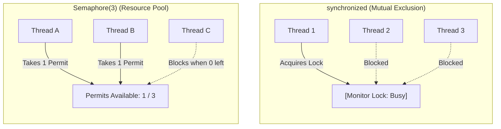

← [Back to Index](../README.md)

# `synchronized` vs `Semaphore` in Java

A comprehensive deep dive into Java concurrency primitives: intrinsic monitor locks (`synchronized`) versus permit-based concurrency (`Semaphore`), object headers, HotSpot lock optimizations, wait/notify semantics, and architectural design choices.

---

## Table of Contents
1. [Core Concepts Overview](#1-core-concepts-overview)
2. [Deep Dive: The `synchronized` Keyword](#2-deep-dive-the-synchronized-keyword)
   - [Method-Level vs Block-Level Synchronization](#method-level-vs-block-level-synchronization)
   - [Intrinsic Locks & The Object Header (Mark Word)](#intrinsic-locks--the-object-header-mark-word)
   - [Reentrant Nature of Intrinsic Locks](#reentrant-nature-of-intrinsic-locks)
   - [JVM Lock Escalation (Biased -> Lightweight -> Heavyweight)](#jvm-lock-escalation-biased---lightweight---heavyweight)
   - [Lock Coarsening & Lock Elision](#lock-coarsening--lock-elision)
   - [Coordinating Threads: `wait()`, `notify()`, and Spurious Wakeups](#coordinating-threads-wait-notify-and-spurious-wakeups)
3. [Deep Dive: `java.util.concurrent.Semaphore`](#3-deep-dive-javautilconcurrentsemaphore)
   - [Permit-Based Mechanism](#permit-based-mechanism)
   - [Counting Semaphore vs Binary Semaphore](#counting-semaphore-vs-binary-semaphore)
   - [Core API: `acquire()`, `tryAcquire()`, `release()`](#core-api-acquire-tryacquire-release)
   - [Fairness vs Non-Fairness Policies (AQS Internals)](#fairness-vs-non-fairness-policies-aqs-internals)
   - [Permit Management: Draining and Dynamic Sizing](#permit-management-draining-and-dynamic-sizing)
4. [Head-to-Head Comparison: `synchronized` vs `Semaphore` vs `ReentrantLock`](#4-head-to-head-comparison-synchronized-vs-semaphore-vs-reentrantlock)
5. [Production Code Examples](#5-production-code-examples)
   - [Example 1: Thread-Safe Bounded Blocking Queue (`synchronized` + `wait`/`notify`)](#example-1-thread-safe-bounded-blocking-queue-synchronized--waitnotify)
   - [Example 2: Rate-Limited Connection Pool (`Semaphore`)](#example-2-rate-limited-connection-pool-semaphore)
6. [Critical Interview Questions & Gotchas](#6-critical-interview-questions--gotchas)

---

## 1. Core Concepts Overview

In multithreaded Java applications, managing access to shared state requires synchronization primitives:
- **`synchronized`**: Built-in Java language keyword providing **mutual exclusion (mutex)**. Exactly **one** thread can hold the intrinsic lock at any moment. It is strictly **thread-bound**: the thread that acquires the lock must be the one that releases it.
- **`Semaphore`**: A concurrency utility in `java.util.concurrent` that manages a fixed set of **permits**. It allows **$N$ concurrent threads** to access a guarded resource simultaneously. It is **not thread-bound**: one thread can acquire a permit, and a completely different thread can release it.



---

## 2. Deep Dive: The `synchronized` Keyword

### Method-Level vs Block-Level Synchronization

Every object in Java has an associated **intrinsic lock** (also called a **monitor**).

```java
public class SynchronizationScopes {
    private final Object customLock = new Object();
    private static int globalCounter = 0;
    private int instanceCounter = 0;

    // 1. Instance Method: Locks on 'this' instance
    public synchronized void incrementInstance() {
        instanceCounter++;
    }

    // 2. Static Method: Locks on the Class object (SynchronizationScopes.class)
    public static synchronized void incrementGlobal() {
        globalCounter++;
    }

    // 3. Block-Level: Locks explicitly on a private object
    // BEST PRACTICE: Prevents outside callers from locking on 'this' and causing deadlocks
    public void executeCriticalSection() {
        // Non-critical operations run concurrently...
        synchronized (customLock) {
            // Critical section guarded by customLock
            instanceCounter += 10;
        }
    }
}
```

> [!TIP]
> **Prefer fine-grained block-level locking with private lock objects** (`private final Object lock = new Object();`). Locking on `this` exposes your monitor to external code, enabling external deadlocks if a client mistakenly synchronizes on your instance.

---

### Intrinsic Locks & The Object Header (Mark Word)

Every Java object in the JVM heap has an **Object Header** consisting of:
1. **Mark Word** (32 bits or 64 bits): Stores hash code, GC age, biased locking flags, and lock state pointers.
2. **Klass Pointer**: Pointer to the class metadata in Metaspace.

The 2 lowest bits of the Mark Word encode the lock state:

| Lock State | Low Bits | Mark Word Contents | Description |
| :--- | :--- | :--- | :--- |
| **Unlocked** | `01` | Hashcode + Age + Bias flag (`0`) | Default initial state |
| **Biased** | `01` | Thread ID + Epoch + Bias flag (`1`) | Locked by a single thread repeatedly |
| **Lightweight** | `00` | Pointer to Lock Record on thread stack | Spin-locking via CAS (no OS context switch) |
| **Heavyweight** | `10` | Pointer to native `ObjectMonitor` | Contended lock; threads sleep in OS wait queue |
| **Marked for GC** | `11` | GC metadata | Used during GC collection cycles |

---

### Reentrant Nature of Intrinsic Locks

Java locks are **reentrant**: if a thread already holds an intrinsic lock, it can enter any other code block protected by the *same* lock without deadlocking itself.

```java
public class ReentrantDemo {
    public synchronized void outer() {
        System.out.println("In outer");
        inner(); // Does NOT deadlock!
    }

    public synchronized void inner() {
        System.out.println("In inner");
    }
}
```

#### How JVM Tracks Reentrancy:
The JVM maintains a **recursion counter** inside the lock record or `ObjectMonitor`.
- On initial acquisition, the owner thread is set and counter = 1.
- Each time the owner thread re-enters, the counter increments.
- Each exit decrements the counter.
- When counter reaches 0, the lock is fully released for other threads.

---

### JVM Lock Escalation (Biased -> Lightweight -> Heavyweight)

To avoid expensive OS-level mutex context switches, HotSpot automatically escalates locks based on contention:


1. **Biased Lock**: The lock assumes only one thread will ever access it. It writes the thread's ID directly into the Mark Word using a single CAS. Subsequent accesses by the same thread require **no atomic instructions or memory barriers**. *(Note: Biased locking is deprecated in newer JVMs due to safepoint revoking costs).*
2. **Lightweight Lock**: When a second thread attempts to acquire the lock, bias is revoked. The thread uses **CAS (Compare-And-Swap)** to swap a pointer to its execution stack frame into the object's Mark Word. The thread spins in a short CPU loop, expecting the lock to be released promptly.
3. **Heavyweight Lock**: If spinning fails after a threshold (adaptive spinning), the lock inflates into an **OS-level Mutex (Heavyweight Lock)**. Contended threads are suspended (`pthread_mutex` or `park()`), yielding CPU cycles until signaled.

---

### Lock Coarsening & Lock Elision

The JIT compiler optimizes synchronized blocks automatically:
- **Lock Elision**: If escape analysis proves an object never escapes the allocating thread (e.g., local `StringBuffer` inside a method), the JIT compiler **removes the synchronization instructions entirely**.
- **Lock Coarsening**: If adjacent code blocks repeatedly acquire and release the same lock (e.g., inside a loop), the JIT combines them into a **single continuous lock block**, eliminating redundant lock/unlock roundtrips.

---

### Coordinating Threads: `wait()`, `notify()`, and Spurious Wakeups

`wait()`, `notify()`, and `notifyAll()` belong to `java.lang.Object`.

> [!IMPORTANT]
> A thread **MUST hold the monitor** before calling `wait()`, `notify()`, or `notifyAll()`. Calling them outside a synchronized block immediately throws `IllegalMonitorStateException`.

#### Spurious Wakeups & The `while` Loop Rule
Threads can wake up from `wait()` without any explicit `notify()` call due to OS-level signaling quirks (spurious wakeups) or race conditions where another thread consumed the state first.

```java
// ALWAYS use a while loop, NEVER an if check!
synchronized (lock) {
    while (!condition) {
        lock.wait(); // Releases lock and suspends thread
    }
    // Condition is verified true; proceed safely
}
```

---

## 3. Deep Dive: `java.util.concurrent.Semaphore`

### Permit-Based Mechanism
A `Semaphore` maintains an internal set of virtual **permits**:
- `acquire()`: Takes a permit. If no permit is available, the thread is blocked until one is released.
- `release()`: Returns a permit to the pool.
- Permits are simply an integer counter managed by `AbstractQueuedSynchronizer` (AQS). **No actual permit objects exist in memory.**

### Counting Semaphore vs Binary Semaphore
- **Binary Semaphore (`new Semaphore(1)`)**: Has at most 1 permit. Acts like a mutual exclusion lock (Mutex).
- **Counting Semaphore (`new Semaphore(N)`)**: Has $N$ permits. Guards a bounded resource pool allowing up to $N$ concurrent callers.

### Core API: `acquire()`, `tryAcquire()`, `release()`

```java
Semaphore semaphore = new Semaphore(3); // 3 permits

try {
    // 1. Blocking acquisition (interruptible)
    semaphore.acquire();

    // 2. Non-blocking attempt with timeout
    boolean acquired = semaphore.tryAcquire(500, TimeUnit.MILLISECONDS);
    if (!acquired) {
        System.out.println("Could not obtain resource, failing fast");
        return;
    }

    // Critical section accessing shared resource...
} catch (InterruptedException e) {
    Thread.currentThread().interrupt(); // Restore interrupt status
} finally {
    // ALWAYS release in a finally block!
    semaphore.release();
}
```

---

### Fairness vs Non-Fairness Policies (AQS Internals)

```java
Semaphore unfair = new Semaphore(5, false); // Default: Unfair
Semaphore fair = new Semaphore(5, true);    // Fair: Strict FIFO order
```

- **Unfair Mode (Default)**: Higher throughput. Threads attempting to `acquire()` can "barge" in front of queued threads if a permit was released right as they arrived. This saves thread park/unpark context switch costs.
- **Fair Mode**: Guarantees FIFO order via an AQS waiting queue. Eliminates thread starvation, but incurs a measurable throughput penalty due to frequent context switching.

---

### Permit Management: Draining and Dynamic Sizing

Unlike locks, permits can be adjusted dynamically:
```java
Semaphore sem = new Semaphore(10);

// Drain all remaining permits immediately (e.g., during graceful shutdown)
int remaining = sem.drainPermits(); // remaining = 10, sem has 0 left

// Calling release() increases total permits beyond initial capacity!
sem.release(5); // Now has 5 permits available
```

---

## 4. Head-to-Head Comparison: `synchronized` vs `Semaphore` vs `ReentrantLock`

| Feature | `synchronized` | `Semaphore` | `ReentrantLock` |
| :--- | :--- | :--- | :--- |
| **Core Purpose** | Mutual exclusion (1 thread) | Bounded concurrency ($N$ permits) | Mutual exclusion (1 thread) with advanced features |
| **Lock Ownership** | Yes (Thread-bound) | **No ownership** (Any thread can release) | Yes (Thread-bound) |
| **Reentrancy** | Yes (Built-in) | **No** (Calling `acquire()` again blocks if 0 permits) | Yes |
| **Timed Try-Acquire** | No (Blocks indefinitely) | Yes (`tryAcquire(timeout)`) | Yes (`tryLock(timeout)`) |
| **Interruptible** | No (Cannot interrupt thread blocked on monitor) | Yes (`acquire()`) | Yes (`lockInterruptibly()`) |
| **Fairness Control** | No (Managed by OS scheduler) | Yes (`new Semaphore(n, true)`) | Yes (`new ReentrantLock(true)`) |
| **Coordination** | `wait()`, `notify()`, `notifyAll()` | Permits (`acquire()`, `release()`) | `Condition` (`await()`, `signal()`) |
| **Implementation** | JVM C++ internals (`ObjectMonitor`) | Java AQS (`AbstractQueuedSynchronizer`) | Java AQS (`AbstractQueuedSynchronizer`) |

---

## 5. Production Code Examples

### Example 1: Thread-Safe Bounded Blocking Queue (`synchronized` + `wait`/`notify`)

```java
import java.util.LinkedList;
import java.util.Queue;

public class BoundedBlockingQueue<T> {
    private final Queue<T> queue = new LinkedList<>();
    private final int capacity;
    private final Object lock = new Object();

    public BoundedBlockingQueue(int capacity) {
        if (capacity <= 0) throw new IllegalArgumentException("Capacity must be positive");
        this.capacity = capacity;
    }

    public void put(T item) throws InterruptedException {
        synchronized (lock) {
            // Guard with while to handle spurious wakeups
            while (queue.size() == capacity) {
                lock.wait(); // Releases lock until signaled that space freed up
            }
            queue.add(item);
            // Notify any consumers waiting for data
            lock.notifyAll();
        }
    }

    public T take() throws InterruptedException {
        synchronized (lock) {
            while (queue.isEmpty()) {
                lock.wait(); // Releases lock until signaled that item was added
            }
            T item = queue.poll();
            // Notify any producers waiting for empty capacity
            lock.notifyAll();
            return item;
        }
    }
}
```

---

### Example 2: Rate-Limited Connection Pool (`Semaphore`)

```java
import java.util.concurrent.Semaphore;
import java.util.concurrent.TimeUnit;
import java.util.ArrayList;
import java.util.List;

public class ConnectionPool {
    private final int poolSize;
    private final List<DatabaseConnection> connections;
    private final boolean[] used;
    private final Semaphore semaphore;

    public ConnectionPool(int poolSize) {
        this.poolSize = poolSize;
        this.connections = new ArrayList<>(poolSize);
        this.used = new boolean[poolSize];
        this.semaphore = new Semaphore(poolSize, true); // Fair queueing

        for (int i = 0; i < poolSize; i++) {
            connections.add(new DatabaseConnection("Conn-" + i));
        }
    }

    public DatabaseConnection acquireConnection(long timeoutMillis) throws Exception {
        boolean acquired = semaphore.tryAcquire(timeoutMillis, TimeUnit.MILLISECONDS);
        if (!acquired) {
            throw new RuntimeException("Connection pool exhausted. Request timed out.");
        }
        return getNextAvailableConnection();
    }

    public void releaseConnection(DatabaseConnection connection) {
        if (markAsUnused(connection)) {
            semaphore.release(); // Return permit to the pool
        }
    }

    private synchronized DatabaseConnection getNextAvailableConnection() {
        for (int i = 0; i < poolSize; i++) {
            if (!used[i]) {
                used[i] = true;
                return connections.get(i);
            }
        }
        return null;
    }

    private synchronized boolean markAsUnused(DatabaseConnection connection) {
        int index = connections.indexOf(connection);
        if (index != -1 && used[index]) {
            used[index] = false;
            return true;
        }
        return false;
    }

    public static class DatabaseConnection {
        private final String id;
        public DatabaseConnection(String id) { this.id = id; }
        public String getId() { return id; }
    }
}
```

---

## 6. Critical Interview Questions & Gotchas

### Q1: Can a thread release a Semaphore without acquiring it first?
**Answer:**
**Yes!** Semaphores have **no concept of ownership**. Any thread can invoke `release()` on a semaphore. 
- In fact, this capability is frequently leveraged in **Producer-Consumer signaling**: Thread A produces an item and calls `semaphore.release()`, while Thread B consumes the item after calling `semaphore.acquire()`.
- **The Gotcha:** If you accidentally call `semaphore.release()` more times than intended, the permit count will grow indefinitely beyond the initial constructor value.

In contrast, if a thread calls `lock.unlock()` or `object.wait()` without holding the intrinsic monitor, the JVM throws an immediate `IllegalMonitorStateException`.

### Q2: What causes `IllegalMonitorStateException`?
**Answer:**
Invoking `wait()`, `notify()`, or `notifyAll()` on an object without holding that specific object's intrinsic lock.
```java
Object lockA = new Object();
Object lockB = new Object();

synchronized (lockA) {
    lockB.wait(); // Throws IllegalMonitorStateException! (Locked lockA, but waited on lockB)
}
```

### Q3: Why is `notifyAll()` preferred over `notify()`?
**Answer:**
`notify()` awakens a single arbitrary thread from the object's wait set. If multiple threads are waiting for different conditions (e.g., both producers waiting for buffer-not-full and consumers waiting for buffer-not-empty on the same monitor), `notify()` might awaken a producer when only space for a consumer opened up. That awakened producer checks its condition, sees it cannot proceed, and goes back to sleep, resulting in **lost signals and deadlocks**. `notifyAll()` guarantees all waiting threads re-check their respective conditions.

### Q4: Can a binary `Semaphore(1)` be used as a direct replacement for `synchronized`?
**Answer:**
Not unconditionally:
1. **Reentrancy**: A binary semaphore is **not reentrant**. If a thread holding the permit calls a method that attempts to acquire the same semaphore again, it deadlocks itself permanently.
2. **Exception Safety**: `synchronized` automatically releases the intrinsic lock when an unhandled exception or error unwinds the stack. A semaphore requires meticulous wrapping in `try-finally` blocks; an uncaught exception skipping `release()` leaks permits permanently.

### Q5: Can a thread blocked on a `synchronized` block be interrupted?
**Answer:**
**No.** A thread waiting to enter a `synchronized` block enters the `BLOCKED` state. In this state, it is completely immune to `Thread.interrupt()` and will wait indefinitely until the monitor becomes free.

If interruptible lock acquisition or timed timeouts are required, use `ReentrantLock.lockInterruptibly()` or `Semaphore.tryAcquire()`.
