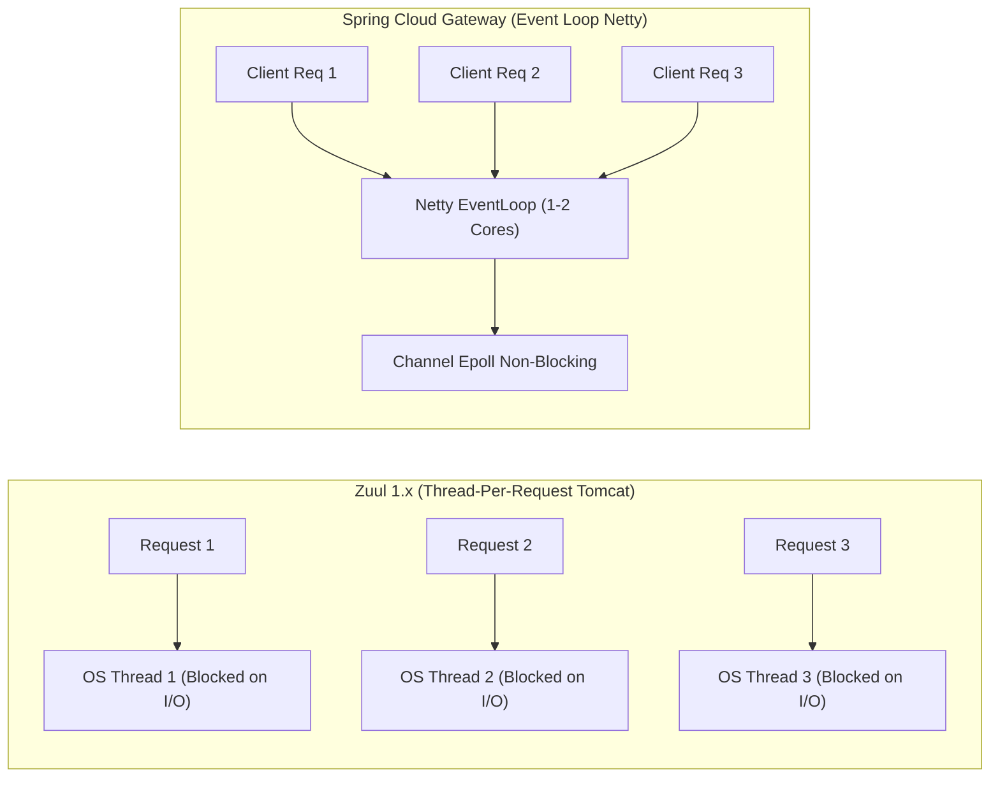
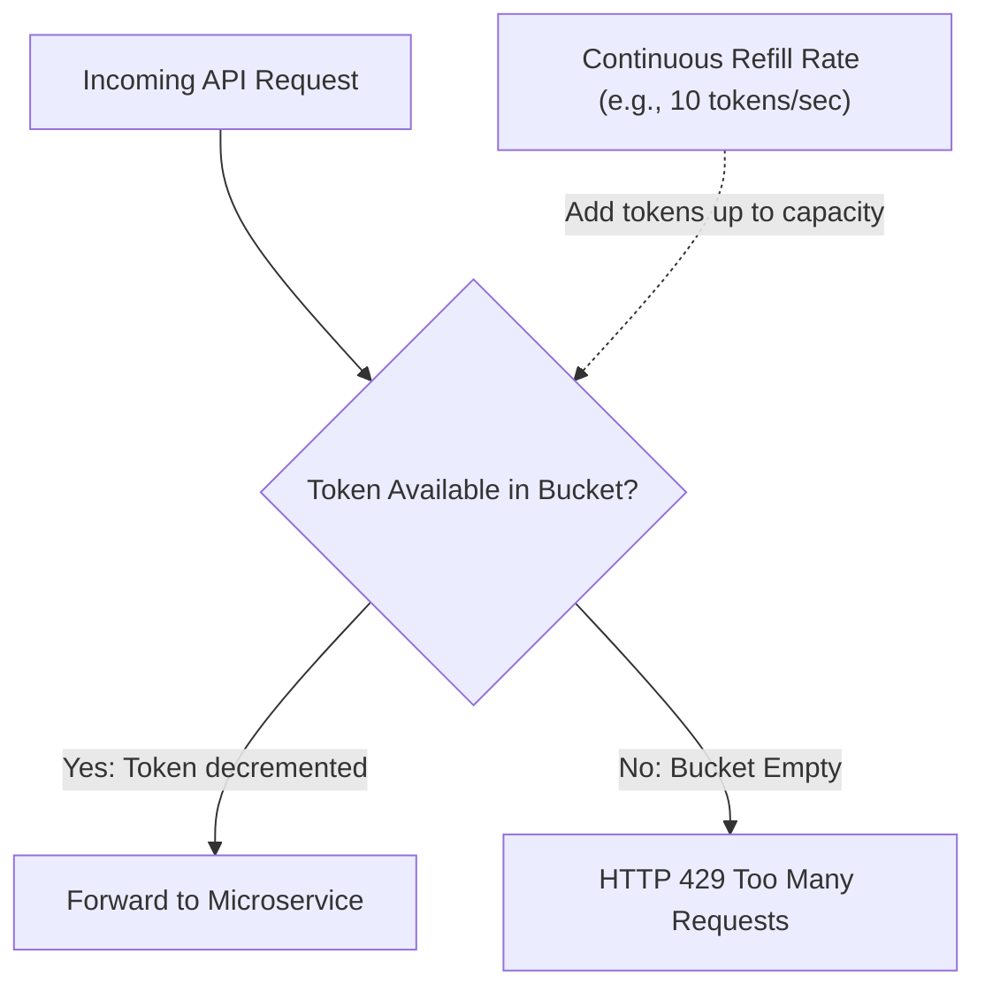
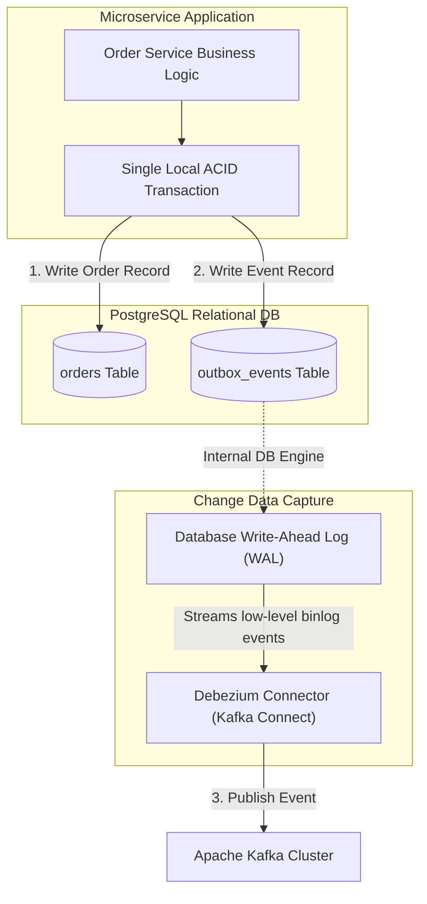

← [Back to Index](../README.md)

# Microservices Architecture Patterns in Spring Boot

A comprehensive architectural and implementation guide to enterprise microservices patterns with Spring Boot 3.x and Spring Cloud. Designed for senior engineers and system architects (8+ years experience), covering API gateways, distributed configuration, inter-service communication, distributed tracing, CQRS, Event Sourcing, the Transactional Outbox pattern, and 12-factor cloud principles.

---

## Table of Contents
1. [API Gateway Pattern (Spring Cloud Gateway)](#1-api-gateway-pattern-spring-cloud-gateway)
   - [Reactive Architecture (Netty vs Tomcat/Zuul)](#reactive-architecture-netty-vs-tomcatzuul)
   - [Route Predicates & Gateway Filters](#route-predicates--gateway-filters)
   - [Distributed Rate Limiting (Redis Token Bucket)](#distributed-rate-limiting-redis-token-bucket)
2. [Service Discovery (Eureka & Consul)](#2-service-discovery-eureka--consul)
   - [Registry Internals: Heartbeats, Leases, and Self-Preservation Mode](#registry-internals-heartbeats-leases-and-self-preservation-mode)
   - [Client-Side vs Server-Side Discovery](#client-side-vs-server-side-discovery)
3. [Externalized Configuration (Spring Cloud Config)](#3-externalized-configuration-spring-cloud-config)
   - [Config Server with Git/Vault](#config-server-with-gitvault)
   - [Dynamic Reloading: `@RefreshScope` and Spring Cloud Bus](#dynamic-reloading-refreshscope-and-spring-cloud-bus)
4. [Inter-Service Communication](#4-inter-service-communication)
   - [Synchronous: RestTemplate vs WebClient vs OpenFeign](#synchronous-resttemplate-vs-webclient-vs-openfeign)
   - [OpenFeign Resilience: Interceptors, Retries & Fallbacks](#openfeign-resilience-interceptors-retries--fallbacks)
   - [Asynchronous Event-Driven: Kafka & RabbitMQ Integration](#asynchronous-event-driven-kafka--rabbitmq-integration)
5. [Client-Side Load Balancing (Spring Cloud LoadBalancer)](#5-client-side-load-balancing-spring-cloud-loadbalancer)
   - [Reactive vs Blocking Balancing Mechanics](#reactive-vs-blocking-balancing-mechanics)
   - [Custom Instance Supplier & Canary Routing](#custom-instance-supplier--canary-routing)
6. [Distributed Tracing & Observability (Micrometer & Zipkin)](#6-distributed-tracing--observability-micrometer--zipkin)
   - [Trace ID vs Span ID & W3C TraceContext Propagation](#trace-id-vs-span-id--w3c-tracecontext-propagation)
   - [Spring Boot 3 Micrometer Tracing Setup & MDC Correlation](#spring-boot-3-micrometer-tracing-setup--mdc-correlation)
7. [CQRS (Command Query Responsibility Segregation)](#7-cqrs-command-query-responsibility-segregation)
   - [Architectural Separation: Command Model vs Query Model](#architectural-separation-command-model-vs-query-model)
   - [Spring Boot Implementation with Materialized Read Views](#spring-boot-implementation-with-materialized-read-views)
8. [Event Sourcing Pattern](#8-event-sourcing-pattern)
   - [Immutable Append-Only Event Store & State Reconstruction](#immutable-append-only-event-store--state-reconstruction)
   - [Aggregate Snapshot Optimization](#aggregate-snapshot-optimization)
   - [Complete Java Implementation](#complete-java-implementation)
9. [Transactional Outbox Pattern & CDC](#9-transactional-outbox-pattern--cdc)
   - [The Dual-Write Problem](#the-dual-write-problem)
   - [Outbox Table Architecture](#outbox-table-architecture)
   - [Debezium Change Data Capture (CDC) vs Polling Publisher](#debezium-change-data-capture-cdc-vs-polling-publisher)
   - [Idempotent Consumer Implementation](#idempotent-consumer-implementation)
10. [Strangler Fig Migration Pattern](#10-strangler-fig-migration-pattern)
    - [Monolith-to-Microservices Incremental Decommissioning](#monolith-to-microservices-incremental-decommissioning)
    - [Gateway Interception & Database Unbundling](#gateway-interception--database-unbundling)
11. [12-Factor App Principles in Microservices](#11-12-factor-app-principles-in-microservices)
12. [Senior Interview Questions & Architectural Gotchas](#12-senior-interview-questions--architectural-gotchas)

---

## 1. API Gateway Pattern (Spring Cloud Gateway)

An API Gateway serves as the single reverse-proxy entry point for client applications, encapsulating internal routing, cross-cutting security, SSL termination, and traffic shaping.

### Reactive Architecture (Netty vs Tomcat/Zuul)

Unlike Spring Cloud Netflix Zuul 1.x (which was built on blocking `Servlet` thread-per-request I/O), **Spring Cloud Gateway** is built on Spring Framework 5/6, Project Reactor, and **Netty**.



- **Efficiency**: Netty handles tens of thousands of concurrent connections using an event loop with a minimal OS thread count, preventing thread starvation during microservice latency spikes.

---

### Route Predicates & Gateway Filters

Spring Cloud Gateway routes requests based on **Predicates** (URL matching, headers, cookies, HTTP methods) and transforms requests/responses via **GatewayFilter** chains.

#### Code: Programmatic Route Locator with Authentication & Header Propagation
```java
package com.example.gateway;

import org.springframework.cloud.gateway.route.RouteLocator;
import org.springframework.cloud.gateway.route.builder.RouteLocatorBuilder;
import org.springframework.context.annotation.Bean;
import org.springframework.context.annotation.Configuration;

@Configuration
public class GatewayRouteConfig {

    @Bean
    public RouteLocator customRouteLocator(RouteLocatorBuilder builder,
                                           JwtAuthenticationFilter authFilter) {
        return builder.routes()
                // Order Service Route
                .route("order-service-route", r -> r
                        .path("/api/v1/orders/**")
                        .filters(f -> f
                                .filter(authFilter.apply(new JwtAuthenticationFilter.Config()))
                                .addRequestHeader("X-Gateway-Source", "EdgeGateway")
                                .retry(retryConfig -> retryConfig.setRetries(3).setBackoff(
                                        java.time.Duration.ofMillis(100),
                                        java.time.Duration.ofSeconds(1),
                                        2, false)))
                        .uri("lb://ORDER-SERVICE"))

                // Inventory Service Route with Path Rewriting
                .route("inventory-service-route", r -> r
                        .path("/api/v1/catalog/**")
                        .filters(f -> f
                                .rewritePath("/api/v1/catalog/(?<segment>.*)", "/api/internal/inventory/${segment}")
                                .circuitBreaker(cb -> cb.setName("catalogCircuitBreaker")
                                        .setFallbackUri("forward:/fallback/catalog")))
                        .uri("lb://INVENTORY-SERVICE"))
                .build();
    }
}
```

---

### Distributed Rate Limiting (Redis Token Bucket)

Spring Cloud Gateway provides an out-of-the-box `RequestRateLimiterGatewayFilterFactory` backed by Redis and Lua scripts implementing the **Token Bucket** algorithm.



#### Code: Key Resolver and Rate Limiter Bean Definition
```java
package com.example.gateway;

import org.springframework.cloud.gateway.filter.ratelimit.KeyResolver;
import org.springframework.cloud.gateway.filter.ratelimit.RedisRateLimiter;
import org.springframework.context.annotation.Bean;
import org.springframework.context.annotation.Configuration;
import org.springframework.context.annotation.Primary;
import reactor.core.publisher.Mono;

@Configuration
public class RateLimiterConfig {

    // Token Bucket: replenishRate = 10 tokens/sec, burstCapacity = 20 tokens
    @Bean
    public RedisRateLimiter redisRateLimiter() {
        return new RedisRateLimiter(10, 20);
    }

    // Rate limit per authenticated user (or fallback to Client IP)
    @Bean
    @Primary
    public KeyResolver userKeyResolver() {
        return exchange -> {
            String apiKey = exchange.getRequest().getHeaders().getFirst("X-API-KEY");
            if (apiKey != null && !apiKey.isBlank()) {
                return Mono.just(apiKey);
            }
            return Mono.just(exchange.getRequest().getRemoteAddress().getAddress().getHostAddress());
        };
    }
}
```

---

## 2. Service Discovery (Eureka & Consul)

In dynamic cloud/Kubernetes topologies, service instances scale up, scale down, and crash with ephemeral IP addresses. Service Discovery decouples physical hostnames from service endpoints.

### Registry Internals: Heartbeats, Leases, and Self-Preservation Mode

In **Netflix Eureka**:
1. **Registration**: When a microservice boots up, it posts its hostname, port, and health check URL to the Eureka Server.
2. **Heartbeats**: Every 30 seconds (default `eureka.instance.lease-renewal-interval-in-seconds`), the microservice sends a renewal heartbeat.
3. **Lease Expiry**: If no heartbeat is received within 90 seconds (`lease-expiration-duration-in-seconds`), Eureka cancels the lease and evicts the node.
4. **Self-Preservation Mode**: If a network partition occurs between Eureka and multiple instances, Eureka detects that heartbeat drops exceed threshold (default: renewals dropped below $85\%$). Eureka **freezes instance eviction** to protect instances from being removed due to a transient network split.

---

### Client-Side vs Server-Side Discovery

```mermaid
flowchart TD
    subgraph ClientSide ["Client-Side Discovery (e.g. Eureka + Spring Cloud LoadBalancer)"]
        direction TB
        C1["Client Service"] -->|1. Query Registry| Reg1["Service Registry (Eureka)"]
        Reg1 -->|2. Return [IP:Port, IP:Port]| C1
        C1 -->|3. Route directly via local load balancing| Instance1["Microservice Node B"]
    end

    subgraph ServerSide ["Server-Side Discovery (e.g. AWS ALB, Kubernetes Service)"]
        direction TB
        C2["Client Service"] -->|1. Call DNS name: order-svc| LB["Load Balancer / Kube Proxy"]
        LB -->|2. Forward to registered pod| Instance2["Microservice Pod B"]
    end
```

| Dimension | Client-Side Discovery (Spring Cloud) | Server-Side Discovery (Kubernetes/ALB) |
| :--- | :--- | :--- |
| **Load Balancing Point** | Inside the client JVM (`Spring Cloud LoadBalancer`) | Dedicated proxy / `kube-proxy` iptables |
| **Language Dependency**| Language-bound (Java Spring Cloud libraries) | Language-agnostic (Works with Go, Python, Node, etc.) |
| **Hops / Latency** | Direct (1 network hop to target node) | Indirect (Extra hop through the proxy/load balancer) |
| **Complexity** | High JVM memory and configuration | Managed by infrastructure / platform team |

---

## 3. Externalized Configuration (Spring Cloud Config)

Centralizing configuration prevents the antipattern of rebuilding container images for environment changes (dev, staging, prod).

### Config Server with Git/Vault

```
Microservice Client ──(HTTP/HTTPS)──► Spring Cloud Config Server ──► Git Repository (Config Repo)
                                                                 └──► HashiCorp Vault (Secrets)
```

#### Application Config Setup (`application.yml`)
```yaml
# Config Server application.yml
server:
  port: 8888
spring:
  cloud:
    config:
      server:
        git:
          uri: https://github.com/my-org/cloud-config-repo
          clone-on-start: true
          default-label: main
          search-paths: '{application}'
```

---

### Dynamic Reloading: `@RefreshScope` and Spring Cloud Bus

When a configuration value changes in the remote Git repo, restarting microservices introduces downtime. Spring provides two dynamic reload mechanisms:

1. **Manual Endpoint Trigger**: Send `POST http://service-host:port/actuator/refresh`. Any Spring bean annotated with `@RefreshScope` destroys its existing proxy instance and recreates it with new property values.
2. **Spring Cloud Bus (Automated Distributed Fanout)**:
   - A Git webhook triggers `POST /actuator/busrefresh` on the Config Server.
   - The Config Server broadcasts an event over a messaging broker (RabbitMQ / Kafka).
   - Every active microservice listens to the bus, refreshes its `@RefreshScope` beans concurrently.

```java
@RestController
@RefreshScope // Allows dynamic reloading without JVM restart
public class DynamicPaymentController {

    @Value("${payment.gateway.timeout-ms:5000}")
    private long timeoutMs;

    @Value("${payment.gateway.feature-flag-v2:false}")
    private boolean useV2;

    @GetMapping("/api/payment/status")
    public String getStatus() {
        return "Gateway Timeout: " + timeoutMs + "ms, V2 Enabled: " + useV2;
    }
}
```

---

## 4. Inter-Service Communication

### Synchronous: RestTemplate vs WebClient vs OpenFeign

| Client | Thread Model | Programming Style | Status |
| :--- | :--- | :--- | :--- |
| **`RestTemplate`** | Blocking (1 thread per request) | Imperative template | Maintenance mode (Spring 5+) |
| **`WebClient`** | Non-blocking (Reactive Project Reactor) | Fluent, Functional reactive | Current recommended reactive client |
| **`OpenFeign`** | Blocking (or reactive with Feign-Reactor) | Declarative interface annotations | High developer productivity |

---

### OpenFeign Resilience: Interceptors, Retries & Fallbacks

Spring Cloud OpenFeign allows declarative interface-based HTTP client definitions.

#### Complete Feign Client Implementation with Fallback
```java
package com.example.client;

import org.springframework.cloud.openfeign.FeignClient;
import org.springframework.stereotype.Component;
import org.springframework.web.bind.annotation.GetMapping;
import org.springframework.web.bind.annotation.PathVariable;

@FeignClient(
    name = "INVENTORY-SERVICE",
    fallback = InventoryClientFallback.class,
    configuration = FeignClientConfiguration.class
)
public interface InventoryClient {

    @GetMapping("/api/inventory/{sku}")
    InventoryResponse getStockBySku(@PathVariable("sku") String sku);
}

// Fallback implementation executed when Inventory Service fails or times out
@Component
class InventoryClientFallback implements InventoryClient {
    @Override
    public InventoryResponse getStockBySku(String sku) {
        // Return default degraded cached response or mark out-of-stock
        return new InventoryResponse(sku, 0, "FALLBACK_DEGRADED");
    }
}

public record InventoryResponse(String sku, int availableStock, String status) {}
```

#### Feign Interceptor: JWT Header Propagation
```java
package com.example.client;

import feign.RequestInterceptor;
import feign.RequestTemplate;
import org.springframework.context.annotation.Bean;
import org.springframework.context.annotation.Configuration;
import org.springframework.web.context.request.RequestContextHolder;
import org.springframework.web.context.request.ServletRequestAttributes;

@Configuration
public class FeignClientConfiguration {

    @Bean
    public RequestInterceptor oauth2HeaderPropagationInterceptor() {
        return (RequestTemplate template) -> {
            ServletRequestAttributes attributes = 
                    (ServletRequestAttributes) RequestContextHolder.getRequestAttributes();
            if (attributes != null) {
                String authHeader = attributes.getRequest().getHeader("Authorization");
                if (authHeader != null) {
                    template.header("Authorization", authHeader);
                }
            }
        };
    }
}
```

---

### Asynchronous Event-Driven: Kafka & RabbitMQ Integration

In microservice ecosystems, direct synchronous chains ($A \rightarrow B \rightarrow C \rightarrow D$) cause cascading latency, tight coupling, and systemic outages when a single dependency fails. Asynchronous messaging decouples systems:

```java
package com.example.messaging;

import org.slf4j.Logger;
import org.slf4j.LoggerFactory;
import org.springframework.kafka.annotation.KafkaListener;
import org.springframework.kafka.core.KafkaTemplate;
import org.springframework.stereotype.Service;

import java.time.Instant;

public record OrderPlacedEvent(String orderId, String customerId, double totalAmount, Instant timestamp) {}

@Service
public class OrderEventService {
    private static final Logger log = LoggerFactory.getLogger(OrderEventService.class);
    private static final String TOPIC = "order-events";

    private final KafkaTemplate<String, OrderPlacedEvent> kafkaTemplate;

    public OrderEventService(KafkaTemplate<String, OrderPlacedEvent> kafkaTemplate) {
        this.kafkaTemplate = kafkaTemplate;
    }

    public void publishOrderPlaced(OrderPlacedEvent event) {
        // Asynchronously publish event partitioned by orderId
        kafkaTemplate.send(TOPIC, event.orderId(), event)
                .whenComplete((result, ex) -> {
                    if (ex == null) {
                        log.info("Published order event [{}] to partition [{}]",
                                event.orderId(), result.getRecordMetadata().partition());
                    } else {
                        log.error("Failed to publish order event: {}", event.orderId(), ex);
                    }
                });
    }

    @KafkaListener(topics = TOPIC, groupId = "inventory-consumer-group")
    public void handleOrderPlaced(OrderPlacedEvent event) {
        log.info("Received OrderPlacedEvent for order: {}. Allocating inventory...", event.orderId());
        // Deduct inventory idempotently
    }
}
```

---

## 5. Client-Side Load Balancing (Spring Cloud LoadBalancer)

Spring Cloud LoadBalancer replaced Netflix Ribbon in Spring Cloud 2020+. It operates directly inside the calling JVM, querying the local discovery cache and executing routing algorithms without extra network hops.

```java
package com.example.config;

import org.springframework.cloud.client.loadbalancer.LoadBalanced;
import org.springframework.context.annotation.Bean;
import org.springframework.context.annotation.Configuration;
import org.springframework.web.client.RestClient;
import org.springframework.web.reactive.function.client.WebClient;

@Configuration
public class LoadBalancerClientConfig {

    @Bean
    @LoadBalanced // Intercepts requests and resolves logical service names to concrete IP:Port
    public WebClient.Builder loadBalancedWebClientBuilder() {
        return WebClient.builder();
    }
}
```

---

## 6. Distributed Tracing & Observability (Micrometer & Zipkin)

In a distributed call graph where a single user action touches 12 different services, debugging an issue without distributed tracing is impossible.

### Trace ID vs Span ID & W3C TraceContext Propagation

```
User Request
     │
     ▼
[API Gateway]       ─── Trace ID: 4bf92f3577b34da6a3ce929d0e0e4736 (Global for entire request)
     │                  Span ID:  00f067aa0ba902b7 (Local to Gateway)
     ▼
[Order Service]     ─── Trace ID: 4bf92f3577b34da6a3ce929d0e0e4736 (Same Trace ID!)
     │                  Parent Span ID: 00f067aa0ba902b7
     │                  Span ID:  5fb3f0e0ba3d4927
     ▼
[Payment Service]   ─── Trace ID: 4bf92f3577b34da6a3ce929d0e0e4736
                        Parent Span ID: 5fb3f0e0ba3d4927
                        Span ID:  3a28b0c8ef291a81
```

- **W3C `traceparent` Header**: Passed over HTTP: `00-4bf92f3577b34da6a3ce929d0e0e4736-00f067aa0ba902b7-01`.

---

### Spring Boot 3 Micrometer Tracing Setup & MDC Correlation

In Spring Boot 3, **Micrometer Tracing** (replacing Spring Cloud Sleuth) bridges to either OpenTelemetry or Brave.

#### Maven Dependencies (`pom.xml`)
```xml
<dependencies>
    <!-- Core Actuator & Micrometer Observation -->
    <dependency>
        <groupId>org.springframework.boot</groupId>
        <artifactId>spring-boot-starter-actuator</artifactId>
    </dependency>
    <dependency>
        <groupId>io.micrometer</groupId>
        <artifactId>micrometer-tracing-bridge-otel</artifactId>
    </dependency>
    <!-- Exporter to Zipkin / OTLP Collector -->
    <dependency>
        <groupId>io.opentelemetry</groupId>
        <artifactId>opentelemetry-exporter-zipkin</artifactId>
    </dependency>
</dependencies>
```

#### Automatic MDC Logging Configuration (`logback-spring.xml`)
```xml
<configuration>
    <appender name="CONSOLE" class="ch.qos.logback.core.ConsoleAppender">
        <encoder>
            <!-- Injects traceId and spanId from SLF4J MDC into every log line -->
            <pattern>%d{yyyy-MM-dd HH:mm:ss.SSS} [%thread] [traceId=%X{traceId:-} spanId=%X{spanId:-}] %-5level %logger{36} - %msg%n</pattern>
        </encoder>
    </appender>
    <root level="INFO">
        <appender-ref ref="CONSOLE" />
    </root>
</configuration>
```

---

## 7. CQRS (Command Query Responsibility Segregation)

### Architectural Separation: Command Model vs Query Model

Traditional architectures use a unified data model for both reads and writes. In complex enterprise systems, read access patterns and write validation rules are fundamentally misaligned:

```mermaid
flowchart TD
    Client["Client Application"]
    
    subgraph WriteSide ["Command Side (Write Model)"]
        direction TB
        Client -->|POST /orders| CmdCtrl["Order Command Controller"]
        CmdCtrl --> Domain["Domain Aggregates (Invariants, Validation)"]
        Domain --> WriteDb[("Write DB (PostgreSQL - 3NF Normalized)")]
        WriteDb -.->|Outbox / Domain Events| Broker["Kafka Broker"]
    end

    subgraph ReadSide ["Query Side (Read Model)"]
        direction TB
        Broker -->|Sync Projection| EventConsumer["Read Model Projector"]
        EventConsumer --> ReadDb[("Read DB (Elasticsearch / Redis / MongoDB)")]
        Client -->|GET /orders/{id}| QueryCtrl["Order Query Controller"]
        QueryCtrl --> ReadDb
    end
```

- **Commands**: High consistency, transaction boundaries, business invariant validation (Normalized relational database).
- **Queries**: Denormalized, ultra-fast indexed lookups (Elasticsearch, Redis, or flat MongoDB collections).

---

### Spring Boot Implementation with Materialized Read Views

```java
package com.example.cqrs;

import org.springframework.data.annotation.Id;
import org.springframework.data.mongodb.core.mapping.Document;
import org.springframework.data.mongodb.repository.MongoRepository;
import org.springframework.kafka.annotation.KafkaListener;
import org.springframework.stereotype.Service;

import java.util.List;

// 1. Read-Optimized Denormalized Projection (MongoDB Document)
@Document(collection = "order_read_views")
public record OrderReadSummary(
        @Id String orderId,
        String customerName,
        List<String> itemDescriptions,
        double grandTotal,
        String status
) {}

public interface OrderReadRepository extends MongoRepository<OrderReadSummary, String> {
    List<OrderReadSummary> findByCustomerName(String customerName);
}

// 2. Query Projector: Asynchronously keeps the read model updated
@Service
public class OrderProjectionProjector {

    private final OrderReadRepository readRepository;

    public OrderProjectionProjector(OrderReadRepository readRepository) {
        this.readRepository = readRepository;
    }

    @KafkaListener(topics = "order-events", groupId = "order-cqrs-projector")
    public void project(OrderDomainEvent event) {
        switch (event.eventType()) {
            case "ORDER_CREATED" -> {
                OrderReadSummary summary = new OrderReadSummary(
                        event.orderId(),
                        event.customerName(),
                        event.items(),
                        event.total(),
                        "PENDING"
                );
                readRepository.save(summary);
            }
            case "ORDER_PAID" -> {
                readRepository.findById(event.orderId()).ifPresent(order -> {
                    OrderReadSummary updated = new OrderReadSummary(
                            order.orderId(), order.customerName(), order.itemDescriptions(),
                            order.grandTotal(), "PAID"
                    );
                    readRepository.save(updated);
                });
            }
        }
    }
}
```

---

## 8. Event Sourcing Pattern

### Immutable Append-Only Event Store & State Reconstruction

Instead of storing current mutable state (e.g. `UPDATE accounts SET balance = 500 WHERE id = 1`), Event Sourcing stores the sequence of all state-changing **domain events** in an append-only log:

```
[AccountCreatedEvent: id=1, balance=0]
     │
     ▼
[MoneyDepositedEvent: id=1, amount=1000]
     │
     ▼
[MoneyWithdrawnEvent: id=1, amount=500]
     │
     ▼
Current State: balance = $500 (Reconstructed by replaying events from genesis)
```

#### Complete Event Sourcing Aggregate Root Implementation
```java
package com.example.eventsourcing;

import java.util.ArrayList;
import java.util.List;

public class BankAccountAggregate {

    private String accountId;
    private double balance;
    private int version;

    // Uncommitted events produced during command handling
    private final List<Object> changes = new ArrayList<>();

    public BankAccountAggregate() {}

    // Factory method for creating aggregate
    public static BankAccountAggregate create(String accountId, String owner) {
        BankAccountAggregate aggregate = new BankAccountAggregate();
        aggregate.applyChange(new AccountCreated(accountId, owner));
        return aggregate;
    }

    // Command: Deposit
    public void deposit(double amount) {
        if (amount <= 0) throw new IllegalArgumentException("Deposit amount must be positive");
        applyChange(new MoneyDeposited(this.accountId, amount));
    }

    // Command: Withdraw
    public void withdraw(double amount) {
        if (amount > this.balance) throw new IllegalStateException("Insufficient funds");
        applyChange(new MoneyWithdrawn(this.accountId, amount));
    }

    // Mutate state in response to events
    private void mutate(Object event) {
        if (event instanceof AccountCreated e) {
            this.accountId = e.accountId();
            this.balance = 0.0;
        } else if (event instanceof MoneyDeposited e) {
            this.balance += e.amount();
        } else if (event instanceof MoneyWithdrawn e) {
            this.balance -= e.amount();
        }
        this.version++;
    }

    // Apply and stage change
    private void applyChange(Object event) {
        mutate(event);
        changes.add(event);
    }

    // Replay past history from Event Store to restore state
    public static BankAccountAggregate reconstructFromHistory(List<Object> history) {
        BankAccountAggregate aggregate = new BankAccountAggregate();
        for (Object event : history) {
            aggregate.mutate(event);
        }
        return aggregate;
    }

    public List<Object> getUncommittedChanges() { return List.copyOf(changes); }
    public void markChangesAsCommitted() { changes.clear(); }
    public double getBalance() { return balance; }
    public int getVersion() { return version; }

    // Domain Events
    public record AccountCreated(String accountId, String owner) {}
    public record MoneyDeposited(String accountId, double amount) {}
    public record MoneyWithdrawn(String accountId, double amount) {}
}
```

---

## 9. Transactional Outbox Pattern & CDC

### The Dual-Write Problem

A common architectural bug in microservices:
```java
// CRITICAL BUG: Dual-Write Hazard
@Transactional
public void completeOrder(Order order) {
    orderRepository.save(order);               // Step 1: Database Commit
    kafkaTemplate.send("order-topic", order);  // Step 2: Network Call to Kafka
}
```
If the database commits but the network times out while talking to Kafka, the event is lost. If the order of operations is reversed and Kafka send succeeds but the database transaction rolls back, downstream services process a ghost order.

---

### Outbox Table Architecture & Debezium CDC

The Transactional Outbox pattern guarantees **at-least-once** event publishing without two-phase commit (2PC) distributed transactions:



#### SQL Schema for Outbox Table
```sql
CREATE TABLE outbox_events (
    id UUID PRIMARY KEY,
    aggregate_type VARCHAR(64) NOT NULL,
    aggregate_id VARCHAR(64) NOT NULL,
    event_type VARCHAR(128) NOT NULL,
    payload JSONB NOT NULL,
    created_at TIMESTAMP WITH TIME ZONE DEFAULT NOW()
);
```

#### Spring Boot Service Writing to Outbox Table
```java
package com.example.outbox;

import com.fasterxml.jackson.databind.ObjectMapper;
import org.springframework.stereotype.Service;
import org.springframework.transaction.annotation.Transactional;

import java.time.Instant;
import java.util.UUID;

@Service
public class OrderTransactionalService {

    private final OrderRepository orderRepository;
    private final OutboxEventRepository outboxRepository;
    private final ObjectMapper objectMapper;

    public OrderTransactionalService(OrderRepository orderRepository,
                                     OutboxEventRepository outboxRepository,
                                     ObjectMapper objectMapper) {
        this.orderRepository = orderRepository;
        this.outboxRepository = outboxRepository;
        this.objectMapper = objectMapper;
    }

    @Transactional
    public Order placeOrder(CreateOrderRequest req) throws Exception {
        Order order = new Order(UUID.randomUUID().toString(), req.customerId(), req.amount());
        orderRepository.save(order);

        // Atomic write into outbox table in the SAME database transaction
        OutboxEvent outboxEvent = new OutboxEvent(
                UUID.randomUUID(),
                "Order",
                order.getId(),
                "ORDER_CREATED",
                objectMapper.writeValueAsString(order),
                Instant.now()
        );
        outboxRepository.save(outboxEvent);

        return order;
    }
}
```

---

### Idempotent Consumer Implementation

Since the Outbox pattern guarantees **at-least-once** delivery, network re-transmissions can deliver duplicate events. Consumers must be **idempotent**.

```java
package com.example.outbox;

import org.springframework.dao.DataIntegrityViolationException;
import org.springframework.jdbc.core.JdbcTemplate;
import org.springframework.kafka.annotation.KafkaListener;
import org.springframework.stereotype.Component;
import org.springframework.transaction.annotation.Transactional;

@Component
public class IdempotentPaymentConsumer {

    private final JdbcTemplate jdbcTemplate;

    public IdempotentPaymentConsumer(JdbcTemplate jdbcTemplate) {
        this.jdbcTemplate = jdbcTemplate;
    }

    @Transactional
    @KafkaListener(topics = "order-events", groupId = "payment-group")
    public void consume(String eventId, String payload) {
        try {
            // Deduplication record insert: Primary Key violation indicates duplicate delivery
            jdbcTemplate.update(
                "INSERT INTO processed_events (event_id, processed_at) VALUES (?, NOW())",
                eventId
            );
        } catch (DataIntegrityViolationException ex) {
            // Duplicate detected! Acknowledge without reprocessing
            return;
        }

        // Process event logic...
    }
}
```

---

## 10. Strangler Fig Migration Pattern

Named after Australian strangler figs that germinate in the crown of a host tree, slowly envelop it, and eventually replace it entirely.

```
Incoming Traffic ──► [ API Gateway / Reverse Proxy (Routing Rules) ]
                                 │                       │
                       (Route /api/v1/users)    (All Other Unmigrated Routes)
                                 │                       │
                                 ▼                       ▼
                    [ New Microservice ]         [ Legacy Monolith ]
```

### 4-Phase Migration Strategy:
1. **Transform**: Build the new microservice independently with its own datastore.
2. **Coexist (Shadow/Canary Routing)**: Route a small percentage of traffic (e.g. 5%) through the API Gateway to the new microservice while running the monolith in parallel.
3. **Cutover**: Divert 100% of the specific domain's endpoints to the microservice.
4. **Eliminate**: Strip dead code and tables from the legacy monolith. Repeat for next subdomain.

---

## 11. 12-Factor App Principles in Microservices

| # | Principle | Description & Microservice Best Practice |
| :- | :--- | :--- |
| **I** | **Codebase** | One codebase tracked in revision control, many deploys (Git mono-repo or multi-repo per service). |
| **II** | **Dependencies** | Explicitly declare and isolate dependencies (`pom.xml` / `build.gradle`, no system-wide JARs). |
| **III**| **Config** | Store config in the environment (`application-{profile}.yml`, Spring Cloud Config, Kube ConfigMaps). |
| **IV** | **Backing services** | Treat backing services as attached resources (swap DB or Redis by changing connection URL without code modifications). |
| **V** | **Build, release, run** | Strictly separate build (compile JAR), release (bundle with config), and run (launch container) stages. |
| **VI** | **Processes** | Execute the app as one or more stateless processes (store session data in Redis, not JVM heap). |
| **VII**| **Port binding** | Export services via port binding (embedded Tomcat/Netty listening on `8080`). |
| **VIII**| **Concurrency** | Scale out via the process model (scale horizontal container pods behind load balancer). |
| **IX** | **Disposability** | Maximize robustness with fast startup and graceful shutdown (`server.shutdown=graceful`). |
| **X** | **Dev/prod parity** | Keep development, staging, and production as similar as possible (use Testcontainers for DB/Kafka). |
| **XI** | **Logs** | Treat logs as event streams (write stdout JSON logs, aggregate via FluentBit/Logstash to Elasticsearch). |
| **XII**| **Admin processes** | Run admin/management tasks as one-off processes (Flyway / Liquibase database migrations in init containers). |

---

## 12. Senior Interview Questions & Architectural Gotchas

### Q1: How do you handle distributed transactions across microservices without 2PC?
**Answer**:
Two-Phase Commit (2PC) does not scale in cloud microservices because it holds database locks across network boundaries, introducing extreme latency, single points of failure, and availability bottlenecks (CAP theorem).
Instead, use the **Saga Pattern**:
- **Choreography-based Saga**: Services publish and react to domain events via Kafka.
- **Orchestration-based Saga**: A central orchestrator (e.g., Camunda, Temporal) issues commands and coordinates **compensating transactions** (e.g., refunding credit card if inventory reservation fails).

---

### Q2: Why is `@Transactional` not recommended across OpenFeign calls?
**Answer**:
`@Transactional` binds to a single JDBC connection and thread. If an OpenFeign HTTP call is executed within `@Transactional`:
1. The JDBC connection remains open while waiting for the remote HTTP call to complete.
2. If the remote service takes 5 seconds, that database connection is held hostage.
3. High concurrency causes immediate HikariCP connection pool exhaustion, crashing the entire application.
**Rule**: Keep `@Transactional` scopes strictly around database read/writes; never wrap external network calls inside DB transactions.

---

### Q3: What is the difference between Service Discovery in Kubernetes vs Spring Cloud Eureka?
**Answer**:
- **Kubernetes (Platform-level)**: Built directly into the OS/orchestrator. Uses Kube-DNS and `kube-proxy` virtual IPs. Language-neutral; applications invoke standard HTTP `http://order-service/` and the Linux kernel load-balances packets.
- **Eureka (Application-level)**: Implemented in the JVM. Client applications poll registry data and execute load-balancing algorithms internally via code.
- **Modern Consensus**: Most organizations migrating to Kubernetes deprecate Eureka in favor of native Kubernetes Services + Envoy/Istio Service Mesh to reduce JVM memory overhead and cross-language barriers.

---

### Q4: How do you solve the "Dual-Write" bug when publishing Kafka events from a database service?
**Answer**:
Use the **Transactional Outbox Pattern**:
- Within the same ACID database transaction that updates business entities, write the event payload to an `outbox` table.
- Use a Change Data Capture (CDC) tool like **Debezium** to tail the database transaction log (PostgreSQL WAL or MySQL binlog) and stream outbox records directly into Kafka.
- This guarantees at-least-once publishing without distributed transactions. Downstream consumers apply deduplication keys to ensure idempotency.
